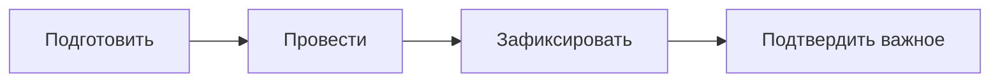

# Лекция 15. Способы выявления требований

## Зачем этот урок

В прошлом уроке мы собрали карту заинтересованных лиц. Стало понятнее, **с кем** работать на Compliance.

Но карта людей сама по себе ещё не даёт требований. Остаётся практический вопрос: **как** добывать информацию, чтобы потом собрать нормальные требования, а не набор лозунгов.

Этим занимается выявление требований — elicitation.

---

## Что такое выявление требований

Если совсем просто: выявление — это целенаправленная работа, чтобы понять потребность, процесс, правила, исключения и ограничения.

Это **не** стенограмма совещания и **не** «записать всё, что сказал самый громкий человек».

### Плохой старт

Заказчик говорит:

> «Нужна удобная система для комплаенса.»

Это ещё не требование. Это сигнал, что есть боль или цель.

Аналитику нужно выяснить другое:

- удобная для кого?
- какие сценарии входят в первую версию?
- какие статусы обязательны?
- что нельзя сломать?
- кто какие данные может видеть?

### Хороший сдвиг в голове

Заказчик редко приносит готовый список требований. Чаще он приносит:

- проблему;
- примеры из жизни;
- недовольство текущим процессом;
- иногда готовое решение вроде «сделайте как в Excel, только в системе».

Ваша работа — вытащить смысл, проверить его и зафиксировать так, чтобы команда могла работать дальше.

---

## Пять рабочих способов

На старте карьеры не нужно знать двадцать техник. Достаточно уверенно пользоваться несколькими.

Ниже у каждого способа: когда уместен, чего ждать, и отдельный пример.

### 1. Интервью

**Что это.** Разговор один на один или в маленькой группе с подготовленными вопросами.

**Когда уместно.** Нужна глубина: как человек думает, какие исключения знает, что считает «нормально» и «критично».

**Чего ждать.** Факты процесса, формулировки-кандидаты, открытые вопросы, ссылки на документы и других людей.

**Пример.** Вы приходите к комплаенс-офицеру не с вопросом «расскажите про систему», а с целью: понять обработку обращения.

Хороший ход — попросить конкретный случай:

> «Давайте возьмём последнее сложное обращение. Что происходило по шагам?»

На таком разборе часто всплывает то, чего нет в презентации: статусы «на уточнении», внутренние комментарии, правила «когда можно закрыть без ответа».

После интервью у вас должны появиться не «впечатления», а записи: кандидаты требований, вопросы без ответа, следующие действия.

### 2. Наблюдение

**Что это.** Вы смотрите, как человек делает работу сейчас. Иногда это называют shadowing.

**Когда уместно.** Люди плохо описывают рутину или сами не замечают обходные пути. На словах всё «нормально», на деле — квест.

**Чего ждать.** Реальные шаги, точки путаницы, лишние переключения в почту/Excel/мессенджер, ожидания по уведомлениям.

**Пример.** Сотрудник на интервью говорит: «Форма регистрации подарка нормальная».

Вы садитесь рядом и просите зарегистрировать подарок так, как он делает обычно. И видите другое:

- он открывает старую инструкцию в третьей вкладке;
- копирует текст из прошлого письма;
- дважды ошибается в поле «стоимость»;
- не понимает, отправилась ли форма.

Наблюдение не для того, чтобы «ловить» человека. Оно нужно, чтобы увидеть разрыв между словами и реальностью.

### 3. Анализ документов

**Что это.** Разбор регламентов, инструкций, шаблонов, старых таблиц, переписки, отчётов.

**Когда уместно.** Нужна as-is картина, формальные ограничения, сроки хранения, обязательные поля «по бумаге».

**Чего ждать.** Черновик правил и ограничений. Но не истину в последней инстанции: документы часто устаревают.

**Пример.** Перед разговором про декларации вы читаете внутренний регламент и шаблон текущей Excel-таблицы.

Из документов видно:

- какие поля считают обязательными сейчас;
- какой срок хранения упоминается;
- кто формально отвечает за проверку.

Потом вы идёте к ответственному и проверяете:

> «В регламенте срок хранения такой-то. Это ещё действует для первой версии системы?»

Без документов вы изобретаете правила. Без проверки с людьми — рискуете перенести в систему устаревшую бюрократию.

### 4. Воркшоп

**Что это.** Общая встреча нескольких ролей с ясной целью: согласовать понимание или принять решение вместе.

**Когда уместно.** Одной роли мало: нужно общее решение, иначе потом каждый будет тянуть в свою сторону.

**Чего ждать.** Согласованный черновик, список решений, список несогласий, следующие шаги.

**Пример.** Офицер хочет много статусов обращения. ИТ просит упростить. ИБ спрашивает, кто что видит на каждом статусе.

Если вы будете ходить к ним по отдельности месяц, получите три несовместимые картинки. На коротком воркшопе с целью «согласовать статусы первой версии и базовые правила доступа» шанс договориться выше.

Важно: воркшоп плох как первая активность, когда вы ещё ничего не понимаете. Сначала наберите базу интервью и документами, потом собирайте людей на решение.

### 5. Анкета или короткий опрос

**Что это.** Одинаковые вопросы многим людям.

**Когда уместно.** Нужен широкий, но неглубокий срез: много однотипных пользователей, один узкий вопрос.

**Чего ждать.** Частоты и приоритеты. Не ждите тонких исключений — анкета их обычно не ловит.

**Пример.** Вы подозреваете, что в форме подарка путают несколько полей. Вместо десяти одинаковых интервью даёте короткий опрос сотрудникам:

- какое поле было самым непонятным;
- хватило ли подсказок;
- куда обращались, если застряли.

Потом 2–3 самых частых боли разбираете глубже интервью или наблюдением.

---

## Как выбирать способ

Не берите «любимый метод». Берите **вопрос**, который нужно закрыть, и **роль**, у которой есть ответ.

После объяснения методов удобно держать под рукой короткую шпаргалку:

| Если нужно… | Обычно берут… | Типичная роль на Compliance |
| --- | --- | --- |
| Глубина и исключения | Интервью | Комплаенс-офицер |
| Увидеть реальный путь пользователя | Наблюдение | Сотрудник |
| Формальные правила и as-is базу | Анализ документов | Регламенты + проверка с ответственными |
| Согласовать решение нескольких ролей | Воркшоп | Офицер + ИТ + ИБ |
| Быстрый срез у многих | Анкета | Много сотрудников |

Связка с прошлым уроком прямая. В stakeholder register уже могут быть колонки «что выяснить» и «как взаимодействовать». План выявления почти продолжает эту таблицу.

---

## Почему одного метода мало

Новичок часто ошибается так: проводит два интервью с заказчиком и считает elicitation законченным.

На Compliance этого мало:

| Кто | Что обычно даёт |
| --- | --- |
| Заказчик | Цель и приоритеты |
| Офицер | Процесс и исключения |
| Сотрудник | Боль формы и реальный путь |
| Руководитель | Метрики и «что считать успехом» |
| ИБ | Ограничения доступов и аудита |
| Документы | Формальные правила |

Ни один источник не закрывает всё. Поэтому делают небольшой план на ближайшие активности: с кем, зачем, каким методом, что должно получиться на выходе.

---

## Цикл любой активности

Даже короткое интервью лучше проходит по одному и тому же циклу.

### Подготовить

Зачем встреча? Что уже известно? Какие вопросы обязательны? Кого зовём? Сколько времени? Какой результат нужен?

### Провести

Спрашивать, слушать, уточнять примерами. Лучше конкретный случай, чем абстракция «как обычно».

### Зафиксировать и подтвердить

Сразу после встречи запишите:

- ключевые факты;
- требования-кандидаты;
- решения;
- открытые вопросы;
- следующие действия.

Если что-то критично — коротко подтвердите с участником:

> «Я правильно понял, что обращение нельзя закрыть без ответа сотруднику?»

Без фиксации elicitation превращается в ощущение «вроде всё понял». Через неделю команда спорит, а вы уже не помните: это было решение или просто идея.

---

## Что считать результатом выявления

На выходе хорошей активности обычно появляется не идеальное ТЗ, а честная рабочая база.

**Требования-кандидаты** — формулировки, которые ещё нужно проверить и согласовать.

**Открытые вопросы** — то, без чего нельзя уверенно двигаться.

**Ограничения и факты процесса** — как есть сейчас, что сохранить, что мешает.

**Следующие действия** — кому написать, какой документ запросить, кого позвать дальше.

В учебном Compliance рядом как раз и живут: план выявления, заметки встреч, реестр требований, список открытых вопросов.

Выявление не заканчивается разговором. Оно заканчивается тем, что знание стало общим и пригодным для следующей работы.

---

## Собираем в план на Compliance

Допустим, по реестру stakeholders видно:

- у офицера нужно выяснить статусы и исключения;
- у сотрудника — удобство формы;
- у руководителя — метрики дашборда;
- у ИБ — ограничения доступов.

Тогда ближайший план может выглядеть так:

| ID | С кем | Метод | Цель |
| --- | --- | --- | --- |
| EL-01 | Комплаенс-офицер | Интервью | Понять обработку обращения |
| EL-02 | Сотрудник | Наблюдение + короткое интервью | Найти места путаницы в форме |
| EL-03 | Руководитель комплаенс | Интервью | Уточнить метрики первой версии |
| EL-04 | Офицер + ИТ + ИБ | Воркшоп | Согласовать статусы и базовые доступы |
| EL-05 | ИТ | Консультация | SSO и источники данных о сотрудниках |
| EL-06 | Регламенты | Анализ документов | Не изобретать правила с нуля |

Это уже не хаотичные встречи «в целом про систему». Это управляемое выявление.

---

## Когда люди не помогают

До сих пор мы говорили так, будто stakeholders хотят с вами работать. В учебнике так часто и бывает.

В реальной работе бизнес-аналитик постоянно сталкивается с сопротивлением. Это не редкий «плохой день». Это нормальная часть профессии.

Люди:

- «очень заняты» и переносят встречу третий раз;
- отвечают общими словами и приходится вытаскивать смысл по слогам;
- боятся изменений и держат знание при себе;
- иногда почти открыто саботируют: игнорируют вопросы, обесценивают задачу, присылают «разберитесь сами».

Если вы этого не ждёте, легко решить: «я плохой аналитик» или «они тупые». Обе реакции бесполезны. Нужна другая установка: **сопротивление — сигнал**, а не приговор. Его надо распознать и выбрать способ действия.

### Почему так происходит

Чаще всего это не личная злость на вас.

Человек может бояться, что автоматизация заберёт контроль, статус или даже работу. Может не доверять проекту: «опять внедрят систему, а нам хуже». Может не понимать свою роль во встрече. Может просто экономить время и не видеть пользы отвечать «ещё одному аналитику».

На Compliance это выглядит очень узнаваемо.

Офицер боится, что новая система отнимет гибкость исключений, которыми он сейчас «рулит вручную».  
Сотрудник не хочет ещё одной формы «для галочки».  
Руководитель подразделения раздражён: его людей отвлекают опросами.  
ИБ отвечает коротко и формально, потому что не верит, что к ним придут до финального дизайна.

Пока вы не назвали причину хотя бы приблизительно, вы будете давить вопросами в пустоту.

### Как это выглядит на практике

**Избегание.** «Давайте на следующей неделе», пустой календарь, «я перешлю коллеге».

**Вода вместо ответа.** На вопрос про статусы обращения слышите: «Ну, как обычно, по процессу». Приходится уточнять по слогам: какой первый статус, кто меняет, что если сотрудник молчит.

**Скрытое сопротивление.** Человек на встрече кивает, а после не присылает примеры, не подтверждает протокол, «теряет» файлы.

**Открытый саботаж.** Обесценивание («это всё бессмысленно»), отказ давать данные, давление через статус: «мы и так знаем, что нужно».

Важно не путать занятость и саботаж. Занятость лечится короткими форматами и подготовкой. Саботаж и политика — подключением спонсора и фиксацией блокеров.

### Что делать аналитику

Ниже — рабочий порядок. Не «манипуляции», а профессиональная гигиена.

#### 1. Снимите напряжение с формата

Публичный воркшоп — плохое место, чтобы «вытягивать» человека, который уже напряжён. Часто лучше личная встреча один на один: там проще говорить о рисках и реальных опасениях.

На Compliance: вместо общего созвона «давайте все обсудим статусы» сначала спокойно сядьте с офицером на 30 минут. Потом, когда база есть, зовите ИТ и ИБ на короткое согласование.

#### 2. Перестаньте допрашивать — дайте черновик на правку

Живой допрос повышает сопротивление: человеку нужно отвечать сходу и «не выглядеть глупо».

Сильный приём: вы сами готовите короткий черновик («как я понял процесс / поля / роли») и просите **исправить ошибки**, а не сочинять ответ с нуля.

Пример для Compliance:

> «Я набросал статусы обращения: Новое → В работе → Уточнение → Закрыто. Пометил, что закрывать без ответа сотруднику нельзя. Где я ошибся?»

Людям обычно легче сказать «тут не так», чем отвечать на абстрактное «расскажите, как у вас устроено».

#### 3. Если рот закрыт — работайте без живого доступа, но не делайте вид, что всё ясно

Пока человека нет или он не включается:

- разбирайте документы и старые таблицы;
- наблюдайте реальную работу пользователей (с разрешением);
- собирайте вопросы в backlog, а не «замораживайте» проект в ожидании идеального интервью.

Потом возвращаетесь к человеку уже с фактами:

> «В текущем Excel я вижу такие поля и такие ручные пометки. Что из этого обязательно сохранить в системе?»

Так вы меньше зависите от настроения одного stakeholder.

#### 4. Просите примеры, а не теорию

Вопросы «как у вас принято?» дают воду. Вопросы про последний реальный случай дают мясо.

Вместо: «Какие исключения бывают?»  
Лучше: «Вспомните последний случай, когда обращение вернули на уточнение. Что именно было не так?»

#### 5. Фиксируйте блокер официально

Если человек саботирует или бесконечно избегает, это уже не «мягкий навык», а риск проекта.

Сделайте три вещи:

1. Коротко опишите, какая информация нужна и зачем.  
2. Зафиксируйте открытый вопрос и влияние на сроки/качество.  
3. Подключите спонсора или руководителя проекта: не в стиле «пожалуйтесь на Ивана», а в стиле «без ответа по доступам/статусам мы не можем согласовать scope первой версии».

На Compliance это может звучать так:

> «Без подтверждения модели доступов от ИБ нельзя честно обещать дату пилота. Вопрос открыт с даты …, встреча перенесена дважды.»

Молчаливое зависание в переписке — худший вариант. Тишина превращается в ваш личный провал, хотя это организационный блокер.

#### 6. Не воюйте с человеком — работайте с интересом

Если сопротивление из страха («меня заменят / отнимут контроль»), спорить бесполезно. Покажите, что вы слышите риск:

> «Я не собираюсь убирать ваши исключения молча. Давайте сначала явно перечислим, какие из них должны остаться в системе, а какие останутся ручным решением офицера.»

Часто сопротивление падает, когда человек видит: его знание не выкидывают, а оформляют.

### Чего не делать

- Давить вопросами в лоб при всех на большом совещании.  
- Принимать воду за ответ и «идти дальше».  
- Месяцами ждать «удобного окна» без альтернативных методов.  
- Эскалировать эмоционально («они вредители»).  
- Делать вид, что саботажа нет, и обещать сроки как будто информация уже получена.

---

## Практический вывод

Перед тем как «писать требования», проверьте себя:

1. Какой вопрос закрываю этим методом?
2. Способ выбран под роль, а не наугад?
3. Я готов зафиксировать кандидаты, вопросы и следующие шаги?
4. Я не опираюсь только на одного человека?
5. Если человек сопротивляется — я понял вероятную причину и выбрал тактику, а не просто «ещё раз написал в чат»?

Если ответы честные, вы уже работаете как аналитик, а не как секретарь совещания.

Дальше в курсе мы будем брать собранные факты и кандидаты и учиться их формализовать. Но без нормального выявления — в том числе через сопротивление — формализовать будет нечего.

---

## Короткий итог

Выявление требований — способ целенаправленно достать знание о потребности, процессе и ограничениях.

Базовые инструменты аналитика на этом этапе:

- интервью;
- наблюдение;
- анализ документов;
- воркшоп;
- короткий опрос.

Их выбирают под цель и stakeholder, часто комбинируют, а результат всегда фиксируют.

Отдельно запомните: **сопротивление при elicitation — обычная часть работы**. Людей иногда приходится «вытаскивать» вопросами, черновиками на правку, документами и наблюдением; при саботаже — фиксировать блокер и подключать спонсора. Это не про «быть удобным». Это про доводить выяснение до результата.

На Compliance хороший следующий шаг после карты заинтересованных лиц — небольшой план elicitation и готовность работать даже когда отвечают неохотно.

---

## Использованные источники

- [IIBA. Engaging Stakeholders in Elicitation and Collaboration](https://www.iiba.org/professional-development/knowledge-centre/articles/engaging-stakeholders-in-elicitation-and-collaboration/) — почему возникает сопротивление при изменениях и зачем работать с вовлечением stakeholders.
- [PMI. Gathering requirements — “Go away, please!”](https://www.pmi.org/learning/library/gathering-requirements-go-away-please-7448) — как недоверие и динамика встреч мешают elicitation; зачем one-on-one и безопасный формат.
- [Bridging the Gap. 3 elicitation techniques without stakeholder access](https://www.bridging-the-gap.com/3-elicitation-techniques-you-can-do-without-stakeholder-access/) — что делать, когда людей трудно «достать»: документы, наблюдение, подготовка базы до разговора.
- [RequirementsFirst. When stakeholders won't answer your questions](https://requirementsfirst.com/posts/handling-stakeholder-resistance-to-questions/) — приём «сначала черновик на правку», а не допрос вживую.
- [IIBA. Business Analysis Technique: Interviews — Example (PDF)](https://www.iiba.org/contentassets/c415419c9c82444b98f9b0ff9c0fc891/interviews--example.pdf) — подготовка интервью, открытые вопросы, фиксация результатов.
