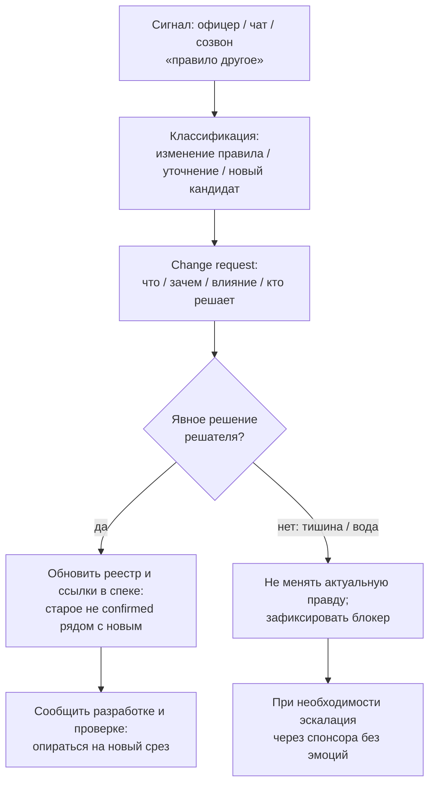

# Лекция 18. Управление требованиями

## Вчера «ок» по каркасу — сегодня правило другое

Вчера комплаенс-офицер посмотрел короткий каркас технического задания (дальше коротко — ТЗ) Compliance и написал в чат: «В целом похоже, можно двигаться». Вы спокойно закрыли день. Сегодня утром то же самое сообщение, но уже другое: «Слушай, срок ответа по обычному обращению — три дня, не пять. И отдельный статус „просрочено“ нам не нужен. Просто поправь в ТЗ, разработка уже спрашивает».

Вы открываете реестр требований. Там нет строки «нормативный срок — пять дней» в статусе `confirmed` (подтверждено). Есть открытый вопрос про владельца продления сроков и вопрос про статусы первой версии продукта — той минимальной поставки, с которой система уже полезна (часто говорят MVP, от *minimum viable product* — «минимально жизнеспособный продукт»; в курсе это просто «первая полезная версия»). В каркасе ТЗ эти места честно помечены как неизвестные. Но в голове команды «пять дней» уже успели прозвучать на созвоне, а разработчик вчера набросал задачу «таймер обещанного срока ответа» (в разговорах иногда звучит SLA — *service level agreement*, договорённость об уровне сервиса; нам сейчас важна не аббревиатура, а смысл: «за сколько дней обязаны ответить»). Офицер говорит не «давайте обсудим», а «просто поправь». Руководитель проекта в треде добавляет: «делайте как скажет офицер» — и исчезает.

Это не сбой документации. Документ как раз сделал свою работу: зафиксировал, что срок ещё не закрыт. Ломается другое — привычка менять смысл так же легко, как править опечатку. Урок 17 учил собрать каркас и не выдавать кандидата за подтверждённое. Этот урок — про то, что происходит после: когда смысл уже лежит в артефактах, и кто-то хочет его сдвинуть.

Если коротко сформулировать задачу аналитика на сегодняшнем шаге: не «переписать файл быстрее всех», а провести изменение так, чтобы через две недели нельзя было сказать «мы так не договаривались» или «в реестре две правды, берите любую».

## Проблема: правки в чате, две правды, разработка пилит старое

Разберём, что обычно происходит, если аналитик принимает давление как инструкцию.

Первый путь — правка в чате без следа. Офицер написал «три дня». Вы ответили эмодзи. Разработчик прочитал тред и переписал задачу. Реестр не трогали. Спецификацию (спеку) не трогали. Через неделю тестировщик открывает каркас ТЗ, видит блок открытых вопросов про срок ответа и спрашивает: «а какой срок всё-таки?» В чате уже другая ветка. Созвона «где решили три дня» никто не найдёт за три минуты. Правка в чате уже обновила требования — так кажется команде. На деле требования живут там, где команда договорилась их хранить. Чат — сигнал. Не хранилище договорённости.

Второй путь — две правды в реестре. Вы добавляете новую строку «срок ответа — три дня» со статусом `confirmed`, а старую формулировку-кандидат «срок уточняется / ориентир пять дней» оставляете тоже `confirmed` или просто забываете. Обе строки читаются как актуальные. Разработчик берёт одну, бизнес вспоминает другую. Две противоречащие формулировки не могут быть одновременно подтверждённым смыслом. Это не «богатая история», это конфликт, который система не разрулит за вас.

Третий путь — разработка пилит старое, пока change «где-то в воздухе». Вы оформили запрос на изменение, разослали письмо и ждёте. Тишина. Офицер на созвоне кивнул, но в письме не ответил. Руководитель сказал «в целом ок, детали потом». Тем временем спринт идёт по вчерашнему пониманию. Через десять дней выясняется: «не так поняли созвон». Работа сделана. Переделка дороже, чем один ясный отказ или одно ясное «да, меняем, вот влияние».

Управление требованиями существует именно для этих трёх развилок. Не чтобы добавить бюрократию ради формы. Чтобы смысл, уже записанный, менялся осознанно: видно, что меняется, зачем, на что влияет, кто сказал «да», и что старое больше не истина.

## Управление vs документирование: документ есть — дальше сопровождение

Документирование отвечает на вопрос: «Как собрать договорённость так, чтобы её можно было читать без вашего голоса?» Управление отвечает на другой: «Что делать, когда договорённость нужно сдвинуть, не потеряв след и не размножив противоречия?»

Разница не в том, что один навык «про Word», а другой «про процесс». Оба про смысл. Но момент другой. Пока вы собираете каркас Compliance, главная ошибка — выдать неизвестное за известное. Когда каркас и реестр уже есть, главная ошибка — тихо подменить известное или полуизвестное так, будто подмены не было.

Представьте, что спецификация и реестр — это не «книга на полке», а рабочая карта маршрута. Документирование — нарисовать карту честно: где дорога подтверждена, где ещё туман, где знак «проезд закрыт до решения». Управление — когда кто-то говорит «езжайте по другой улице». Вы не стираете старую улицу маркером втихаря. Вы помечаете: с такой-то даты маршрут другой, вот почему, вот кого затронет, вот кто утвердил поворот. Аналогия ломается там, где городские карты меняются редко, а требования в проекте — часто. Именно поэтому ритуал изменения должен быть лёгким, а не «enterprise-форма на двадцать полей».

Итак, управление требованиями — это сопровождение зафиксированного смысла во времени. Документ и реестр — не финиш. Это точка, от которой изменения становятся контролируемыми. Если файла ещё нет, вам нечем управлять: сначала фиксируете, потом меняете. Урок 17 закрыл фиксацию каркаса. Сегодня — сопровождение.

## Версия смысла на дату — до слова «baseline»

Прежде чем произносить красивое слово, разберём житейскую нужду.

Команде Compliance нужно уметь ответить на вопрос: «На какую договорённость мы опирались во вторник, когда оценили спринт?» Не «что офицер сказал в пятницу вечером в мессенджере». Не «что аналитик держит в голове». А срез: вот эти формулировки в реестре, вот эти ссылки в каркасе ТЗ, вот эти открытые вопросы ещё открыты — и на эту дату мы считали это рабочей картиной.

Без такого среза любой спор превращается в угадайку. Разработчик: «Мы же делали по тому, что было». Офицер: «Я всегда говорил про три дня». Руководитель: «Почему срыв?» Аналитик без датированного среза вынужден защищать память, а не артефакт.

Ещё одна бытовая картинка. Вы согласуете с коллегой список покупок на вечер. В 18:00 список такой: хлеб, молоко, яйца. В 19:30 человек пишет «ещё сыр, молока не надо». Если вы не зафиксировали, какой список был «на ужин до правки», вы не отличите ошибку покупки от смены решения. В требованиях то же самое, только цена выше: переписанный экран очереди офицера, сломанный таймер срока ответа, спор «кто виноват».

Теперь можно назвать это учебным словом. **Учебный baseline** (произносится «бейслайн»; буквально — «базовая линия», опорная точка) в нашем курсе — это согласованный срез смысла на дату. Не «файл с датой в названии». Не «замороженный PDF навсегда». Это пометка: вот состояние реестра и связанных кусков спецификации, на которое команда опиралась в такой-то день; дальше изменения идут уже относительно этого среза.

Зачем это аналитику лично, а не «компании вообще»? Чтобы отделить «мы уточняем внутри уже согласованного» от «мы меняем саму договорённость». Чтобы при эскалации сказать спонсору не «мне кажется, офицер передумал», а «после среза от 12 октября изменилось правило срока; влияние на очередь и дашборд просрочек; решения по изменению ещё нет». Чтобы не путать версию файла с версией смысла: файл можно сохранить хоть каждый час, смысл меняется только когда меняется договорённость.

Частая ошибка: принять за baseline сам факт, что документ «лежит в общей папке» или что кто-то сохранил копию «на всякий случай». Копия файла не равна подтверждённому срезу. Учебный baseline / версия смысла на дату живёт в договорённости людей и в статусах артефактов: что подтверждено, что ещё кандидат, какие вопросы открыты. Если файл красиво назван «финал_v3», а в реестре две противоречащие `confirmed`-строки, у вас нет рабочего baseline — есть иллюзия порядка.

На Compliance учебный baseline на текущем шаге выглядит скромно. Каркас ТЗ со статусом «не финальный», ссылка на реестр кандидатов, открытые вопросы с номерами вроде OQ-001…OQ-005 (OQ — от *open question*, «открытый вопрос»; так в журнале вопросов Compliance помечают записи). Вы можете буквально записать в заметке к срезу: «2026-10-12: каркас ТЗ + реестр в статусе candidate (кандидат) + открытые вопросы по срокам и статусам первой версии открыты. Нормативный срок ответа не confirmed». Этого достаточно, чтобы завтрашнее «три дня» читалось как изменение относительно вчерашней картины, а не как «ну мы всегда так жили».

## Change request: ритуал, а не форма на двадцать полей

Когда смысл уже в baseline-срезе, любое существенное смещение — это не правка опечатки. Это **change request / изменение требования**: оформленное предложение сдвинуть договорённость. Дальше в лекции часто коротко — **запрос на изменение** или **CR** (от *change request*). Это не «магический тикет из большой системы», а короткое сообщение с четырьмя ясными полями.

«Оформленное» пугает сильнее, чем нужно. На учебной практике Compliance запрос на изменение — короткий ритуал из четырёх вопросов, которые можно уместить в одно сообщение, одну страницу или одну карточку. Не толстый корпоративный регламент «как менять всё на свете». Не отдельная тяжёлая система учёта жизненного цикла приложений. Не «заполни двадцать полей, иначе изменение не существует».

Четыре вопроса звучат так.

Что именно меняется? Не «чуть подправим срок ответа», а конкретная формулировка: «нормативный срок ответа по обычному обращению — с пяти дней на три» или «отдельный статус „просрочено“ не вводим, просрочка — вычисляемый признак». Если не можете назвать старое и новое одной фразой, вы ещё не поняли изменение — вы почувствовали давление.

Зачем меняется? Бизнес-причина одним абзацем. «По внутреннему регламенту комплаенс срок три дня», «на пиковой нагрузке пять дней нереалистичны», «отдельный статус „просрочено“ путает офицеров с отдельным состоянием». Без «зачем» изменение невозможно отличить от каприза и невозможно оценить, не сломает ли оно соседнее правило через неделю.

На что влияет? Базовая карта последствий: какие строки реестра, какие открытые вопросы, какой кусок каркаса ТЗ, какая роль (сотрудник видит срок? офицер видит таймер? руководитель видит просрочки на дашборде?). Пока влияние не названо, «просто поправь ТЗ» — лозунг, а не решение.

Кто решает? Имя роли или человека, без которого изменение не считается принятым. На Compliance для правила срока и продления это не «любой, кто громче написал в чат». Ниже разберём решателя отдельно. Сейчас важно: change без адресата решения — письмо в никуда.

Вот как может выглядеть рабочий change request по Compliance, без канцелярита:

«Запрос на изменение CR-CMP-014 (номер удобно давать сами: CR = change request, CMP = Compliance). Меняем: нормативный срок ответа по обычному обращению. Было в рабочем понимании команды / кандидате: ориентир 5 дней (не confirmed). Предлагается: 3 дня. Зачем: позиция комплаенс-офицера + ссылка на операционную практику отдела. Влияние: очередь офицера (таймер/подсветка), дашборд просрочек руководителя (строка реестра REQ-CMP-005 — „требование Compliance №5“), открытый вопрос OQ-001 про продление срока — не закрывать автоматически. Решатель: руководитель комплаенс (владелец правила срока/продления) + подтверждение офицера как источника практики. Статус запроса: предложен, ждёт явного да/нет.»

Это и есть ритуал. Коротко. По делу. Можно переслать. Можно отклонить. Можно принять с условием. Нельзя честно сказать «я не видел, что менялось».

Отдельно отличим три разных события, которые в чате часто называют одним словом «поменяй».

Изменение правила — сдвиг уже обсуждавшегося или подразумеваемого правила: срок, право продления, набор статусов первой версии. Это классический change относительно среза.

Уточнение — сужение неизвестного без смены курса: «в первой версии точно нет статуса „отменено“ для сотрудника» при том, что вопрос статусов ещё открыт. Иногда это закрытие открытого вопроса, а не change confirmed-строки. Важно не маскировать изменение правила под «ну мы уточнили».

Новый кандидат — появляется новая потребность: например, отдельный тип обращения для конфликта интересов. Это не правка старой строки, а новая запись со статусом `candidate`, пока её не подтвердят. Если вы правите старую формулировку «создать обращение» так, чтобы туда влезло всё подряд, вы теряете след и смешиваете смыслы.

## Compliance: офицер меняет правило — три развёрнутые сцены

Сквозной кейс урока — **Compliance: офицер меняет правило**. Ниже три сцены: срок, статусы первой версии, продление. В каждой — как звучит диалог на практике и что делает аналитик, а не «идеальный учебник».

### Сцена 1. «Срок три дня, просто поправь ТЗ»

Офицер пишет в общий тред с разработкой:

— Срок по обычным обращениям три дня. Пять — это старое. Просто поменяй в ТЗ, не надо совещаний.

Разработчик:

— Ок, перепишу задачу на 72 часа.

Вы:

— Погодите. В каркасе срок не confirmed, открытый вопрос по продлению ещё открыт. Три дня — это изменение относительно рабочего среза. Я оформлю запрос на изменение: что меняется, влияние на дашборд просрочек и на таймер в очереди. Кто даёт да/нет по правилу срока — руководитель комплаенс. Офицер, подтверди, пожалуйста, что источник — ваш операционный регламент, и что продление срока отдельно не закрываем этим сообщением.

Офицер:

— Вы усложняете. Я же сказал.

Здесь важно не спорить про «усложнение», а назвать цену упрощения. Если вы «просто поправите» файл, через неделю руководитель комплаенс скажет, что три дня не утверждали, а разработка уже отгрузила таймер. Давление «просто поменяй» — это давление статусом и скоростью, а не замена решателя. Офицер может быть источником практики и даже владельцем куска процесса, но на Compliance владелец ответа по продлению срока в открытых вопросах указан как руководитель комплаенс. Смешивать «офицер сказал» и «правило утверждено» нельзя.

Рабочий ход аналитика: короткий запрос на изменение, явный решатель, влияние на строку REQ-CMP-005 и связанные вопросы, старое понимание не выдавать за confirmed. В чат разработке: «до явного решения по запросу пилим без жёсткого таймера 3/5 — иначе переделка».

### Сцена 2. «Отдельный статус „просрочено“ нам не нужен»

На созвоне по статусам первой версии офицер говорит:

— Отдельного статуса «просрочено» (в черновиках иногда писали английским словом Overdue) не будет. Просрочка сама считается. Вчерашнее «можно подумать про Overdue» забудьте. Обновите модель.

В реестре и вопросах это бьёт по открытому вопросу OQ-002 (статусы первой версии) и по связанному вопросу, нужен ли отдельный статус просрочки. Если кто-то уже набросал в черновике спецификации слово Overdue как решение, молча удалить его — плохой ход: след решения исчезнет, а через месяц кто-то снова «предложит Overdue».

Вы после созвона присылаете не «обновлённое ТЗ целиком», а запрос на изменение на одну тему:

«Запрос CR-CMP-015. Убираем кандидата на статус „просрочено“ / Overdue из первой версии. Просрочка — признак поверх статуса (дата нормы против „сейчас“). Влияние: очередь офицера, дашборд руководителя, текст каркаса в блоке открытых вопросов / будущих статусов. OQ-002 частично сужается: отдельного Overdue в первой версии нет. Решатель по составу статусов — комплаенс-офицер; для метрики просрочек на дашборде — согласование с руководителем комплаенс.»

Если офицер отвечает водой — «ну да, в целом так, там ещё подумаем» — вы не закрываете change. Вода вместо решения по change означает: состав статусов всё ещё не принят целиком. Вы фиксируете только то, что сказано жёстко («отдельного статуса „просрочено“ нет»), и оставляете остальной перечень статусов открытым вопросом. Не дописывайте «полный жизненный цикл как у всех заявок», чтобы схема выглядела красиво.

### Сцена 3. «Продлевать может любой офицер»

Руководитель проекта пересылает вам сообщение офицера:

— Пусть каждый офицер сам продлевает срок, иначе очередь встанет. Сделайте так в системе.

В журнале открытых вопросов запись OQ-001 прямо стоит: кто утверждает продление срока ответа — и владелец ответа указан руководитель комплаенс. Офицер предлагает правило, которое меняет ответственность. Это не уточнение поля на форме. Это изменение правила власти в процессе.

Диалог, который стоит провести спокойно:

Вы руководителю проекта:

— Это изменение по открытому вопросу OQ-001. Сейчас решатель по вопросу — руководитель комплаенс. Офицер предлагает делегировать продление на уровень офицера. Я оформлю запрос на изменение с влиянием на аудит действий и на дашборд просрочек. Без явного да от руководителя комплаенс в ТЗ и реестр это не внесу — иначе через месяц аудит спросит, кто имел право двигать обещанный срок ответа.

Руководитель проекта:

— Делайте как скажет офицер, мне лишь бы срок проекта.

Вы:

— Принял риск срока проекта. Для смысла правила всё равно нужно да/нет от владельца OQ-001. Отправлю запрос ему напрямую и скопирую вас. Пока ответа нет — разработку в продление срока не отдаю.

Это не саботаж аналитика. Это отказ выдавать чужое «делайте как скажет» за фиксацию решения владельца смысла.

## Статусы в реестре при изменении: одна актуальная правда

Реестр Compliance уже умеет держать статусы (английские ярлыки из шаблона курса — рядом по-русски): `candidate` — кандидат, ещё не подтверждено; `confirmed` — подтверждено; `open` — открыто / требует решения; `deferred` — отложено. При change эти статусы — ваш главный инструмент, чтобы старая и новая формулировка не жили как две правды.

Как обновлять статусы в реестре при изменении — на пальцах.

Допустим, была строка-кандидат: «Нормативный срок ответа — 5 рабочих дней» (`candidate`). Приняли изменение на три дня. Вы не оставляете обе строки `confirmed`. Вы делаете одно из учебных действий:

Либо помечаете старую формулировку как снятую с актуальности — по-русски «заменена», в текстах иногда пишут английское superseded — и оставляете рядом ссылку на новую строку по её номеру и на запрос на изменение. Старая не удаляется бесследно: след нужен, чтобы спорить фактами. Но она больше не «текущая правда».

Либо, если отдельного поля «заменена» в вашем шаблоне ещё нет, явно меняете статус старой на `deferred` или `open` с пометкой в формулировке/комментарии: «заменено запросом CR-CMP-014, не использовать», а новую вводите как `candidate` или `confirmed` — строго по факту подтверждения.

Критичное правило: две противоречащие формулировки не могут быть `confirmed` одновременно. Если видите такое — это дефект управления, не «гибкость».

Ещё один тонкий момент. Change не должен молча закрывать открытый вопрос «стилем в ТЗ». Если OQ-001 открыт, а вы в абзаце спецификации написали «срок продлевает офицер», вы закрыли вопрос без решателя. Правильно: либо решение по запросу на изменение явно закрывает открытый вопрос со ссылкой на решателя и дату, либо вопрос остаётся открытым, а в спецификации по-прежнему вопрос, не ответ.

Практический вывод для реестра: при каждом принятом изменении пройдите три строки мышления — какой номер строки меняется, какой статус у старого смысла, какой статус у нового, и где в журнале открытых вопросов нужно обновить связь. Это и есть сопровождение, а не «поиск файла, куда вставить цифру 3».

## Базовая трассировка влияния: что затронет изменение

Слово «трассировка» пугает огромными таблицами «всё связано со всем». В этом уроке нужна **трассировка на базовом уровне**: уметь ответить «что затронет изменение», не заводить отдельную тяжёлую систему учёта и не вести гигантскую матрицу как отдельный культ.

На Compliance для изменения по сроку базовый след выглядит так: требование или правило срока → связанные строки реестра (например, дашборд просрочек REQ-CMP-005) → кусок каркаса ТЗ / блок вопросов → роли, которые увидят эффект (офицер в очереди, руководитель на дашборде, сотрудник на портале, если срок ему показывается). Иногда в цепочку попадает открытый вопрос как узел: OQ-001, OQ-002.

Этого достаточно, чтобы запрос на изменение был честным. Недостаточно для курсовой «матрица на 200 строк». В состоянии проекта Compliance запланирована отдельная матрица связей требований, но файла ещё нет — и для урока 18 это нормально. Это направление на будущее, не курс матриц сегодня. Сегодня вы учитесь думать связями вручную на одном изменении.

Ниже — схема потока изменения смысла. Это не схема устройства системы и не диаграмма UML (UML — язык схем для моделирования; свой модуль курса будет позже). Это поток работы аналитика и решателя.

Словами: сигнал не равен изменению. Сначала классифицируете. Потом коротко оформляете запрос на изменение. Потом добиваетесь явного решения. Только после этого трогаете реестр и спецификацию так, чтобы актуальная правда была одна. Если решения нет — держите старый срез и не притворяйтесь, что тишина вас утвердила.

## Кто решает изменение и фиксация решения

Вопрос **кто решает изменение** на Compliance нельзя оставлять в зоне «тот, кто написал громче». У разных правил разные владельцы смысла. Офицер хорошо знает операционку очереди. Руководитель комплаенс отвечает за управленческие правила вроде продления срока и за метрики на дашборде. ИБ может быть решателем по составу аудита. Руководитель проекта решает срок поставки, но не подменяет собой владельца бизнес-правила только фразой «делайте как скажет офицер».

Как выбирать решателя на практике: смотрите журнал открытых вопросов и круг заинтересованных лиц (тех, кого изменение затронет или кто владеет правилом). Если вопрос уже назвал владельца ответа — это ваш первый кандидат в поле «кто решает» внутри запроса на изменение. Если change порождает новый вопрос — назначьте владельца явно в тексте запроса, не надейтесь, что «и так понятно».

Теперь про **фиксацию решения**. Решение — это не настроение треда. Решение — записанный итог: принято / отклонено / принято с условием; кто; когда; на какой запрос на изменение; что стало с статусами строк.

Что не является фиксацией решения:

Тишина после рассылки запроса. Повтор урока 17 в новой одежде: **тишина ≠ approve изменения** (approve здесь — «утвердили / согласовали»; отсутствие ответа не равно «да, меняем»). Если change разослан, а ответов нет, разработка не получает права пилить «как будто согласовали». Вы пишете в статусе запроса: «отправлен такому-то, ответа нет, изменение не принято». Это спасает от фразы через две недели: «ну вы же всем отправили».

Фраза «в целом ок, детали потом». Это вода. Она может быть вежливым способом отложить разговор, но она не говорит, принято ли «три дня», закрыт ли отдельный статус «просрочено», делегировано ли продление. На change нужен ответ по содержанию предложения, а не оценка тона документа.

Кивок на созвоне без следа. Созвон полезен. После созвона нужен один абзац: «по итогам, CR-CMP-014 принят, срок 3 дня, OQ-001 не закрыт». Без абзаца у вас снова миф «я же говорил».

Давление старшего без владельца смысла. «Просто поменяй» от офицера или «делайте как скажет офицер» от руководителя проекта — сигналы. Они становятся решением только когда владелец правила оставляет явное да/нет.

Как фиксировать коротко и по-человечески: в том же сообщении или карточке поле «Решение: принято 2026-10-18, Иванов (руководитель комплаенс). Условие: продление срока по-прежнему только через руководителя. Реестр: строка A заменена, строка B confirmed. Спецификация: ссылка на реестр, OQ-001 обновлён». Всё. Этого хватает, чтобы через месяц не судить по памяти.

## Негативы: давление, вода, тишина, саботаж — и действия аналитика

Идеальная картина, где все быстро и честно подтверждают change, в курсе не считается достаточной. Разберём трение так, как оно бывает.

### Давление «просто поменяй»

Как выглядит: старший по статусу сокращает процесс до правки файла. Часто добавляет стыд: «вы тормозить будете». Иногда подключает руководителя проекта: «не усложняйте».

Чем занятость отличается от давления. Занятый офицер скажет: «три дня, вот скрин регламента, решителя ставьте руководителя, мне некогда на созвон — отвечу в письме да/нет по запросу на изменение». Давление говорит: «не надо никакого запроса, просто поправь».

Что делать аналитику. Сохраняйте тон спокойный. Переводите давление в содержимое запроса одним сообщением: «Зафиксировал просьбу. Чтобы разработка не переделывала, нужно явное да от [роль]. Вот влияние в трёх пунктах. Могу внести за 15 минут после да». Если давят дальше — фиксируйте риск без ярлыков характера: «без явного решения по сроку команда либо угадывает, либо останавливает таймер». Эскалация через спонсора: не «офицер давит», а «нужен решатель на 10 минут, иначе срыв переделки обещанного срока ответа».

### Вода вместо решения по change

Как звучит: «в целом ок», «давайте позже», «там ещё подумаем», «делайте в правильном направлении». Ни одного да/нет по конкретной дельте.

Что делать. Верните тот же запрос и сузьте вопрос до бинарного: «Нужен ответ только по пункту 1: срок 3 дня — да или нет. Остальное могу оставить открытым». Не закрывайте соседние открытые вопросы «за компанию». Если вода повторяется — статус запроса «не решён», в журнале блокеров — дата и цитата без эмоций.

### Тишина, пока разработка пилит старое

Как выглядит: запрос в почте, все «заняты», спринт идёт. Через неделю — удивление.

Что делать. Явно напишите разработке: «запрос не принят, опираемся на прежний срез; новую цифру в оценку не закладываем». Назначьте дату, после которой идёте к спонсору: «без ответа к четвергу не можем обещать срок ответа в ближайшей поставке». Тишина — отсутствие решения, не скрытое согласие. Повторим учебную формулу урока: тишина ≠ approve изменения.

### Саботаж ревью change

Как выглядит: встречу на разбор запроса срывают, письмо не открывают, а потом говорят «не так поняли созвон» или «я всегда был против». Иногда человек соглашается устно при одном составе участников и отрицает при другом.

Чем отличается от простой занятости. Занятость оставляет след попытки: перенос с новой датой, короткий содержательный ответ, делегирование. Саботаж ревью change оставляет пустоту и поздний спор про интерпретацию.

Что делать аналитику. Не диагностируйте мотивы вслух. Соберите факты: запрос отправлен тогда-то; напоминания; встречи сорваны; содержательного ответа нет; разработка стоит или угадывает. Эскалация через спонсора без эмоций: «нужна обязательная 20-минутная рамка на CR-CMP-014, иначе не можем подтвердить состав работ спринта». Параллельно предложите путь без встречи: «достаточно одного предложения в письме: принять / отклонить / принять с условием». Черновик на правку снова работает лучше пустого «пожалуйста, согласуйте».

Если после эскалации приходит позднее «я же говорил на созвоне иное» — ваш щит уже должен быть готов: текст запроса и отсутствие письменного решения до даты X. Вы не спорите, кто что помнит. Вы показываете, что до фиксации решения актуальная правда не менялась.

## Практика: оформить change и ход при трении

Сделайте одно учебное упражнение на Compliance. Не переписывайте весь каркас ТЗ. Возьмите одну дельту.

Контекст. После среза «каркас + реестр candidate + открытые вопросы открыты» комплаенс-офицер пишет: «Срок три дня, просто поправь ТЗ. Отдельный статус „просрочено“ не нужен. Продлевать может любой офицер». Руководитель проекта: «делайте как скажет офицер». Запрос на изменение вы разослали руководителю комплаенс — пока тишина. Разработка спрашивает, закладывать ли таймер на три дня в спринт.

Задание.

1. Оформите один change request / изменение требования (можно один запрос на срок, а статус «просрочено» и продление — отдельными, если видите, что это разные решатели; учебный минимум — один полный запрос по сроку). Обязательно поля смысла: что меняется, зачем, на что влияет, кто решает.
2. Опишите, как обновятся статусы в реестре, если запрос примут: что станет со старой формулировкой, что с новой, какой открытый вопрос затронут.
3. Выберите одно трение из трёх и распишите ваше действие: давление «просто поменяй»; вода «в целом ок, детали потом»; тишина при живой разработке. Нужен не лозунг «надо эскалировать», а конкретные сообщения: кому, что фиксируете, что говорите разработке сегодня.

Критерий хорошего ответа: по вашему тексту нельзя принять тишину или давление за approve (утверждение); видно одну актуальную правду после изменения; влияние названо без огромной таблицы на стену.

## Граница урока и мост дальше

Сегодняшняя граница жёсткая и полезная. Базовая трассировка и change — да. Учебный baseline как срез смысла на дату — да. Статусы реестра и явный решатель — да. Полные корпоративные каталоги процессов и «базы конфигураций всего предприятия» — нет. Отдельные тяжёлые системы учёта жизненного цикла приложений — нет. Нотация UML (схемы моделирования) — нет, она придёт своим модулем. Проектирование программных интерфейсов (API) и баз данных — нет. Повтор каркаса спецификации урока 17 — нет: каркас уже собран, мы его сопровождаем, а не рисуем заново. Полные своды профессиональных стандартов про управление изменениями — не цель; нам нужен рабочий ритуал аналитика на Compliance.

Дальше по курсу — урок про сценарии использования и моделирование. Управление изменениями смысла на базовом уровне вы уже можете держать в руках. Когда появятся сценарии и модели, тот же навык change пригодится: модель тоже будет меняться не «потому что в чате сказали», а через понятную дельту и решение.

Если вернуться к утреннему сообщению офицера, хороший ответ аналитика теперь звучит так: «Принял сигнал. Оформляю запрос на изменение относительно вчерашнего среза: срок, влияние на очередь и дашборд, решатель — руководитель комплаенс; статус „просрочено“ и продление — отдельно, там другие развилки. Пока явного да нет, в ТЗ и реестр актуальную правду не подменяю, разработке даю держаться текущего среза. Тишина и „просто поменяй“ для меня не approve».

## Короткий итог

Документ и реестр — не финиш, а точка сопровождения. Управление требованиями — умение менять зафиксированный смысл без двух правд и без мифа, что чат уже всё обновил.

Учебный baseline — согласованный срез смысла на дату, а не «файл с красивым названием». Change request — короткий ритуал: что, зачем, влияние, кто решает. Статусы в реестре при изменении держат одну актуальную формулировку; старое оставляют со следом, но не как confirmed-конкурента. Трассировка на базовом уровне отвечает «что затронет», не требуя тяжёлой матрицы с первого дня.

На Compliance офицер может менять правило — срок, статусы, продление — но давление статусом, вода и тишина не заменяют фиксацию решения. Саботаж ревью change лечится фактами, черновиком на правку и спокойной эскалацией через спонсора, а не спором про характер.

## Использованные источники

- [Technical Assignment: Compliance](project/compliance/specification/technical-assignment.md) — ранний скелет ТЗ, не финальный: назначение, пользователи, область первой версии, ссылка на реестр и открытые вопросы; точка, от которой сопровождаются изменения смысла.
- [Requirements Register: Compliance](project/compliance/requirements/requirements-register.md) — реестр с полями номера, формулировка, источник, статус (`candidate` / `confirmed` / `open` / `deferred`) и критерием проверки; база для обновления статусов при change.
- [Open Questions: Compliance](project/compliance/requirements/open-questions.md) — журнал открытых вопросов (в т.ч. OQ-001 продление сроков, OQ-002 статусы первой версии), которые change не должен закрывать «стилем в ТЗ» без решателя.
- [Project state: Compliance](project/compliance/project-state.yaml) — отдельная матрица связей требований ещё только в планах; в лекции — только учебный минимум трассировки влияния.

Учебные определения baseline, change request и правила «тишина / „в целом ок“ ≠ approve» — определения курса на опоре brief и практики трения; отдельного авторского текста и внешнего исследования в доступных источниках этого выпуска не было.
