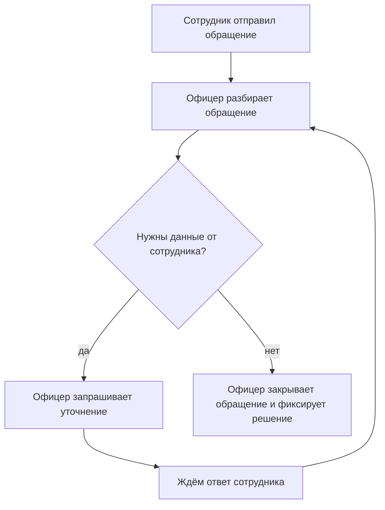

# Лекция 16. Моделирование и формализация требований

## Заметки есть, а статусов нет

После прошлого урока у вас уже не пустые руки. Есть план выявления, заготовка заметок и реестр Compliance. В реестре кандидат уже сформулирован по-деловому: комплаенс-офицер должен уметь запросить уточнение у сотрудника. Рядом висит открытый вопрос: какие статусы обращения входят в первую версию. А в блокноте после разговора легко остаётся строка, которую вы записали своими словами: «Обращение идёт по процессу. Иногда просим уточнить, потом закрываем».

Звучит понятно. Вы даже можете помнить, что офицер кивнул.

На следующий день разработчик спрашивает другое: какие статусы у обращения и кто имеет право его закрыть? Вы открываете заметку и видите ту же фразу. Честного ответа в ней нет. Очередь обращений по ней не собрать: непонятно, что показывать офицеру, что видит сотрудник и в какой момент обращение считается законченным.

Вот здесь заканчивается выявление и начинается другая работа. Заметка фиксирует, что человек сказал. Формализация делает из этого формулировку, по которой можно действовать. Моделирование показывает кусок процесса, который фраза прячет.

## Что вы на самом деле принесли со встречи

Фраза офицера — ещё не требование. В словаре BABOK требование — это пригодное представление потребности: такое, которым может пользоваться команда, а не только автор заметки. «Иногда просим уточнить» пригодным представлением не является. Из него нельзя понять, кто просит, у кого, что происходит с обращением, пока ждут ответ, и как проверить, что система сделала нужное.

То, что у вас лежит после интервью, честнее называть так: это требования-кандидаты. Кандидат — гипотеза: «кажется, система должна уметь вот это». Гипотеза может оказаться верной. Пока её не сверили с человеком, который знает работу, это не договорённость.

Рядом с кандидатами остаются открытые вопросы. В реестре Compliance один из них уже записан прямо: какие статусы обращения входят в первую версию. Это не дыра в вашем характере. Это дыра в знании. Формализация как раз учит не замазывать такие дыры красивым текстом.

## Формализация: одна фраза, которую можно проверить

Возьмём ту же реплику и не будем «улучшать стиль». Посмотрим, чего в ней не хватает, если завтра по ней писать поведение системы.

Кто уточняет? Комплаенс-офицер. У кого? У сотрудника, который создал обращение, а не «у кого-нибудь». Что нельзя делать, пока ответа нет? Считать обращение закрытым. Как поймём, что это выполнено? Сотрудник видит запрос, а в очереди офицера обращение не числится закрытым.

Получается кандидат такого вида.

Комплаенс-офицер может запросить уточнение у сотрудника, который создал это обращение. Пока ответ не получен, обращение не переводится в закрытое. Критерий проверки: сотрудник видит запрос, а обращение в списке офицера не отображается как закрытое.

Сравните с исходным «иногда просим уточнить, потом закрываем». Смысл тот же, но из второй фразы уже можно спорить предметно. Офицер может сказать: «нет, закрыть можно и во время ожидания, если риск низкий». Это полезный спор. Из слова «иногда» такой спор не начинается: каждый додумывает своё.

Карл Вигерс называет два свойства, без которых формулировка разваливается. Первое — отсутствие неоднозначности: разные читатели должны прийти к одному чтению. Второе — возможность проверки: можно придумать испытание, показ или разбор, а не голосование «ну вроде удобно». Слова вроде «иногда», «нормально», «по процессу» как раз ломают оба свойства.

Он же отдельно предупреждает про догадку. Если в проверке нет того, кто знает работу, разработчик или аналитик легко говорит: «так не бывает, наверное они имели в виду вот это». Вигерс прямо называет это guessing — угадыванием. На Compliance угадывание выглядит безобидно: «ну, статусов наверное четыре, как у всех заявок». Через месяц офицер смотрит на очередь и говорит, что половина обращений висит не в том состоянии. Чинить это дороже, чем в день интервью оставить вопрос открытым.

Поэтому формализация — не причёсывание текста. Это решение, что именно вы готовы утверждать, а что ещё не знаете.

Рядом с кандидатом выше честно остаются открытые вопросы. Полный перечень статусов первой версии мы не выдумали. Срок, после которого молчание сотрудника что-то значит, тоже не выдумали. Вигерс для таких пробелов использует пометку «ещё не определено» и просит не начинать изготовление именно этой части, пока пометка жива. Не всей системы. Именно куска, который висит на неизвестном правиле. Портал сотрудника можно обсуждать и без финального списка статусов. Очередь офицера — нельзя.

## Почему точной фразы всё ещё мало

Допустим, кандидат про уточнение все прочитали одинаково. Это ещё не значит, что они видят один и тот же путь.

Офицер представляет так: запросил данные, дождался, снова посмотрел обращение, только потом закрыл. Разработчик представляет иначе: уточнение — это комментарий в карточке, а закрыть обращение можно в тот же день, если офицер уже всё решил. Наша фраза запрещает закрытие, пока ответа нет. Она не показывает, что после ответа обращение снова попадает к офицеру, а не исчезает. И она молчит про случай, когда сотрудник не отвечает совсем.

Одна фраза держит правило. Она плохо держит развилку, возврат и пропуск. Для этого нужна модель.

В глоссарии BABOK модель требований — абстрактное, обычно рисунком, представление одного аспекта текущего или будущего состояния. Не всей системы. Одного аспекта. Для нас сейчас аспект такой: что происходит с обращением после того, как сотрудник его отправил.

Аналогия помогает удержать масштаб. Фраза «офис где-то в бизнес-центре» и схема этажа с поворотом после турникета — не одно и то же. Схема не заменяет здание и не заменяет правила пропуска. Так и здесь. Рисунок пути обращения не является системой, не является регламентом комплаенса и не является спецификацией. Спецификация — следующий урок. Рисунок нужен раньше: чтобы увидеть дыру, пока её ещё дёшево признать.

Вигерс пишет то же самое с другой стороны. Графическая модель другого ракурса вскрывает неполноту, которую сплошной текст прячет. Не потому что рисунок «солиднее». Потому что на нём видно, куда стрелка не пришла.

## Одна схема вместо всей системы

Ниже не нотация UML и не чертёж экрана. Прямоугольники — моменты работы. Ромб — развилка. Стрелка — что происходит дальше. Это черновик одного пути обращения в Compliance, собранный из заметки, а не утверждённый регламент.

Пройдём стрелки словами. Сотрудник отправил обращение, офицер его разбирает. Если данных хватает, офицер закрывает обращение и оставляет решение. Если данных не хватает, он просит уточнение и ждёт. Ответ возвращает обращение к разбору, а не в пустоту.

Посмотрите, чего на схеме нет. Нет стрелки «сотрудник молчит три дня — обращение закрывается само». Нет стрелки «закрыть можно, не написав решение». Нет второго контура для руководителя и для подарков. Это не забывчивость рисунка. Это граница того, что мы реально слышали.

Отсутствующая стрелка — находка. Пока её нет, вопрос «что делать, если сотрудник не отвечает» остаётся открытым. Дорисовать её «чтобы схема была полной» — как раз угадывание. Полная схема с выдуманным правилом опаснее дырявой схемы с честной дырой: по полной начинают делать очередь.

Рядом со схемой полезен короткий сценарий. Не документ на десять страниц, а история одного случая. Сотрудник отправил обращение о возможном конфликте интересов. Офицер видит, что не названа сторона сделки, и запрашивает уточнение. Сотрудник отвечает. Офицер снова открывает обращение и либо просит ещё один факт, либо закрывает его с текстом решения. Сценарий хорош тем, что по нему можно спросить: «такой случай у вас бывает или я собрал его из общих слов?» Вигерс как раз советует пользовательские сценарии, чтобы вытащить неоднозначность, которую не видно в одинокой фразе.

Отдельная ловушка — одно слово на двоих. Для офицера «закрыто» может значить «сотрудник получил решение». Для разработчика — «в поле статуса написано Closed». Оба кивают на схему и расходятся с разными системами в голове. Здесь рисунок десяти квадратов не лечит. Лечит одна строка общего словаря: что мы в этой системе называем закрытием и чего в это понятие не входит. В BABOK такой словарь близок к модели понятий: не картинка процесса, а договорённость о значениях слов предметной области. На старте вам хватит трёх-четырёх опасных слов. «Закрыто», «уточнение», «просрочено», «обращение». Не глоссария на сорок страниц.

## В каких артефактах это живёт

До сих пор мы собирали куски по ходу рассказа. Их полезно назвать, иначе формализация снова выглядит как «пиши аккуратнее». На этом шаге она живёт в шести артефактах. Это не альбом на весь Compliance и не нотация UML. Нотация и текст спецификации будут позже. Сейчас — носители, без которых фраза со встречи не становится тем, по чему можно работать.

**Формулировка требования.** Строка, которой может пользоваться команда: кто действует, что происходит, при каком условии, критерий проверки. В нашем случае это кандидат про запрос уточнения. Пока вместо неё в блокноте лежит «иногда просим уточнить», формализации нет, есть пересказ.

**Бизнес-правило.** Ограничение, которое обязано выполняться независимо от экрана. «Пока ответа нет, обращение не закрывается» и «закрытие без текста решения запрещено» — не пожелания к кнопке. Если оставить правило внутри длинного абзаца про интерфейс, при следующей перерисовке экрана его потеряют. Отдельная строка этого не даёт.

**Глоссарий.** Короткая договорённость о словах, из-за которых люди кивают и расходятся. Для обращения хватает «закрыто», «уточнение», «просрочено», «обращение». Глоссарий на сорок страниц на этом шаге не нужен.

**Сценарий.** Один живой случай от начала до исхода: сотрудник отправил обращение о конфликте интересов, офицер запросил сторону сделки, после ответа закрыл с текстом решения. Схема показывает, какие ветки бывают. Сценарий показывает, бывает ли так у конкретного офицера, и по нему можно спросить: «этот случай ваш или я его собрал?»

**Модель пути.** Рисунок одного аспекта — что происходит с обращением после отправки. Она нужна, когда фраза не держит развилку, возврат и пропуск. Один путь. Подарки, декларации и дашборд в эту картинку не входят.

**Открытые вопросы.** Список того, что вы сознательно не заполнили: статусы первой версии, молчание сотрудника. Это тоже результат формализации. Без такого списка дыра притворяется готовым правилом, и по ней начинают делать очередь.

Не нужно выпускать все шесть на каждую реплику. Берут тот артефакт, который закрывает дыру. Слово поняли по-разному — глоссарий и заново написанная формулировка. Не виден возврат к офицеру — модель пути или сценарий. Правило тонет в описании экрана — отдельная строка бизнес-правила. Ещё не знаете — открытый вопрос, а не новая стрелка.

Реестр Compliance при этом не седьмой способ думать. Это место, где формулировки, правила и вопросы лежат рядом и не расползаются по чатам. Пустой реестр сам ничего не формализует: формализует то, что в нём записано.

## Что делать, когда времени мало

Не рисуйте весь Compliance, чтобы почувствовать, что урок усвоен. Выбирайте по боли из шести артефактов выше, а не заводите седьмой формат «на всякий случай».

Если спор в слове, сначала глоссарий и формулировка. Схема с красивыми стрелками только спрячет неоднозначность внутрь подписи на прямоугольнике.

Если фраза уже точная, но вы не можете рассказать, что происходит на развилке и куда обращение возвращается, нужна короткая модель одного пути или сценарий одного случая. Одного. Обращение — да. Подарки, декларации и дашборд руководителя в ту же картинку не тащите: у них другие действующие лица, и схема перестанет читаться.

Если формулировка и путь уже совпали и человек, который знает работу, показал пальцем «вот здесь не так» или «вот здесь верно», остановитесь. Следующая диаграмма «на всякий случай» легко становится альбомом, который никто не откроет. Модель, которую не читают, не подтверждена. Она только выглядит законченной.

Проверка формулировки и проверка «это то, что людям нужно» — разные вопросы. Можно написать гладкую фразу про автозакрытие молчащих обращений. Она будет однозначной и проверяемой. И при этом ненужной или вредной, если офицер как раз не хочет терять такие случаи. Гладкость текста этого не ловит. Ловит разговор по черновику.

## Когда схему не смотрят

До этого места легко представить вежливого офицера, который садится и правит стрелки. Так бывает не всегда.

Вы присылаете одну страницу: кандидат про уточнение и схему выше. В ответ: «Квадратики не смотрю. Я на созвоне всё сказал, делайте систему». Встречу, где вы хотели пройти путь вместе, переносят второй раз. Тем временем разработка просит «зафиксировать статусы, а то мы стоим».

Это уже не проблема выявления «человек не пришёл на интервью». Знание в какой-то форме прозвучало. Ломается следующий шаг: подтверждение. Пока черновик не сверили, IIBA считает результат выяснения неподтверждённым. Задача подтверждения как раз в том, чтобы проверить точность и согласованность и убрать ошибки, пропуски, противоречия и неоднозначность. Общее понимание — результат этой проверки, а не тон, которым вам сказали «ну вы поняли».

Почему так выходит, если не сводить всё к «он вредный».

Офицер может быть занят живой очередью. Тогда схема из двенадцати страниц для него шум, а одна страница с одним вопросом — рабочий формат. Он может бояться, что рисунок отнимет право решать исключения вручную: сегодня он закрывает странный случай звонком, а квадратик это запретит. Он может не верить, что разработка вообще посмотрит на схему, и не тратить на неё час. Бывает и давление статусом со стороны руководителя подразделения: «не отвлекайте людей бумажками, им обращения закрывать надо».

Занятость и отказ выглядят похоже только в календаре. Занятый человек поправит одну конкретную ошибку, если вопрос короткий и черновик уже лежит перед ним. Отказ выглядит иначе: «и так всё очевидно», ни одной пометки на странице, а через две недели — «вы сами не так поняли, я же говорил». Между этими точками нет правки. Есть только ваша догадка, которая успела стать задачей в разработке.

### Что делать аналитику

Не приносите альбом. Принесите черновик на правку и один вопрос: «Где я ошибся в шаге закрытия?» Людям проще ткнуть в чужую ошибку, чем с нуля рассказать жизненный цикл. Если человек занят, этот формат как раз уважает его время. Если он избегает содержания, короткий вопрос это тоже показывает: ответить на него можно одним предложением, и отсутствие ответа уже нельзя списать на «вы прислали слишком много».

На самой схеме подпишите, что подтверждено, а что нет. Кандидат про уточнение может стоять как черновик. Список статусов — как открытый вопрос. Пропущенная встреча не переводит черновик в статус «согласовано». Тишина — не подпись.

Пока подписи нет, не отдавайте разработке перечень статусов как решение. Можно отдать границу: «закрытие без текста решения и без ответа на уточнение мы не проектируем, правило про молчание сотрудника не определено, очередь статусов ждёт подтверждения». Вигерс описывает ту же ловушку с другого конца: единственный человек, который может прояснить требование, не берёт трубку, и команда вынуждена гадать. Гадание он считает предвестником переделки. Ваша задача — не стать этим гаданием из вежливости.

Если перенос повторяется, а вопрос блокирует кусок первой версии, фиксируйте блокер спокойно. Кому нужно: спонсору или руководителю проекта. Что нужно: двадцать минут на одну страницу, не «вовлечь офицера в методологию». Чем грозит пауза: очередь обращений начнут делать на выдуманных статусах. Без характеристики человека. «Он саботирует» — эмоция. «Без подтверждения смысла слова „закрыто“ мы сделаем не ту очередь» — риск срока и смысла.

И не прячьтесь за схемой. Модель не заменяет разговор с тем, кто знает исключения. Если офицер не смотрит рисунок, полезно прийти с одним живым случаем из последней недели: «вот это обращение вы закрыли без ответа сотрудника — так и должно остаться в системе?» Иногда живой случай пробивает там, где квадратики вызывают отторжение. Если не пробивает, случай всё равно становится фактом в открытом вопросе, а не вашей частной теорией.

Чего в этой ситуации не стоит делать:

- дописать статусы самим, чтобы задача в разработке выглядела готовой;
- считать устное «ок» на шумном созвоне подтверждением схемы, которую человек не открывал;
- эскалировать после первого переноса и в формулировках про характер;
- рисовать весь Compliance на одном листе, чтобы было что приложить к письму.

## Куда это кладётся дальше

К концу этого шага у вас должен быть не «документ требований», а более честная пачка из тех же артефактов: формулировки, которые можно проверить, бизнес-правила отдельно от экрана, короткий глоссарий опасных слов, сценарий или модель одного пути и открытые вопросы. Плюс пометки, что человек смотрел, а что нет.

Следующий урок соберёт из этого спецификацию: текст, который другие читают как договорённость о системе, а не как вашу личную заметку. Ещё позже появятся отдельные нотации — сценарии использования, деятельности, состояния. Сегодня они не нужны. Нужна привычка не путать услышанное, сформулированное и подтверждённое.

Если разработчик снова спросит про статусы, хороший ответ теперь звучит скучно и точно: «Вот кандидат про уточнение и закрытие. Вот путь, который из него следует. Вот вопрос про молчание сотрудника, он не решён. Пока вопрос открыт, эту часть очереди за согласованную не выдаю».

## Короткий итог

Формализация — это не более аккуратный пересказ. Она оседает в артефактах: формулировка требования, бизнес-правило, глоссарий, сценарий, модель пути и открытые вопросы. Берут не все сразу, а тот, который закрывает конкретную дыру.

Неподтверждённый черновик остаётся черновиком. Занятость лечится коротким черновиком на правку. Отказ смотреть и последующее «вы не так поняли» — повод остановить изготовление спорного куска и спокойно назвать риск спонсору.

На Compliance ближайший полезный шаг — не альбом диаграмм. Одна формулировка про уточнение, одно бизнес-правило про закрытие, три-четыре слова в глоссарии, одна схема пути и явный список того, что вы не стали додумывать.

## Использованные источники

- [IIBA. BABOK Guide Glossary](https://www.iiba.org/career-resources/a-business-analysis-professionals-foundation-for-success/babok/glossary/) — требование как пригодное представление потребности; модель требований; модель понятий; проверка качества формулировки.
- [Karl Wiegers. Writing Quality Requirements (PDF)](https://www.processimpact.com/articles/qualreqs.pdf) — однозначность и проверяемость, угадывание вместо подтверждения, пометки о неизвестном, модели и сценарии как способ увидеть пропуски.
- [IIBA. Confirm Elicitation Results, task card (PDF)](https://www.iiba.org/contentassets/2360a3a5e25b481496ba96a4381c3d79/task-card-confirm-elicitation-results.pdf) — неподтверждённый результат становится подтверждённым только после проверки на ошибки, пропуски, противоречия и неоднозначность.
- [IIBA. The Business Analysis Standard: Elicitation and Collaboration](https://www.iiba.org/knowledgehub/business-analysis-standard/4-tasks-and-knowledge-areas/b-elicitation-and-collaboration) — подтверждение как проверка точности и согласованности собранной информации.
