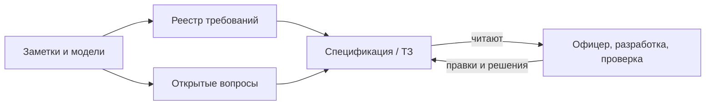

# Лекция 17. Спецификация и документирование требований

## «Где ТЗ?»

После прошлого урока у вас уже не пустые руки. Есть сформулированные кандидаты, короткая модель пути обращения, открытые вопросы и реестр Compliance. Разработчик всё равно пишет в чат: «Где ТЗ? Мне нужна одна точка, откуда брать, что делаем в первой версии».

Вы открываете папку и видите несколько файлов. Заметки с интервью. Реестр строк. Схему одного пути. Список вопросов про статусы. Каждый кусок сам по себе честный. Вместе они ещё не отвечают на вопрос разработчика. Ему нужно не «всё, что вы когда-либо слышали», а связный текст, по которому можно решить: что входит в работу сейчас, что сознательно отложено, и куда смотреть за деталями.

Вот здесь начинается документирование. Не как ритуал «написать красивый документ», а как сборка договорённости, которую читают чужие люди без вашего голоса в наушниках.

## Зачем спецификация, если уже есть реестр

Реестр держит формулировки рядом со статусом и критерием проверки. Это удобно для учёта. Плохо — как единственный вход для человека, который впервые заходит в Compliance.

Разработчик спрашивает не «какая строка REQ-CMP-001», а «что это за система и где её край». Руководитель комплаенс спрашивает, не раздули ли первую версию. Тестировщик спрашивает, что уже можно проверять, а что ещё висит вопросом. Разным читателям нужен разный срез одной и той же правды. Спецификация требований как раз и есть связный документ для этих читателей: назначение, граница, ссылки на подтверждённое и явное место для неизвестного.

Важно не перепутать роли артефактов. Спецификация не заменяет реестр и не копирует его целиком. Она говорит: вот зачем система, вот кто ею пользуется, вот что входит в первую область, а подробные формулировки смотрите в реестре. Реестр отвечает на вопрос «какие требования и в каком статусе». Спецификация отвечает на вопрос «как это складывается в одну картину, по которой можно работать».

В логике нашего курса спецификация — не цитата из стандарта и не «полный IEEE SRS». Это учебное определение: связный текст для бизнеса, разработки и проверки, собранный из подтверждённых формулировок и ссылок на модели; то, что ещё не подтверждено, остаётся вопросом, а не дописанным абзацем «все и так понимают».

Аналогия помогает удержать масштаб. Реестр похож на опись комнат в квартире: кухня, спальня, балкон. Спецификация — короткая инструкция для бригады: что ремонтируем в этом заезде, куда не заходим, где ключи от щитка. Опись не заменяет инструкцию. Инструкция не должна переписывать каждую розетку заново. Граница аналогии: квартира не меняет хозяина каждую неделю, а требования меняются — поэтому следующий урок отдельно разберёт, как сопровождать изменения. Сегодня мы собираем честный каркас, а не процесс версий.

## Для кого документ и какое решение он даёт

Аудитория документа — не абстрактный «бизнес», а конкретные роли с разными решениями. Перед тем как писать раздел, полезно спросить себя: какое решение читатель должен принять без повторного интервью с вами.

Комплаенс-офицер смотрит документ и решает: «это похоже на нашу работу или аналитик додумал статусы». Руководитель проекта решает: «первая версия умещается в срок или граница расползлась». Разработчик решает: «могу ли я начинать очередь обращений или кусок заблокирован открытым вопросом». Проверка решает: «есть ли критерий, по которому понять, что сделано».

Если документ этого не даёт, он ещё заметка автора, даже если оформлен заголовками. Красивая вёрстка не равна согласованию. Молчание после рассылки тоже не равно согласованию. К этому вернёмся отдельно — на Compliance это ломается чаще, чем кажется.

## Каркас Compliance: что уже можно собрать честно

В проекте Compliance ранний скелет технического задания уже есть. Статус документа прямо написан: это не финальное ТЗ. И это нормально. На этом шаге курса вы не «закрываете спецификацию». Вы собираете каркас, в котором видно, что известно, а что нет.

Назначение системы можно взять из уже зафиксированных фактов проекта. Внутренняя Compliance-система автоматизирует подачу обращений сотрудниками, обработку обращений комплаенс-офицерами, регистрацию подарков, декларации и отчётность для руководителя комплаенс. Это не гипотеза из чата — это то, ради чего проект заведён.

Пользователи тоже уже названы: сотрудник, комплаенс-офицер, руководитель комплаенс. Ссылка на стейкхолдеров остаётся рядом, а не копируется внутрь ТЗ списком на три страницы.

Область первой версии — портал сотрудника, рабочее место офицера, дашборды руководителя, вход через корпоративную SSO, ролевой доступ к обращениям, декларациям, подаркам и отчётности. Здесь важно слово «первая». Документ не обещает, что завтра в той же главе появятся все процессы, все экраны и весь аудит «как в большой компании».

Раздел требований в каркасе — это ссылка на реестр, а не вставка всех строк. На текущем этапе курса записи в реестре в основном со статусом `candidate`: они ещё требуют подтверждения через интервью, воркшопы, документы и прототипы. Спецификация, которая молча переписывает кандидата как готовое решение, врёт читателю красивее, чем пустой раздел.

Открытые вопросы живут отдельным артефактом и коротко перечисляются в ТЗ: статусы обращения для MVP, владелец решения по продлению сроков, обязательные действия для аудита, состав первого дашборда, источники данных о сотрудниках. Эти вопросы нельзя «закрыть стилем» внутри абзаца про очередь.

Будущие разделы — процессы, сценарии, данные, интеграции, API, нефункциональные требования — в каркасе помечены как будущие. Их отсутствие на этом шаге не дыра в вашей квалификации. Это честная граница урока: сегодня мы учимся собирать документ, а не проектировать API.

Ниже — как эти куски связаны. Прямоугольники — артефакты. Стрелки — не «копировать содержимое», а «ссылаться и не смешивать статусы».

Словами: заметки и модели кормят реестр и журнал вопросов. Спецификация собирает картину и ссылается на оба. Читатели правят документ. Они не «утверждают» то, чего в тексте нет, и не закрывают вопрос тем, что письмо ушло.

## Что кладём в документ, а что оставляем открытым

После урока формализации у вас уже есть привычка: подтверждённое можно утверждать, неподтверждённое нельзя дорисовывать. В спецификации эта привычка становится правилом вёрстки смысла. Статус candidate и confirmed нельзя смешивать в одном абзаце так, будто это одна и та же степень договорённости.

Подтверждённое попадает в связный текст или в явную ссылку на артефакт, где оно лежит. Кандидат в реестре остаётся кандидатом: в документе его можно упомянуть как «в работе / требует подтверждения», но нельзя вплести в абзац так, будто офицер уже подписал. Открытый вопрос остаётся вопросом — в отдельном блоке или со ссылкой на `open-questions`, а не растворяется фразой «статусы будут стандартные».

Смешение статусов в одном абзаце — типичная ловушка. Выглядит так: «Система поддерживает полный жизненный цикл обращения, включая автозакрытие при молчании сотрудника; детали уточним позже». Первая часть читается как решение. Вторая делает вид, что решения ещё нет. Разработчик услышит первую. Через две недели вы будете спорить, «кто так понял».

Честный вариант скучнее и полезнее. «Создание обращения сотрудником и запрос уточнения офицером зафиксированы как кандидаты в реестре. Полный перечень статусов MVP и правило молчания сотрудника — открытые вопросы OQ-002 и связанные. Пока вопросы открыты, очередь статусов за согласованную не выдаём.»

Ещё одна ловушка — дописать то, что «все и так понимают». На Compliance это часто срок ответа, состав дашборда или право продлевать SLA. Если в реестре нет критерия, а в вопросах вопрос всё ещё `open`, в спецификации нет места для уверенного «нормативный срок — пять дней». Разработка может спросить именно это. Правильный ответ документа: «кандидат без критерия / вопрос открыт», а не импровизация аналитика ради спокойствия чата.

Документ ссылается на артефакты, а не копирует всё подряд. Копия устаревает в ту же минуту, когда вы поправили одну строку реестра. Ссылка заставляет читателя смотреть актуальное место. Каркас ТЗ как раз так и устроен: назначение и граница — в тексте, требования и вопросы — по ссылке.

## Согласование: занятость, вода и саботаж ревью

Допустим, каркас готов. Вы отправляете комплаенс-офицеру короткий черновик: назначение, граница первой версии, ссылка на реестр, блок вопросов про статусы. Просите не «согласовать ТЗ целиком», а ответить на одно: какие статусы входят в MVP и где черновик врёт про работу офицера.

Через день приходит: «В целом ок, детали потом». Встречу на разбор раздела переносят. Через три дня на письмо с черновиком тишина. Тем временем разработка спрашивает нормативный срок ответа — а в документе только кандидат без критерия.

Красивый документ здесь ни при чём. Согласование документа — это не факт отправки файла. Это факт, что нужный человек посмотрел конкретный кусок и оставил решение: верно, неверно, или «ещё не знаю, оставляем вопрос».

Почему так бывает, если не сводить всё к «офицер вредный».

Занятость выглядит как очередь живых обращений и календарь без щелей. Занятый человек часто отвечает коротко, но по существу, если вопрос один и черновик уже лежит перед ним: «статуса Overdue у нас нет, просрочка считается отдельно». Водяной ответ выглядит иначе: «в целом ок, детали потом» — и ни одной правки по статусам. Саботаж ревью ещё резче: раздел не открывают, встречу срывают, а через две недели говорят «вы сами не так поняли, я же говорил на созвоне». Между этими точками нет содержательной правки. Есть только ваша догадка, которая успела стать задачей.

Давление статусом тоже бывает. Руководитель подразделения может сказать: «не отвлекайте людей бумажками». Тогда документ воспринимается как бюрократия, а не как защита от неправильной очереди. Ваша задача — не спорить про жанр, а показать цену паузы на одном конкретном решении.

### Что делать аналитику

Не присылайте «ТЗ на согласование» как роман. Пришлите черновик на правку: одна страница, один вопрос, уже заполненные варианты, которые можно зачеркнуть. Людям проще ткнуть в ошибку, чем с нуля продиктовать жизненный цикл.

Если пришла вода вроде «в целом ок», не закрывайте раздел про статусы. Ответьте тем же черновиком и уточнением: «Чтобы продолжить очередь, нужно да или нет по этому списку статусов. Если списка нет — оставляем OQ-002 открытым и не отдаём разработку в этот кусок». Фраза «детали потом» в статусе документа означает «раздел не согласован».

Если письмо игнорируют три дня, зафиксируйте блокер без эмоций. Кому: спонсору или руководителю проекта. Что нужно: двадцать минут на одну страницу, не «вовлечь офицера в методологию». Чем грозит пауза: разработку попросят «просто зафиксировать статусы», и команда начнёт угадывать. «Он саботирует» — характеристика человека. «Без ответа по MVP-статусам мы либо стоим, либо строим не ту очередь» — риск срока и смысла.

Молчать после рассылки черновика ≠ согласовали. Тишина — отсутствие решения. В каркасе это можно буквально подписать: «черновик отправлен такому-то, ответа нет, раздел не утверждён». Тогда через неделю никто не скажет: «ну вы же разослали, значит все были в курсе».

Чего в этой ситуации не стоит делать:

- дописать статусы и срок «как у всех заявок», чтобы чат с разработкой успокоился;
- считать «в целом ок» подписью под разделом, который человек не правил;
- эскалировать после первого переноса и в формулировках про характер;
- прятать открытые вопросы в будущие разделы, чтобы документ выглядел цельным.

## Где заканчивается документирование

К концу этого шага у вас должен быть не «утверждённый толстый том», а честный каркас: назначение, пользователи, граница первой версии, ссылка на реестр кандидатов, блок открытых вопросов и пометки, что смотрели, а что нет. Документ уже можно показать команде как точку входа. Его ещё нельзя выдавать за закрытую спецификацию всей системы.

Здесь заканчивается тема документирования и начинается соседняя. Управление требованиями берёт уже зафиксированный документ и учит сопровождать изменения: что делать, когда офицер завтра меняет правило, как не потерять след решения, как не плодить тихо противоречащие копии. Версии, baseline и процесс change request — туда. Сегодня достаточно понимать границу: сначала честно записали, потом отдельно учимся менять записанное.

UML и подробные диаграммы тоже не сегодня. Модели появятся в своём модуле. Спецификация может на них ссылаться, когда они будут. Она не обязана рисовать их вместо текста.

Если разработчик снова спросит «где ТЗ», хороший ответ теперь звучит спокойно: «Вот каркас: назначение и граница первой версии. Требования — в реестре, большинство ещё candidate. Статусы MVP и владелец продления сроков — в открытых вопросах. Пока эти вопросы открыты, соответствующий кусок за согласованный не отдаю».

## Короткий итог

Спецификация — связный документ для читателей, а не причёсанные заметки и не копия реестра. Она нужна, чтобы разные роли могли принять решение без вашего повторного пересказа.

На Compliance рабочий шаг — собрать каркас из известного: назначение, пользователи, область первой версии, ссылки на реестр и вопросы. Подтверждённое, кандидат и открытый вопрос в одном абзаце не смешивают.

«В целом ок», перенос ревью и тишина после письма не закрывают раздел. Черновик на правку, фиксация блокера и спокойная эскалация через спонсора — рабочие ходы. Угадывание ради красивого документа — нет.

## Использованные источники

- [Technical Assignment: Compliance](project/compliance/specification/technical-assignment.md) — ранний скелет ТЗ: назначение, пользователи, область MVP, ссылка на реестр, открытые вопросы, будущие разделы; документ явно не финальный.
- [Requirements Register: Compliance](project/compliance/requirements/requirements-register.md) — отдельный реестр со статусами `candidate` / `confirmed` / `open` / `deferred` и критерием проверки; на этапе курса записи в основном `candidate`.
- [Open Questions: Compliance](project/compliance/requirements/open-questions.md) — журнал открытых вопросов (статусы MVP, продление сроков, аудит, дашборд, источники данных о сотрудниках), которые нельзя закрывать в тексте ТЗ без подтверждения.

Определение спецификации в лекции — учебное определение курса на опоре этих артефактов, не цитата внешнего стандарта. Отдельного авторского текста по теме в доступных источниках run не было; внешний research для темы запрещён.
