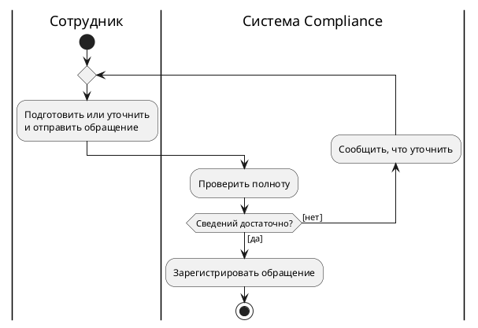
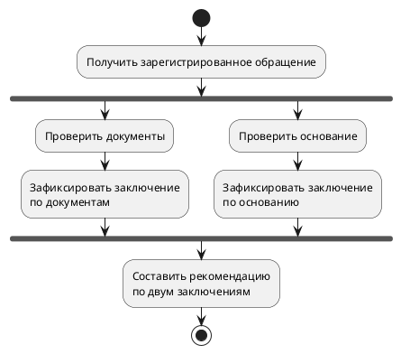
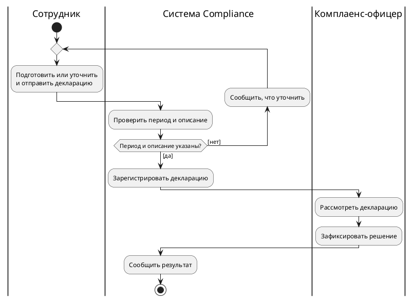

# Ответы и критерии к уроку 20

Важен смысл путей, ожиданий и завершения. Допустимы другие названия действий и расположение элементов, если они выражают те же учебные условия. Дополнительные бизнес-правила нельзя выдавать за согласованные.

## 1. Вопрос и граница модели — ACT20-01

**A — use case, B — activity, C — state, D — sequence.** Activity подходит для вопроса о ходе работы и вариантах продолжения. Use case показывает цели и участников, state — состояния одного предмета и их изменения, sequence — обмен сообщениями во взаимодействии.

Для B допустима граница: «Одна обработка одного обращения: начинается подготовкой и отправкой, заканчивается фиксацией решения и сообщением результата сотруднику». Возможна и более узкая граница «от отправки до регистрации либо возврата», если она явно названа и весь маршрут ей соответствует. Нельзя незаметно начать одной обработкой, а закончить описанием работы всей компании.

BPMN — другой язык. Сходство ромба или круга не разрешает переносить его правила в UML activity. Сначала нужно договориться о вопросе и языке модели.

**Критерии:** четыре верных сопоставления; назван один ограниченный экземпляр работы, начало и результат; нет смешения семантики UML/BPMN.

## 2. Кто выполняет действие — ACT20-02

| Порядок | Действие | Дорожка |
| --- | --- | --- |
| 1 | Подготовить сведения | Сотрудник |
| 2 | Отправить обращение | Сотрудник |
| 3 | Проверить полноту | Система Compliance |
| 4 | Зарегистрировать обращение | Система Compliance |
| 5 | Рассмотреть обращение | Комплаенс-офицер |
| 6 | Зафиксировать решение | Комплаенс-офицер |
| 7 | Сообщить результат | Система Compliance |

Начальный узел находится перед подготовкой, activity final — после сообщения результата выбранной обработки. В этом задании рассматривается только успешный путь.

Дорожки группируют ответственность. Они не создают три потока: последовательность выше задаётся control flows. Из названия дорожки также не следует ни конкретный сервер, ни полная модель доступа. Если на проекте решение действительно принимает человек, нельзя ради удобного рисунка отнести его к автоматическому действию системы.

**Критерии:** все семь действий распределены согласно условиям, порядок сохранён, конец после результата; дорожки не объявлены параллельными потоками или правами доступа.

## 3. Guards без пересечений и дыр — ACT20-03

| Описание | Контакт | Исходные guards | Правильный путь по условию |
| --- | --- | --- | --- |
| Есть | Есть | Оба истинны: пересечение | Регистрация |
| Есть | Нет | Истинен guard к регистрации | Уточнение — исходная модель ведёт неверно |
| Нет | Есть | Истинен guard к уточнению | Уточнение |
| Нет | Нет | Оба ложны: допустимого выхода нет | Уточнение |

Исправленная пара: `[есть описание И есть контакт]` к регистрации и `[нет описания ИЛИ нет контакта]` к уточнению. Второй guard можно заменить одним `[else]`: это остаточный путь, когда не выполнилось условие регистрации.

В разобранных четырёх случаях условия полны и не пересекаются. Из положения ветви сверху не следует правило приоритета. Исходное пересечение нельзя устранить обещанием «выберется верхняя»: это новое правило, которого нет в модели.

**Критерии:** разобраны четыре случая; найдены пересечение и дыра, а также неправильный маршрут «описание есть, контакта нет»; условия отражают именно оба обязательных поля; `else` объяснён без придуманного порядка проверки.

## 4. Первый вход и возврат — ACT20-04

Перед общим действием нужен **merge**. Первый вход от начального узла и обратный вход от сообщения об уточнении — альтернативы: для очередного выполнения общей работы достаточно пришедшего пути. Два control flows прямо в действие могут потребовать обоих входов. Тогда первый запуск оказался бы в ожидании возврата, который ещё невозможно получить. Decision после проверки остаётся решением о продолжении, а не превращается в merge.

Правильный рисунок можно записать так:

Это ограниченный фрагмент **приёма**, заканчивающийся регистрацией; последующее рассмотрение сюда не включено. Верхнее объединение принимает первый или обратный путь. Нижнее решение выбирает продолжение. Оценивать нужно эти маршруты, а не воспроизведение команды `repeat`.

| Случай | Ручной маршрут | Проверки | Сообщения об уточнении |
| --- | --- | --- | --- |
| Сразу достаточно | Начало → merge → подготовка и отправка → проверка → `[да]` → регистрация | 1 | 0 |
| Одно уточнение | Начало → merge → отправка → проверка → `[нет]` → сообщение → merge → уточнение и повторная отправка → **новая** проверка → `[да]` → регистрация | 2 | 1 |

В полном процессе после регистрации выполняются рассмотрение, решение и сообщение результата. Не требуется проходить уточнение на успешном первом пути. Нельзя и зарегистрировать обращение после первого отрицательного результата, не повторив проверку.

Наличие пути `[да]` не гарантирует завершения каждого случая. Возможны новые недостаточные сведения или отсутствие ответа. Лимит попыток, отмена и срок ожидания требуют решения владельца процесса. Не следует добавлять «три раза» лишь ради внешне завершённого рисунка.

**Критерии:** merge перед общей работой; decision после проверки; верные количества и новая проверка после возврата; отсутствие самовольного лимита; различение возможного выхода и гарантированного завершения.

## 5. Что именно ждёт join — ACT20-05

В **A** после decision запущен только путь документов. Его поток достигает AND-join, но поток основания не был запущен и прийти не может. Обычный join ждёт оба входа, поэтому рекомендация не начинается. Если для результата достаточно выбранной проверки, нужен **merge** альтернатив перед общим продолжением: он не ждёт невыбранный путь.

В **B** по условию нужны обе независимые проверки. Сверху нужен **fork**, а перед рекомендацией — **AND-join**. Возможная модель:

В минуту 2 один результат уже пришёл, но второго нет. Продолжение разрешено, когда в минуту 7 готово и доставлено второе заключение. Сама рекомендация может начаться позже по организационным причинам; модель не обещает начать её мгновенно в минуту 7.

Если заключение по документам отрицательное, а рекомендация должна учесть его вместе с другим, этот результат тоже должен дойти до join. Нельзя просто уничтожить поток до синхронизации: тогда недостающий вход останется недостижим. Другое бизнес-правило — «отрицательное заключение прекращает весь процесс» — потребовало бы явно показать такое завершение и проверить судьбу другой активной ветви. Оно не задано в B.

Fork разрешает независимое продвижение. Он не обещает старта двух людей в одну секунду; исполнитель может выполнить независимые работы последовательно, если обязанности и доступность ресурсов это допускают.

**Критерии:** в A назван конкретный несуществующий вход; merge выбран именно для альтернатив. В B обе ветви реально запускаются, join ждёт обе; объяснены минуты 2 и 7, отрицательный результат не уничтожен, физическая одновременность не обещана.

## 6. Кто заканчивает работу — ACT20-06

Для потока ненужного напоминания нужен **flow final** — круг с крестом. Заканчивается только пришедший к нему поток, а рассмотрение офицером продолжается. Если поставить там **activity final** — мишень, — закончится вся выбранная активность, включая незавершённое рассмотрение. В условиях задания это преждевременная остановка.

После фиксации итогового решения, если она по принятому правилу завершает всю выбранную обработку, нужен **activity final**. Это завершение данной активности, а не выключение Compliance или других экземпляров обработки.

В отдельном примере с двумя обязательными проверками flow final перед join уничтожает пришедший поток. Он не передаёт результат в join и не «зачитывает выполнение» отсутствующего входа. Вторая ветвь может дойти до join и ждать бесконечно, поскольку первого входа уже не будет.

К конечным узлам нельзя приписать исходящие продолжения. Если обязательное действие ещё впереди, конечный узел поставлен раньше нужного результата либо неверно выбрана граница модели.

**Критерии:** в каждом случае названа судьба обоих потоков, верно различены flow final и activity final; объяснён недостающий вход join, а не только произнесено слово «зависание».

## 7. Последний текст и уклончивый участник — ACT20-07

Control flow разрешает продолжение работы после предыдущей. Он сам по себе не утверждает передачу конкретных сведений или последней версии текста. Для object flow нужно определить, какие значения выходят из подготовки и поступают в проверку через объектные узлы или входы/выходы действий. «Сведения обращения» — данные; «Создать обращение» — работа, их выполняющая или порождающая.

Три возможных вопроса:

1. «Возьмём последнее обращение, которое вы вернули за уточнением: каких сведений не хватало и где вы получили ответ?»
2. «После повторной отправки какой именно текст проверяли — первоначальный, изменённый или оба? Как вы различали версии?»
3. «Что происходило, когда уточнение не приходило: кто решал ждать, отменять или закрывать обработку?»

Пример записи:

- **Подтверждено:** в рассматриваемом примере работа переходит от подготовки к проверке. Одной стрелкой передача последней версии не подтверждена.
- **Гипотеза:** после уточнения проверяется изменённый набор сведений того же обращения.
- **Открытый вопрос:** кто обеспечивает выбор нужной версии и что должно происходить при отсутствии ответа?
- **Владелец:** владелец процесса обработки обращений; если конкретный человек неизвестен, сначала установить уполномоченного участника.
- **Следующий шаг:** сравнить с ним один успешный и один проблемный случай и согласовать данные входа проверки и ветвь отсутствующего ответа.

Факт переписки в чате описывает текущую работу. Из него не следует обязанность будущей системы использовать чат. Рисунок object flow тоже не даст ответа вместо владельца процесса.

**Критерии:** различены порядок и данные, объект и действие; вопрос о последней версии сформулирован предметно; получены три вопроса и запись с владельцем и следующим шагом; гипотеза не выдана за согласование.

## 8. Учебный проект: обработка декларации — ACT20-08

Граница: одна обработка одной декларации, от подготовки/отправки до сообщения решения. Это activity-вопрос о ходе действий и возврате, а не use-case карта целей.

Один согласованный вариант:

На схеме guard `[да]` означает «период указан И описание указано», `[нет]` — «период отсутствует ИЛИ описание отсутствует». Эти условия не пересекаются и покрывают четыре сочетания из учебной проверки. Первый и повторный входы объединены merge перед работой сотрудника; решение после проверки выбирает выход или обратную ветвь. При новом проходе уточняют ту же декларацию, а не запускают независимый экземпляр другой декларации.

**Маршрут 1:** сотрудник сразу указал оба поля → отправка → проверка `[да]` → регистрация → рассмотрение → решение → сообщение → activity final. Одна проверка, ноль сообщений об уточнении.

**Маршрут 2:** описание отсутствует → отправка → проверка `[нет]` → сообщение о недостатке → merge → сотрудник добавляет описание и повторно отправляет → новая проверка `[да]` → регистрация и обычное завершение. Две проверки, одно сообщение об уточнении. Регистрация не выполняется на первом отрицательном результате.

Control flows задают этот порядок. Они не заменяют договорённость о том, что проверка получила именно изменённые сведения. Можно отдельно описать входные «Сведения декларации» и их версию; нельзя заявлять, что нарисованная стрелка уже гарантирует нужное содержимое.

Два вопроса владельцу процесса:

1. «Что делаем, если сотрудник не отвечает на запрос уточнения: кто решает ждать или отменять обработку, есть ли согласованный срок?»
2. «Достаточно ли самого наличия периода и описания либо проверяется их содержание; кто утверждает критерии и подтверждает входную версию после изменения?»

Учебные условия задают только наличие двух полей и обязанности трёх участников. Нельзя без ответа добавить лимит возвратов, автоматический отказ по сроку или механизм гарантированной передачи версии. Канонические схемы проекта при выполнении задания не редактируются.

**Критерии:** указаны граница и конечный результат; ответственность верна; guards полны и не пересекаются; merge стоит перед общим действием; возврат приводит к новой проверке; оба пути подтверждены подсчётом; вопросы данных не спрятаны за control flow; два открытых вопроса адресованы владельцу.

## Покрытие результатов обучения

| Результат обучения | Задания |
| --- | --- |
| LO1 — назначение и выбор модели | ACT20-01, ACT20-08 |
| LO2 — действия, граница и дорожки ответственности | ACT20-02, ACT20-08 |
| LO3 — decision, guards и merge | ACT20-03, ACT20-04, ACT20-08 |
| LO4 — цикл и ручной проход первого/повторного пути | ACT20-04, ACT20-08 |
| LO5 — fork, AND-join и недостижимый вход после выбора | ACT20-05 |
| LO6 — flow final и activity final при нескольких потоках | ACT20-06 |
| LO7 — control/object flow и уточнение реального процесса | ACT20-07, ACT20-08 |

Self-check: восемь заданий, все семь LO покрыты; у каждого есть объяснение и наблюдаемые критерии. Проектное задание — учебное, канонических изменений нет.
