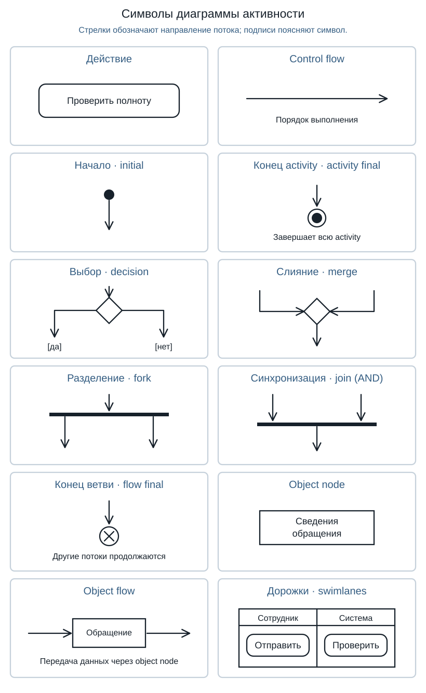
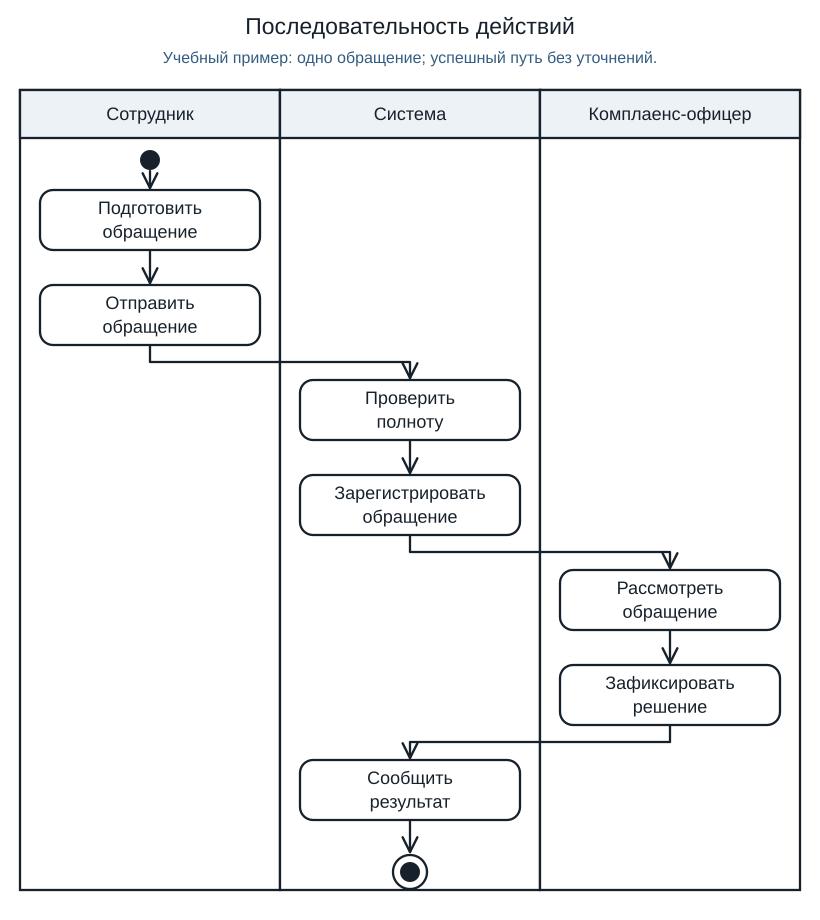
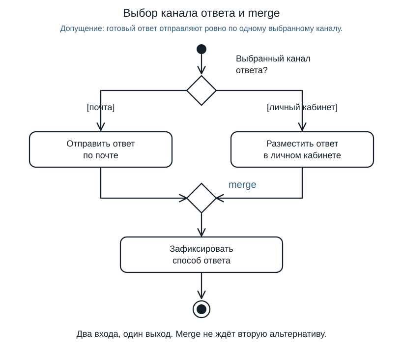
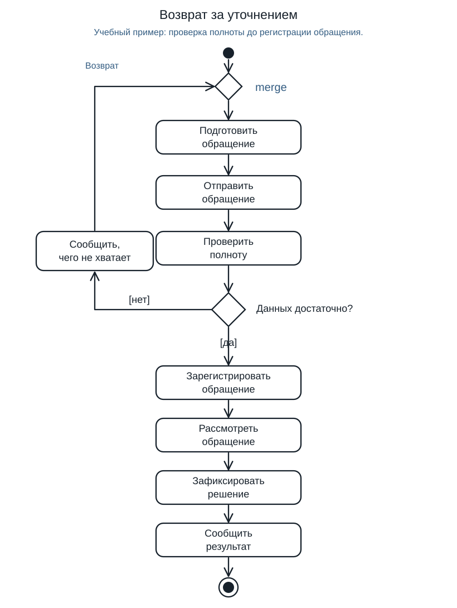
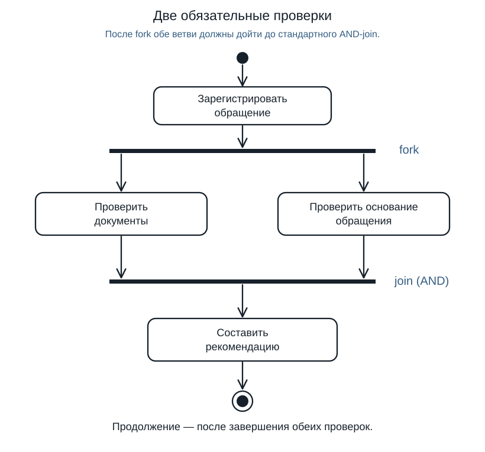
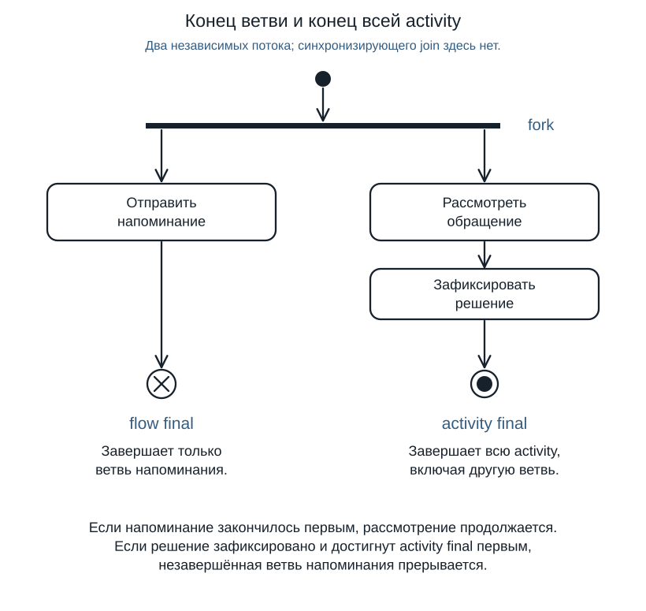
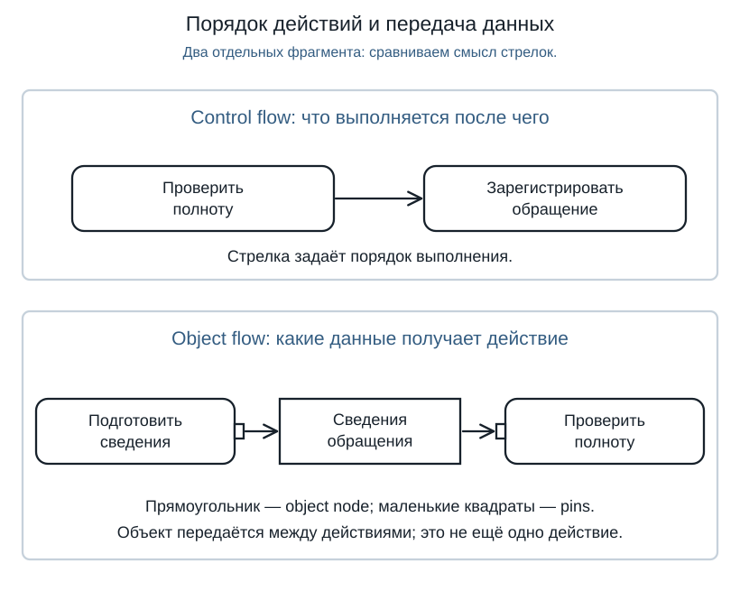

# Лекция 20. UML. Диаграмма активности

Use-case диаграмма из урока 19 отвечает на вопрос «Кто использует систему и зачем?». Диаграмма активности показывает **ход работы**: что выполняется, как выбирается путь, где действия повторяются и каких результатов нужно дождаться.

Разберём обработку одного обращения в Compliance: сотрудник отправляет сведения, система проверяет их, офицер готовит решение, сотрудник получает ответ. Все правила примеров — учебные допущения, а не утверждённые требования проекта.

## Обозначения

Посмотрите на образцы: дальше каждый из них появится в небольшой схеме.

Начальный узел запускает рассматриваемую активность. **Действие** обозначает работу, стрелка **control flow** — порядок её продолжения. **Decision** выбирает путь по условию **guard**; **merge** объединяет альтернативы. **Fork** разделяет работу на независимые ветви, **join** ожидает их результаты. В этом уроке используем стандартный AND-join: нужны все его входы. **Flow final** заканчивает один поток, **activity final** — всю рассматриваемую активность. Эти обозначения определены в главе 15 OMG UML 2.5.1.

У decision и merge одинаковый ромб, но разное число связей в наших примерах. У decision — один вход и несколько выходов. У merge — несколько входов и один выход. Поэтому узнавать элемент только по форме недостаточно: нужно посмотреть на стрелки и его задачу.

## Действия и дорожки

Сначала предположим, что сотрудник сразу сообщил достаточно сведений. Пройдите по стрелкам от начала до конца.

Сотрудник подготавливает сведения и отправляет обращение. Система проверяет полноту и регистрирует его. Офицер рассматривает обращение и фиксирует решение. Система сообщает результат сотруднику — выбранная обработка завершена.

**Дорожки** показывают ответственность: кто выполняет действие. Они не означают отдельные параллельные процессы. В этой схеме порядок задают стрелки: офицер начинает рассмотрение после регистрации. Переход между дорожками также не устанавливает ни способ передачи данных, ни права доступа.

Названия действий начинаются с работы: «Проверить полноту», «Зафиксировать решение». Надпись «На рассмотрении» называла бы состояние обращения, а «Форма ответа» — часть интерфейса. Они не объясняют, что участник должен сделать. Масштаб тоже важен: мы показываем обработку обращения, поэтому не разбиваем отправку на открытие вкладки и нажатия кнопок.

У первой схемы есть ограничение: после проверки она всегда ведёт к регистрации. Если неполные сведения должны останавливать подачу, одного прямоугольника «Проверить» недостаточно. Нужен явно показанный выбор.

## Выбор и слияние

Сначала разберём выбор без цикла. Пусть ответ уже подготовлен, а сотрудник заранее выбрал **ровно один** канал: почту или личный кабинет. После отправки ответа система записывает, каким способом он направлен.

В верхнем ромбе **decision** маршрут расходится. Подписи `[почта]` и `[личный кабинет]` — guards. В нашем примере они не пересекаются: для одного обращения выбран один канал. Они покрывают все принятые варианты. Если выбор может отсутствовать, схема неполна: нужно отдельно определить такой случай.

В нижнем ромбе **merge (слияние)** маршруты сходятся: **два входа, один выход**. Он пропускает пришедшую альтернативу к действию «Зафиксировать способ ответа». Merge не ждёт, когда выполнятся обе отправки: по нашей договорённости одна из них вообще не запускается.

Проверим два случая. Выбрана почта — выполняется отправка по почте, затем общий шаг. Выбран личный кабинет — ответ размещается там, после чего выполняется тот же общий шаг. Нельзя читать схему как «отправить в оба места»: для этого потребовалась бы другая договорённость и другое разветвление.

Не выбирайте guards вроде `[есть контакт]` и `[ответ готов]` для двух альтернатив: оба условия могут оказаться истинными одновременно. Положение ветвей на рисунке не задаёт приоритет «сверху вниз». Если нужен остаточный путь, можно обозначить одну ветвь `[else]`: её выбирают, когда другие условия не выполнились.

Если после альтернатив нужна общая работа, не стоит сводить две стрелки прямо в действие. Несколько входящих control flows у действия могут задать ожидание всех входов. Явный merge показывает нужную здесь логику: продолжить по пришедшему пути.

## Цикл уточнения

Вернёмся к проверке полноты. Теперь примем правило: при нехватке сведений система сообщает, что дополнить; сотрудник уточняет обращение и отправляет повторно. Регистрация начинается только после успешной проверки.

Верхний merge объединяет **первый вход** и **возврат после уточнения**. Действие сотрудника выполняется в обоих случаях: сначала он подготавливает сведения, затем исправляет их. Система каждый раз проверяет отправленные сведения заново. Нижний decision выпускает либо на повтор, либо к регистрации.

Пройдём схему на двух обращениях:

1. **Сведений сразу достаточно.** Сотрудник отправил обращение → система проверила → на вопрос «Данных достаточно?» выбран путь `[да]` → регистрация. Сообщение об уточнении не выполняется.
2. **Потребовалось одно уточнение.** После первой проверки выбран путь `[нет]` → система сообщила, чего не хватает → сотрудник вернулся через merge, уточнил и отправил → новая проверка дала `[да]` → регистрация.

Такой проход проверяет рисунок предметно: не произошло ли регистрации до проверки, не потерялся ли обратный путь и не использован ли старый результат вместо повторной проверки. Возвращается то же обращение; создание нового на каждом повторе мы не предполагаем.

Что будет, если сотрудник не ответит или снова пришлёт неполные сведения? Пока схема позволяет повторять цикл. Она имеет выход, но не гарантирует завершение каждого случая. Нужны решения владельца процесса об отмене, сроке ожидания и возможном отказе. Придумывать «после третьей попытки закрываем» только ради завершённого рисунка нельзя.

## Параллельные действия

В другом фрагменте процесса после регистрации нужны два заключения: по документам и по основанию обращения. Предположим, проверки независимы, а для рекомендации обязательны оба результата.

Верхняя планка **fork** даёт две ветви. Нижняя планка **join** ожидает обе. Если проверка документов закончилась быстро, а проверка основания продолжается, рекомендация пока не составляется. Это предусмотренное ожидание.

Независимость не обещает физически одновременное выполнение. Даже один специалист может выполнить проверки по очереди, если результат одной не нужен для начала другой. Если же проверка основания требует сначала прочитать заключение по документам, fork не подходит: между работами есть зависимость.

### Merge и join нельзя менять местами

Сопоставьте две схемы: в примере с каналом ответа запускается **одна** ветвь и нужен merge. В примере с проверками запускаются **обе** и нужен join.

Если поставить join после выбора канала, процесс зависнет: ответ отправлен по почте, а join ждёт ещё и путь личного кабинета, который decision не выбрал. Продолжение требует результата, который не появится. Исправление — merge, если нам действительно нужен один из каналов.

Если поставить merge после двух обязательных проверок, первая завершившаяся проверка сможет пропустить выполнение дальше без второго заключения. Исправление — join, если рекомендация действительно требует оба результата. Выбор элемента следует из необходимой работы, а не из сходства фигур.

## Завершение процесса

Разницу конечных узлов видно, когда активны несколько ветвей. Допустим, рассмотрение обращения и отправка напоминания идут независимо. Напоминание уже отправлено, но рассмотрение должно продолжиться.

Ветка напоминания заканчивается **flow final** — кругом с крестом. Она завершена, а офицер продолжает рассмотрение. Когда офицер фиксирует итоговое решение, **activity final** — мишень — завершает всю показанную активность. В этом отдельном примере после ветвей нет общей работы, которая ждёт их окончания.

Если заменить конец напоминания на activity final, отправленное напоминание остановит ещё не законченное рассмотрение. Если в примере с обязательными проверками поставить flow final до join, ветвь не принесёт к нему результат: другая будет ждать. Поэтому перед каждым концом спрашивайте: **что ещё выполняется и должно ли оно продолжиться?**

У конечного узла нет исходящей стрелки. Если после него нужно уведомить сотрудника, завершение поставлено слишком рано. При этом «завершить активность» означает закончить выбранную обработку одного обращения, а не выключить всю систему Compliance.

## Поток управления и данные

Сравните две записи одного фрагмента. Первая показывает порядок работ. Во второй отдельно названо, какие сведения передаются на проверку.

**Control flow** отвечает: «После какой работы можно продолжить?» **Object flow** отвечает: «Какие значения получает следующая работа?» На нижней схеме «Сведения обращения» — объект данных, а «Подготовить сведения» — действие. Одно нельзя подменить другим.

В цикле уточнения это различие помогает задать важный вопрос: повторная проверка получает обновлённый текст или прежнюю версию? Обратная стрелка показала повтор работы, но сама не определила правила обновления данных. Если эти правила важны для задачи, их нужно раскрыть. Не всякая стрелка между дорожками автоматически означает передачу документа.

## Проверка схемы

Проверяйте небольшой рисунок вместе с участником процесса на конкретном случае, а не вопросом «Всё верно?». Подойдут два приёма:

- На «у нас всё обычно» попросите последнее обращение, которое потребовало уточнения. «Чего не хватало? Кто запросил сведения? Что позволило продолжить?» Ответ поможет найти пропущенный шаг или условие.
- На «рисуйте сами, потом согласуем» покажите один спорный маршрут и отделите факт от гипотезы: «Уточнение подтверждено. Возврат до регистрации — пока предположение. Кто решает, когда разрешена регистрация?» Зафиксируйте владельца вопроса и следующий шаг согласования.

Затем выполните короткую проверку:

1. Назовите старт и результат **одного** рассматриваемого процесса.
2. Пройдите успешный маршрут и маршрут с уточнением. На каждой развилке проверьте, какой guard выбирается.
3. Найдите merge: он должен объединять альтернативы, а не ожидать невыбранную ветвь.
4. Найдите каждый join и объясните, откуда придёт **каждый** ожидаемый вход. Проверьте случай, когда одна ветвь медленнее другой.
5. Проверьте каждый конец и спросите, что произойдёт с остальными активными ветвями.
6. Отметьте неизвестные правила отмены, отказа и ожидания. Не заполняйте их придуманными ограничениями.

Так можно найти недостижимое продолжение, преждевременное завершение и повтор без согласованного выхода. Это ручная проверка выбранных маршрутов, а не доказательство корректности любой сложной UML-модели.

## Когда нужна другая диаграмма

| Вопрос | Подходящее представление |
| --- | --- |
| Кто использует систему и ради какой цели? | Use-case диаграмма |
| Какие действия выполняются, где выбор, повтор и ожидание? | Диаграмма активности |
| В каких состояниях бывает одно обращение и как они меняются? | Диаграмма состояний |
| Кто кому и в каком порядке посылает сообщения? | Диаграмма последовательности |

BPMN — отдельный язык моделирования процессов. Его можно выбрать по задаче проекта, но похожие фигуры не делают правила BPMN и UML взаимозаменяемыми.

Для самопроверки попробуйте без текста объяснить по рисункам три различия: **decision и merge**, **merge и join**, **flow final и activity final**. Затем проведите обращение через один возврат за уточнением. Если можете показать маршрут и назвать результат каждого шага, базовая модель читается.

## Источники

- [OMG UML 2.5.1 — нормативная спецификация, глава 15 Activities](https://www.omg.org/spec/UML/2.5.1/PDF).
- [PlantUML — официальный синтаксис диаграмм активности](https://plantuml.com/activity-diagram-beta).
