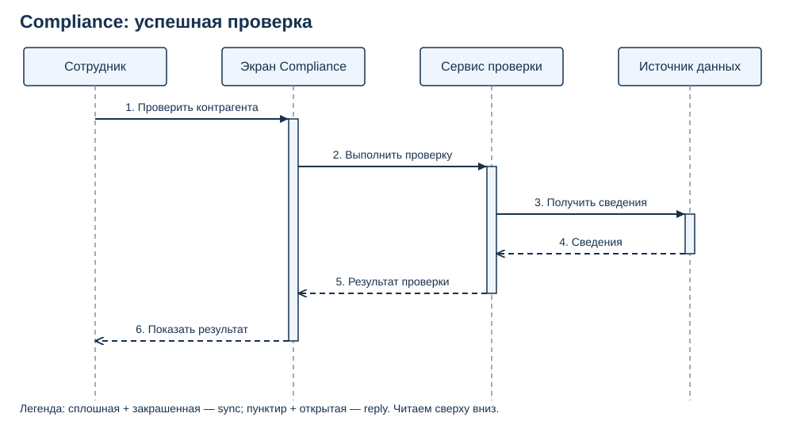
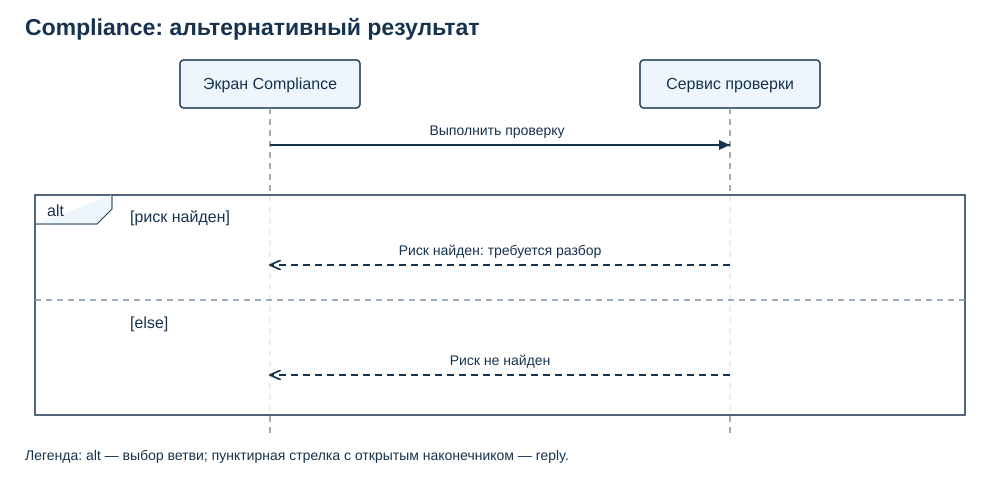
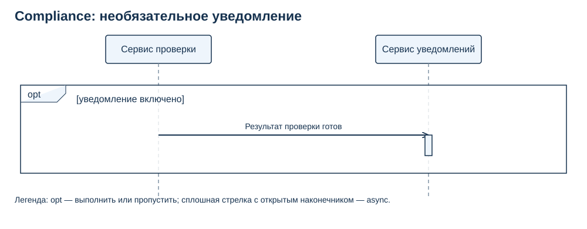
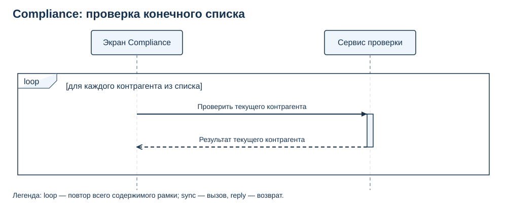

# Ответы и наблюдаемые критерии. Урок 22

Все ситуации Compliance — учебные допущения из лекции, а не подтверждённые требования проекта. Авторские материалы отсутствуют; бизнес-правила риска и уведомлений требуют уточнения. UML-STATE указан как завершённый по сообщению координатора; содержание предыдущего урока не проверялось. Необходимые обозначения разобраны в текущей лекции.

A1–A6 служат самопроверкой. Для A7 сверяйте свой артефакт с каждым критерием: невыполненный критерий означает конкретную доработку.

## A1. Прочитать основной обмен

Сотрудник → Экран Compliance: запуск проверки; экран → Сервис проверки: выполнить проверку; сервис → Источник данных: получить сведения; источник → сервис: сведения; сервис → экран: результат; экран → сотрудник: показ результата. Сервис ждёт сведения от источника. Lifeline — голова с именем и вертикальная пунктирная линия жизни; activation — узкий прямоугольник периода выполнения работы, который может включать вложенный вызов и ожидание результата. Отступы не задают секунды.

Почему: В этом связанном обмене сообщения читаются сверху вниз. Полоса выполнения не является отдельным компонентом или всей жизнью участника.

Наблюдаемые критерии:

- Названы четыре участника и сохранены порядок и направления шести сообщений.
- Ожидание сведений отнесено к сервису проверки.
- Линия жизни и полоса выполнения различены; из отступов не выведено время.

## A2. Различить вызов, возврат и событие

а) Sync: сплошная линия, закрашенный наконечник; экран ждёт завершения вызова сервиса. б) Reply: пунктир, открытый наконечник по соглашению урока; идёт от источника обратно к сервису и завершает его ожидание сведений. в) Async: сплошная линия, открытый наконечник; сервис проверки не ждёт завершения обработки события.

Почему: Тип определяется смыслом зависимости или возврата, затем согласуется с формой. Reply отвечает на конкретный вызов; событие async сообщает о произошедшем. Async не гарантирует доставку или немедленную обработку.

Наблюдаемые критерии:

- Верно классифицированы все три сообщения.
- Указаны линия и наконечник каждого типа.
- Ожидание привязано к вызывающему участнику; для async ожидание завершения обработки отсутствует.

## A3. Исправить условия alt

Оба исходных условия могут быть истинны одновременно; alt не задаёт приоритет между ними и не означает выполнение обеих ветвей подряд. Второе условие заменяем на [else] либо [риск не найден]. При риске выбирается только первая ветвь, без риска — вторая. В общем случае alt выполняет не более одной подходящей ветви; при отсутствии истинных условий и else ветвь может не выполниться.

Почему: Завершение проверки не исключает найденный риск. Для однозначного учебного сценария нужны взаимоисключающие условия.

Наблюдаемые критерии:

- Обнаружено пересечение исходных условий.
- Предложена взаимоисключающая пара и верно названы результаты двух проходов.
- Не утверждается, что alt всегда выполняет все ветви или ровно одну в любом случае.

## A4. Прочитать opt с async

При ложном условии вся рамка пропускается, событие не отправляется; основной результат сам по себе не отменяется. При истинном условии событие отправляется без ожидания завершения его обработки. Обязательный reply как возврат на sync здесь не нужен: показано самостоятельное событие. Например, нужно уточнить, кто получает уведомление и можно ли показывать результат до его доставки.

Почему: Opt выполняет содержимое один раз или пропускает. Async выражает отсутствие ожидания завершения обработки отправителем; само по себе оно не устанавливает бизнес-правила или гарантии доставки.

Наблюдаемые критерии:

- При ложном условии пропущена вся рамка.
- Отсутствуют обязательные ожидание обработки async и reply на событие.
- Хотя бы одно неподтверждённое правило названо вопросом.

## A5. Определить границы loop

Исходная рамка повторяет только ответы на один внешний вызов и не описывает отдельную проверку каждого контрагента. Внутрь нужно включить вызов проверки текущего элемента и возврат его результата. Для двух элементов обмен повторится два раза, для пустого списка — ни разу.

Почему: Повторяется всё содержимое рамки. Для конечного списка каждый элемент должен иметь свой вызов и результат.

Наблюдаемые критерии:

- Выявлена неверная граница loop.
- Внутри исправленной рамки есть вызов и возврат.
- Верно названы два обмена и ноль обменов.

## A6. Исправить направление и ожидание

1) Запрос сведений должен идти sync от сервиса проверки к источнику. 2) Возврат сведений должен идти reply от источника к сервису: пунктир с открытым наконечником. Сплошная открытая стрелка означала бы async. 3) Фразу об обязательном ожидании следует убрать: в данном сценарии сервис проверки не ждёт завершения обработки async. Если бизнесу нужно ожидание, правило и модель предстоит пересмотреть, но такого требования здесь нет.

Почему: Инициатор просит получателя выполнить работу. Возврат связан с предшествующим вызовом, а форма async должна совпадать с объяснением ожидания.

Наблюдаемые критерии:

- Исправлено направление запроса.
- Возврат обозначен reply правильного направления и формы.
- Убрано обязательное ожидание обработки async без выдуманного бизнес-правила.

## A7. Построить учебную модель Compliance

Основной обмен соответствует assets/02-main.svg. После возврата сведений ответ сервиса экрану заменяется рамкой alt: [риск найден] → reply «Требуется разбор»; [else] → reply «Риск не найден». За проход возвращается один ответ, затем экран показывает выбранный результат сотруднику. Форма рамки показана в assets/03-alt.svg. Отдельный opt соответствует assets/04-opt.svg: при истинном условии сервис проверки отправляет async сервису уведомлений; при ложном — не отправляет. Loop соответствует assets/05-loop.svg: повторяет вызов для текущего контрагента и возврат его результата. Экран ждёт сервис, сервис ждёт источник, но не ждёт завершения обработки async. Все указанные SVG являются одновременно видимыми схемами и редактируемыми исходниками. Допустимы другие читаемые схемы с тем же смыслом. Пример вопроса: кто определяет риск и что в реальном проекте означает «Требуется разбор»?

Почему: Компактные схемы позволяют проверить каждый механизм отдельно. Нотация отражает учебный сценарий; правила реального Compliance требуют согласования. Alt выбирает результат, opt управляет необязательным фрагментом, loop — повтором всего внутреннего обмена.

Наблюдаемые критерии:

- Есть видимые схемы и редактируемые исходники; указаны названия и легенды.
- В основном обмене четыре подписанных участника; отдельное уведомление вводит пятого. Lifeline и activation показаны и объяснены.
- Направления вызовов: сотрудник → экран → сервис → источник; reply идут обратно. Показ результата следует после получения выбранного ответа.
- Sync — сплошная линия с закрашенным наконечником; async — сплошная с открытым; reply — пунктир с открытым. Объяснение ожиданий совпадает с формами.
- Alt содержит [риск найден] и [else] либо равносильную взаимоисключающую пару; за проход выбран один соответствующий ответ.
- Ложный opt полностью пропущен; истинный отправляет событие без ожидания завершения обработки.
- Loop охватывает вызов текущего элемента и возврат; для пустого списка — ноль выполнений.
- Проверены проходы: риск есть/нет, уведомление включено/выключено, список пустой/из двух элементов; результаты согласованы с условиями.
- Хотя бы одно реальное бизнес-правило отмечено вопросом; знания API и инфраструктуры не требуются.

## Видимые эталоны A7

SVG можно открыть как изображение и редактировать как исходник. Alt заменяет ответ основного сценария, а не добавляет второй обязательный ответ.

Редактируемые исходники: [основной обмен](assets/02-main.svg), [alt](assets/03-alt.svg), [opt](assets/04-opt.svg), [loop](assets/05-loop.svg).

## Карта покрытия

| Результат | Задания | Что наблюдаем |
|---|---|---|
| LO1 | A1, A5, A7 | Участники, порядок и границы обмена |
| LO2 | A2, A4, A6, A7 | Форма сообщения, возврат и ожидание |
| LO3 | A7 | Собственная схема Compliance с alt и объяснение |
| LO4 | A3, A4, A5, A6, A7 | Исправление условий, направлений и ожиданий; граничные случаи |
