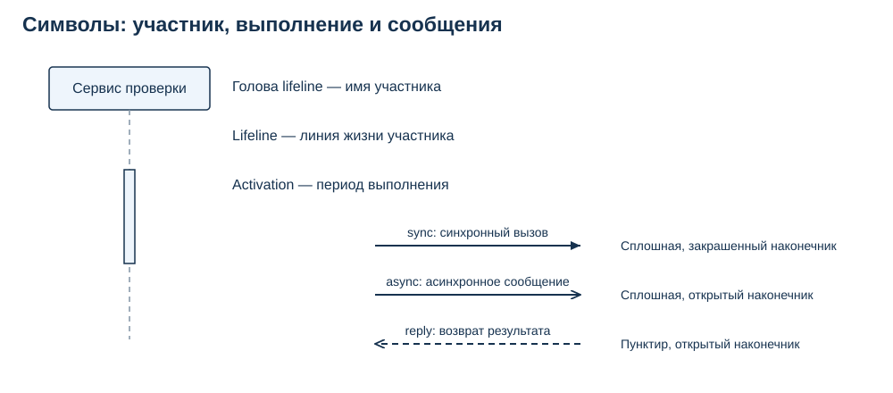
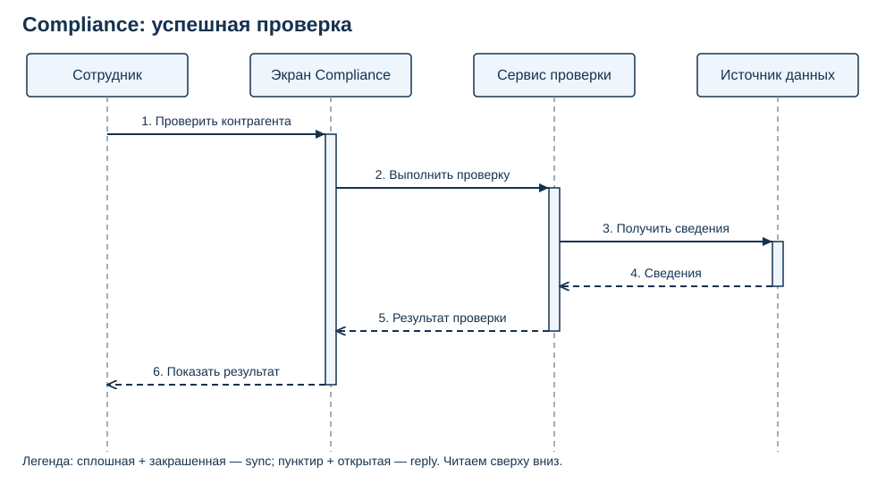
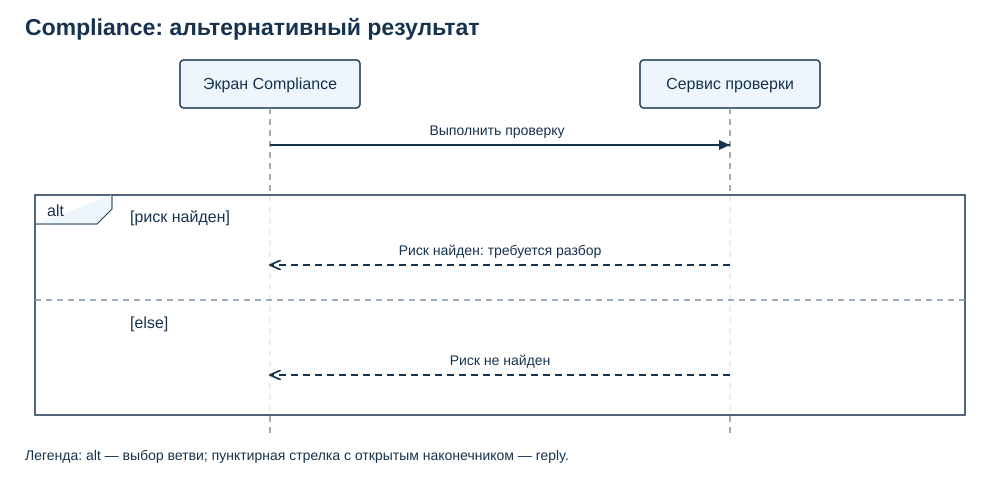
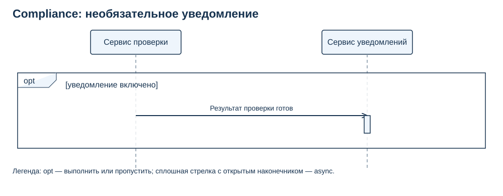
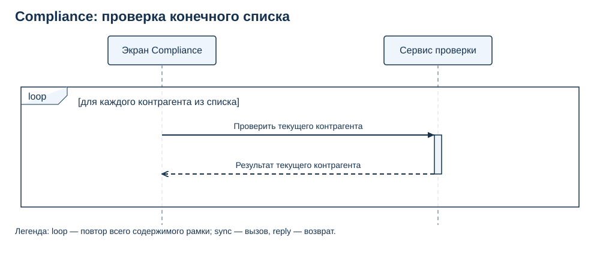

# Лекция 22. UML. Диаграмма последовательностей

## Один сценарий взаимодействия

Сотрудник запускает проверку контрагента в Compliance. Экран принимает запрос, сервис проверки запрашивает сведения и возвращает результат. Чтобы объяснить разработчикам, кто к кому обращается и когда можно показать ответ, аналитик изображает обмен сообщениями в одном сценарии. Такая модель — **диаграмма последовательностей**. Сообщение здесь — обращение от одного участника к другому: например, просьба получить сведения или возврат результата.

В теме UML-STATE мы смотрели на состояния одного объекта и переходы между ними. Здесь меняется вопрос: какие участники обмениваются сообщениями, в каком порядке и кто ждёт завершения работы? Знание предыдущей темы помогает, но необходимые обозначения разберём прямо в этом уроке. Статус UML-STATE передан как завершённый; содержание предыдущей лекции при подготовке не проверялось.

Весь сценарий проверки контрагента ниже — **учебное допущение**, а не подтверждённое требование Compliance. Авторские материалы недоступны, бизнес-правила проверки, риска и уведомлений не предоставлены. Поэтому схема помогает освоить нотацию, а реальные правила ещё предстоит уточнить.

## Участники и сообщения

**Участник** — тот, кто отправляет или получает сообщения в выбранном сценарии. Им может быть сотрудник, экран системы или сервис — часть системы, выполняющая определённую работу. Его **lifeline**, или линия жизни, состоит из головы с именем и вертикальной пунктирной линии. Узкий прямоугольник на ней — **activation**, полоса выполнения: она показывает период выполнения работы этим участником. Посмотрите на настоящие символы перед разбором сценария.

На рисунке слева показаны голова, линия жизни и полоса выполнения сервиса проверки. Справа — три вида сообщения. Легенда подписана рядом с каждой стрелкой: обращайте внимание и на линию, и на наконечник.

**sync** — синхронный вызов: сплошная линия с закрашенным наконечником. Вызывающий участник ждёт, пока вызванная работа завершится, прежде чем продолжить зависимые от неё действия. Например, экрану нужен результат проверки, чтобы показать его сотруднику.

**async** — асинхронное сообщение: сплошная линия с открытым наконечником. Отправитель не ждёт завершения обработки этого сообщения. Сервис проверки может передать событие «Результат проверки готов» сервису уведомлений и продолжить свою работу. Это само по себе не гарантирует доставку и не означает, что обработка обязательно начнётся немедленно или пойдёт параллельно.

**reply** — возврат из синхронного вызова, часто с результатом. Его рисуют пунктиром в обратном направлении. В этом уроке у reply всегда открытый наконечник; UML допускает также закрашенный. Возврат «Сведения» отвечает на вызов «Получить сведения», а событие «Результат проверки готов» сообщает о произошедшем и не является таким возвратом.

Activation не обозначает отдельный сервис, ожидание доставки или всю жизнь участника. Полоса может охватывать выполнение операции с вложенным вызовом: участник ещё не завершил свою операцию, хотя ждёт результат от другого участника. Начинающему полезно явно рисовать возвраты, даже если на более компактной рабочей схеме часть из них впоследствии опустят.

## Успешная проверка

В нашем примере сотрудник запускает проверку. Экран Compliance принимает ввод и показывает результат. Сервис проверки организует работу, источник данных возвращает сведения. Пятый участник, сервис уведомлений, появится отдельно: сейчас он не нужен для понимания основного обмена.

У схемы есть название и легенда: сплошная стрелка с закрашенным наконечником — sync, пунктир с открытым — reply; прямоугольники на линиях жизни — activation. Читайте события **сверху вниз**. Сотрудник посылает запрос экрану (1), экран вызывает сервис проверки (2), а тот обращается к источнику данных (3). Источник возвращает сведения (4), сервис формирует результат (5), экран показывает его сотруднику (6). Последняя стрелка моделирует показ результата как возврат на исходное обращение сотрудника; это выбранный уровень описания интерфейса.

После вызова 2 экран ещё не может показать результат: он ждёт завершения проверки. После вызова 3 сервис проверки, в свою очередь, ждёт сведения. На его полосе выполнения виден вложенный обмен с источником. Результат всей схемы — сотрудник получил результат проверки; способ получения сведений и детали программной реализации здесь не нужны.

Вертикальный промежуток между стрелками **не измеряет длительность**. Большой отступ не означает долгую проверку. Порядок событий на одной линии жизни и связи отправки с получением помогают читать взаимодействие; расположение всех стрелок на странице не задаёт полный порядок независимых событий на разных линиях жизни. В нашей схеме сообщения связаны вызовами и возвратами, поэтому их удобно последовательно читать по номерам. Из неё нельзя вычислить секунды ожидания.

## Альтернативный результат

Успешно выполненная проверка может вернуть разные бизнес-результаты. Чтобы не рисовать две почти одинаковые диаграммы, добавим **alt** — рамку альтернатив. Метка alt стоит в левом верхнем углу; пунктирная горизонтальная черта разделяет ветви, а условия записаны в квадратных скобках. Этот образец показывает только экран и сервис после получения сведений: остальной обмен уже разобран выше.

Легенда: alt выбирает ветвь, пунктирные стрелки с открытым наконечником возвращают результат. Если условие `[риск найден]` истинно, сервис возвращает «Риск найден: требуется разбор». Ветка `[else]` означает «иначе»: она выбирается, если условие другой ветви не выполнено, и возвращает «Риск не найден». Результат фрагмента — **один** из двух ответов, а не два последовательных ответа экрану.

В общем случае alt допускает выбор не более одной подходящей ветви. Если подходят несколько, сама схема не устанавливает приоритет; если не подходит ни одна и нет else, ветвь может не выполниться. Поэтому в учебном сценарии используем понятную взаимоисключающую пару «риск найден / иначе». Кто определяет риск и что означает «требуется разбор» в реальном Compliance — открытые вопросы, а не выводы из нотации.

## Необязательное уведомление

Если действие может выполниться один раз или полностью отсутствовать, подходит **opt** — необязательный фрагмент. На образце одна рамка, одно условие и одна ветвь. Представим, что проверка уже завершена и её результат можно передать сервису уведомлений.

Легенда: opt — выполнить или пропустить; сплошная стрелка с открытым наконечником — async. При истинном условии `[уведомление включено]` сервис проверки отправляет событие «Результат проверки готов». Если условие ложно, **вся рамка пропускается**, сообщение не отправляется. Результат фрагмента — событие передано либо ничего не произошло.

Отправитель не ждёт завершения отправки уведомления сотруднику. На этой схеме нет reply от сервиса уведомлений: мы показываем передачу события, а не синхронный запрос результата. Прямоугольник у получателя обозначает его работу после получения события; длина полосы не обещает конкретного времени. Нужно ли уведомление, кто его получает и можно ли показывать результат до его доставки — вопросы для согласования бизнес-правил.

## Повтор проверки

Для конечного списка контрагентов используем **loop** — повтор фрагмента. В рамку помещают весь обмен, который требуется повторять, а не только одно направление сообщения.

Легенда: loop повторяет содержимое рамки; закрашенная сплошная стрелка — sync, пунктирная с открытым наконечником — reply. Условие `[для каждого контрагента из списка]` означает: взять очередного контрагента, вызвать проверку, получить его результат и перейти к следующему. Для списка из трёх контрагентов обмен внутри рамки выполнится три раза, для пустого списка — ни разу. Результат — результаты проверок всех элементов выбранного конечного списка. Детали каждого вызова уже объяснены на основной схеме.

Не складывайте alt, opt, loop и все пять участников в одну диаграмму только ради полноты. Аналитику полезнее несколько маленьких схем с явно указанным контекстом: основной обмен, варианты результата, уведомление и повтор.

## Практика

Постройте учебную диаграмму Compliance по сценарию: сотрудник запускает проверку; экран вызывает сервис проверки; сервис получает сведения от источника и возвращает результат. При найденном риске экран получает «Требуется разбор», иначе — «Риск не найден». Если уведомления включены, сервис проверки передаёт сервису уведомлений событие о готовом результате без ожидания завершения его обработки. Для конечного списка контрагентов проверка повторяется для каждого элемента.

Сначала нарисуйте основной сценарий с четырьмя подписанными участниками, sync, reply и полосами выполнения. Добавьте alt с понятными условиями. Затем отдельно покажите opt с пятым участником и async, а также loop для списка. Вы вправе использовать любой редактор, который позволяет различить формы стрелок.

Сдайте три результата:

1. Видимую диаграмму или набор небольших диаграмм с названием и легендой.
2. Редактируемый исходник; SVG тоже подходит, если его можно изменить.
3. Короткое объяснение: кто ждёт завершения какого вызова, как выбирается ветвь, когда отправляется событие и что повторяется.

Проверьте направления и порядок сообщений, различимость трёх форм стрелок, подписи lifeline и смысл activation. Условия должны быть в квадратных скобках и не противоречить друг другу. Схема должна читаться без знания программных интерфейсов и инфраструктуры. Учебные SVG этого урока — одновременно изображения и редактируемые исходники; файл `assets/preview.html` позволяет посмотреть их рядом.

## Ошибки при чтении

Если обе стрелки внутри alt читаются как обязательные последовательные ответы, потерян смысл выбора ветви. Вернитесь к условиям и проговорите один конкретный проход: риск найден либо не найден.

Если «Получить сведения» нарисовано от источника к сервису, инициатор обращения перепутан. Назовите отправителя обычными словами: сервис просит источник, источник возвращает сведения. Название сообщения должно поддерживать направление стрелки.

Если отправитель async описан как ожидающий завершения обработки, форма стрелки и объяснение расходятся. Либо ожидание действительно нужно и следует пересмотреть выбор сообщения, либо последующие действия не должны зависеть от завершения этой обработки. А если результат источника нарисован сплошной открытой стрелкой, он выглядит как самостоятельное асинхронное сообщение вместо reply на конкретный вызов.

Если полоса activation подписана как отдельный компонент или вертикальные отступы переведены в секунды, схема получила смысл, которого в этих обозначениях нет. Имена компонентов стоят в головах линий жизни; длительность требует отдельного указания.

## Самопроверка

**1. Кто ждёт при sync «Выполнить проверку» от экрана к сервису?** Экран ждёт завершения вызова сервиса. В нашем сценарии он не может показать итог до получения результата.

**2. Чем reply «Результат проверки» отличается от события «Результат проверки готов»?** Reply возвращает из ранее сделанного синхронного вызова экрану. Событие передаёт информацию сервису уведомлений без ожидания завершения обработки; это async, а не возврат по тому вызову.

**3. Что выполнится в opt, если уведомления выключены?** Ничего внутри рамки. Основной результат проверки от этого сам по себе не отменяется.

**4. Сколько ветвей alt выполняется при найденном риске в нашем примере?** Одна: `[риск найден]`. Ветка `[else]` не выполняется. Общее правило alt — не более одной выбранной ветви, поэтому условия нужно формулировать внимательно.

**5. Что повторяет loop для списка из двух контрагентов?** Два раза выполняется весь внутренний обмен: вызов проверки текущего контрагента и возврат его результата. Это не два повторных ответа на один вызов.

## Источники

[OMG UML 2.5.1 — спецификация](https://www.omg.org/spec/UML/2.5.1)

[OMG UML 2.5.1, глава 17: взаимодействия, линии жизни, выполнение, сообщения и фрагменты](https://www.omg.org/spec/UML/2.5.1/PDF)
