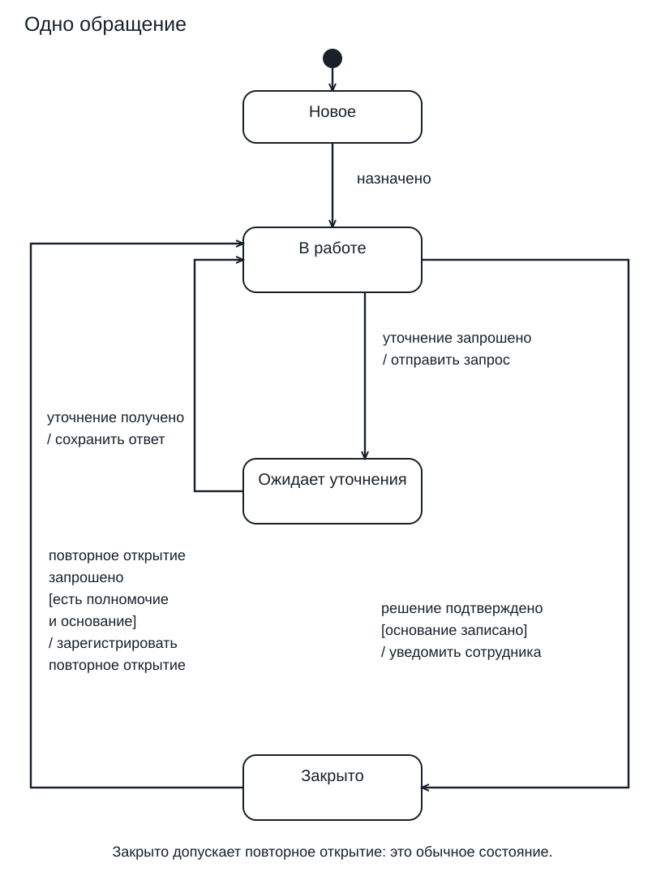

# Ответы и критерии

## 1. Объект и граница

Объект — одно обращение Compliance. Начало — обращение уже создано и находится в «Новое». Средний узел — «В работе»; рассмотрение — действие внутри этого периода. Последовательность действий удобнее показать activity diagram.

Почему: Состояние сохраняется между событиями; работа с документами может идти без смены состояния обращения.

Критерии:

- Названы одно обращение и начало после создания.
- Действие заменено состоянием «В работе».
- Ход действий отнесён к activity diagram с объяснением различия.

## 2. Два пути одного обращения

А: В работе → Закрыто. Б: В работе → Ожидает уточнения → В работе → Закрыто. Эффекты Б: отправить запрос; сохранить ответ; уведомить сотрудника.

Почему: Получение уточнения возвращает обращение в работу. Для закрытия требуется отдельное подтверждение решения с истинным guard.

Критерии:

- Обе трассы содержат состояние после каждого события.
- После уточнения указано «В работе», без автоматического закрытия.
- Три эффекта связаны со своими событиями.

## 3. Событие не заменяется условием

Trigger — «решение подтверждено»; guard — «основание записано»; effect — «уведомить сотрудника». В а, б, в — «В работе», эффект этой стрелки не выполняется. В г — «Закрыто», уведомление выполняется.

Почему: Guard проверяют при обработке события. Модель не задаёт опрос условия или автоматический повтор ранее отклонённого перехода.

Критерии:

- Верно выделены три части подписи.
- Для а–в нет перехода и эффекта.
- В г указаны переход в «Закрыто» и уведомление.

## 4. Закрыто и final

Заменять нельзя: из «Закрыто» разрешено продолжение. В 1 — «В работе», зарегистрировать повторное открытие; в 2 и 3 — «Закрыто», эффект открытия не выполняется. Отдельный допустимый эскиз: «Закрыто» — архивирование подтверждено → final. Допущение эскиза: после подтверждённого архивирования рассматриваемый жизненный цикл завершён, повторное открытие в нём запрещено. Это дополнительный учебный вариант, не изменение основной модели.

Почему: Final — чёрный центр во внешнем кольце без исходящих переходов; он завершает поведение, но сам по себе не означает удаление записи.

Критерии:

- Отказ от замены обоснован разрешённым продолжением.
- Проверены оба обязательных условия и все три результата.
- На отдельном эскизе видны final, входящий переход, событие и явная конечная граница; исходящей стрелки нет.

## 5. Порядок действий

Запрос: остановить отсчёт → отправить запрос → включить напоминание. Ответ: выключить напоминание → сохранить ответ → начать отсчёт.

Почему: Для этих простых состояний внешний переход выполняет exit исходного, effect стрелки, entry целевого.

Критерии:

- Обе последовательности содержат три действия в правильном порядке.
- Entry и exit не перепутаны с эффектами стрелок.

## 6. Два комментария и повторное подтверждение

Внешняя петля: entry 3, exit 2, сохранений 2. Внутренняя обработка: entry 1, exit 0, сохранений 2. Подсчёт заканчивается до закрытия. При повторном подтверждении в «Закрыто» состояние остаётся «Закрыто»; эффект отсутствующей стрелки не выполняется. Код/текст API-ответа и идемпотентность уведомлений реализацией из этого не следуют.

Почему: Внешняя петля пересекает границы выхода и входа; внутренняя обработка их не пересекает. Отсутствие перехода не задаёт автоматически ошибку API или гарантию от дублей.

Критерии:

- Верны все шесть чисел до закрытия.
- Для повторного подтверждения названо неизменное состояние.
- API-ответ и идемпотентность обозначены как отдельные требования.

## 7. Найти и исправить дефекты

«Ожидает уточнения» недостижимо от initial. Добавить «В работе» — уточнение запрошено / отправить запрос → «Ожидает уточнения». Нельзя оставлять только [нужно уточнение]: условие не заменяет событие. Когда полномочие и основание есть, оба ошибочных guard истинны. Основное исправление — один переход в работу: повторное открытие запрошено [есть полномочие и основание] / зарегистрировать повторное открытие. Для двух исходов: [есть полномочие и основание] и [нет полномочия или нет основания]; при втором исходе нужно отдельно определить способ обработки без открытия и его эффекты. Такая обработка — учебный вариант, отсутствующий в основной схеме.

Почему: Обратная стрелка не обеспечивает достижимость. Для заданных двух булевых признаков предложенные guards взаимоисключающие и покрывают все комбинации.

Критерии:

- Назван недостижимый узел и добавлен входящий переход с событием и эффектом.
- Конфликт продемонстрирован случаем двух истинных признаков.
- Основное исправление использует логическое «и»; альтернативные guards не пересекаются.

## 8. Compliance: схема и проверяемый сценарий

Один эскиз с initial → Новое без trigger/guard; Новое — назначено → В работе; В работе — уточнение запрошено / отправить запрос → Ожидает уточнения; обратно — уточнение получено / сохранить ответ; В работе — решение подтверждено [основание записано] / уведомить сотрудника → Закрыто; Закрыто — повторное открытие запрошено [есть полномочие и основание] / зарегистрировать повторное открытие → В работе. Final вместо «Закрыто» нет. Сценарий: дано Новое; назначено → В работе; уточнение запрошено → Ожидает уточнения + запрос отправлен; уточнение получено → В работе + ответ сохранён; основание записано, решение подтверждено → Закрыто + сотрудник уведомлён. Отдельно: в работе, основания нет, подтверждение → В работе, без уведомления этой стрелки; закрыто, полномочия нет, запрос открытия → Закрыто, без регистрации открытия. Вопрос владельцу процесса Compliance: кто вправе открыть обращение, обязательно ли основание и действительно ли допустимо открытие без полномочия? До ответа правило остаётся учебным допущением.

Почему: Сценарий проверяет промежуточные состояния и эффекты, а отрицательные случаи — guards. Заявление «всегда» конфликтует с текущим допущением и требует решения владельца процесса.

Критерии:

- На эскизе видны initial, четыре именованных состояния и шесть переходов; подписи согласованы с лекцией.
- Путь с уточнением содержит четыре события с ожидаемыми состояниями и тремя эффектами.
- Две отрицательные проверки явно запрещают соответствующий переход и эффект.
- Вопрос адресован владельцу процесса, допущения помечены, canonical не изменён.

Исправленная основная схема:

## Карта покрытия

| LO | Задания |
|---|---|
| UML-STATE-LO1 | STATE-01, STATE-08 |
| UML-STATE-LO2 | STATE-02, STATE-04, STATE-08 |
| UML-STATE-LO3 | STATE-02, STATE-03, STATE-07, STATE-08 |
| UML-STATE-LO4 | STATE-04, STATE-08 |
| UML-STATE-LO5 | STATE-05 |
| UML-STATE-LO6 | STATE-06 |
| UML-STATE-LO7 | STATE-07, STATE-08 |
