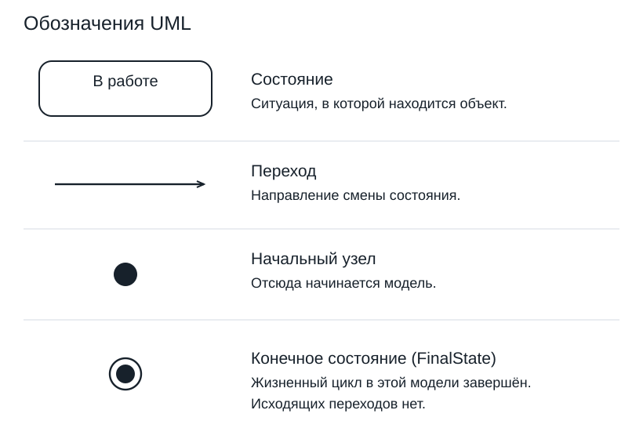

# Практика 21. UML. Диаграмма состояний

Все правила Compliance здесь — учебные допущения. Работайте с одним обращением. Можно рисовать от руки или в любом редакторе; команды PlantUML не требуются.

## 1. Объект и граница

В схеме обращения есть узлы «Новое → Рассмотреть обращение → Закрыто». Исправьте средний узел. Назовите объект, границу начала модели и объясните, куда лучше поместить последовательность «прочитать документы → подготовить ответ».

## 2. Два пути одного обращения

По схеме лекции выпишите состояние после каждого события в двух трассах: А) назначено → решение подтверждено; Б) назначено → уточнение запрошено → уточнение получено → решение подтверждено. Перед каждым подтверждением основание записано. Начало — «Новое». Для Б укажите эффекты запроса, получения и подтверждения.

## 3. Событие не заменяется условием

Разберите «решение подтверждено [основание записано] / уведомить сотрудника». Обращение в работе. Что произойдёт: а) основание есть, события нет; б) событие пришло без основания; в) после б основание записали, нового подтверждения нет; г) пришло новое подтверждение с основанием? Укажите состояние и выполнение эффекта.

## 4. Закрыто и final

Можно ли заменить «Закрыто» знаком final, сохранив повторное открытие? Для события «повторное открытие запрошено» заполните результаты: 1) полномочие и основание есть; 2) основание есть, полномочия нет; 3) полномочие есть, основания нет. Укажите состояние и эффект. Затем нарисуйте отдельно минимальный фрагмент окончательного завершения: состояние → final; подпишите учебное событие и явно задайте границу, после которой открытия нет.

## 5. Порядок действий

В «В работе»: entry / начать отсчёт, exit / остановить отсчёт. В «Ожидает уточнения»: entry / включить напоминание, exit / выключить напоминание. Выпишите порядок действий для запроса уточнения и для получения ответа. Эффекты стрелок — отправить запрос и сохранить ответ.

## 6. Два комментария и повторное подтверждение

Сначала обращение один раз вошло в «В работе», затем получены два комментария. Сравните отдельные варианты «комментарий получен / сохранить комментарий»: внешняя петля и внутренняя обработка. Посчитайте entry, exit и сохранения, включая первоначальный вход. Затем обращение закрыли и снова получили «решение подтверждено»: подходящего перехода и отложенной обработки нет. Что известно о состоянии, API-ответе и безопасности повторного уведомления?

## 7. Найти и исправить дефекты

В ошибочной модели есть initial → Новое → В работе → Закрыто и «Ожидает уточнения → В работе» по получению ответа. По требованию запрос уточнения должен переводить обращение из работы в ожидание, но стрелки нет. Найдите недостижимый узел и восстановите полную подпись перехода. Другая ошибка: из «Закрыто» одно событие открытия имеет два перехода: [есть полномочие] и [есть основание]. Покажите конфликт. Для учебного правила «открыть только при обоих признаках» исправьте модель; если нужны отдельные исходы «открыть / оставить закрытым», предложите непересекающиеся guards.

## 8. Compliance: схема и проверяемый сценарий

Создайте учебный эскиз жизни одного обращения: initial, четыре состояния лекции, назначение, уточнение туда и обратно, закрытие и повторное открытие. Подпишите события, известные guards и effects. Используйте допущения лекции. По пути с одним уточнением запишите «дано → событие → ожидаемое состояние и эффект» на каждом шаге; добавьте проверки закрытия без основания и открытия без полномочия. Реплика заказчика: «открывать можно всегда». Запишите вопрос владельцу процесса. Отметьте границы учебного результата; canonical не меняйте.
