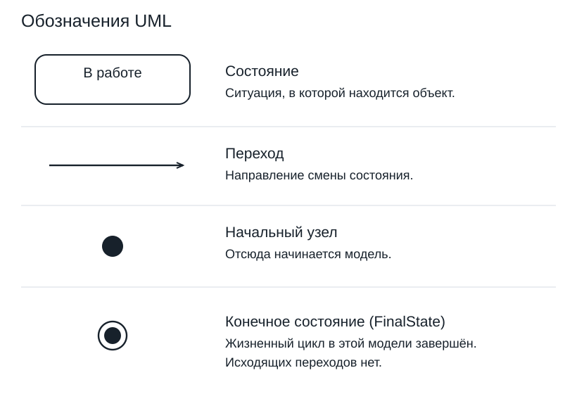
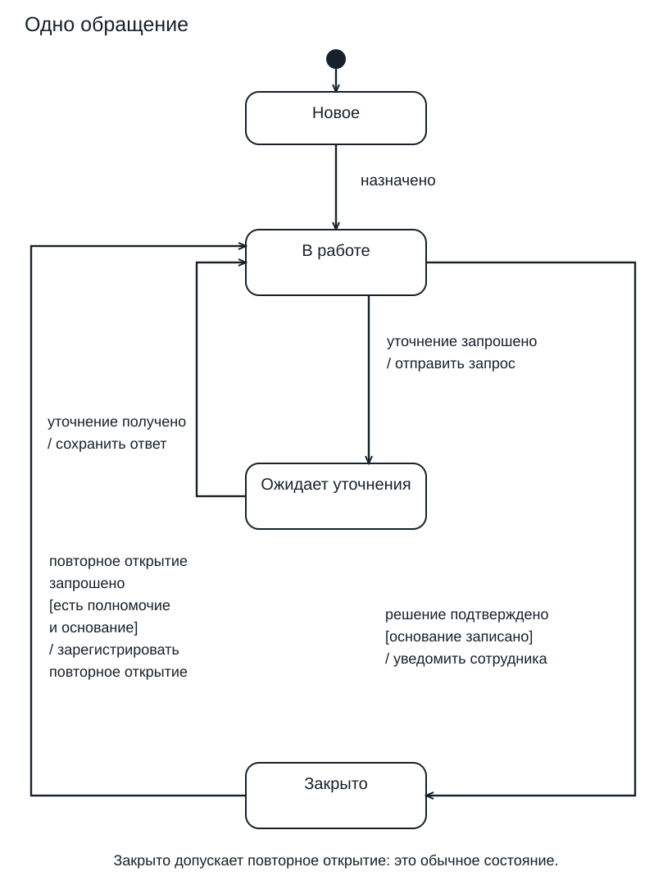
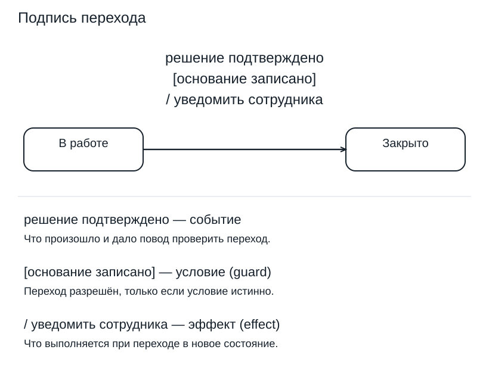
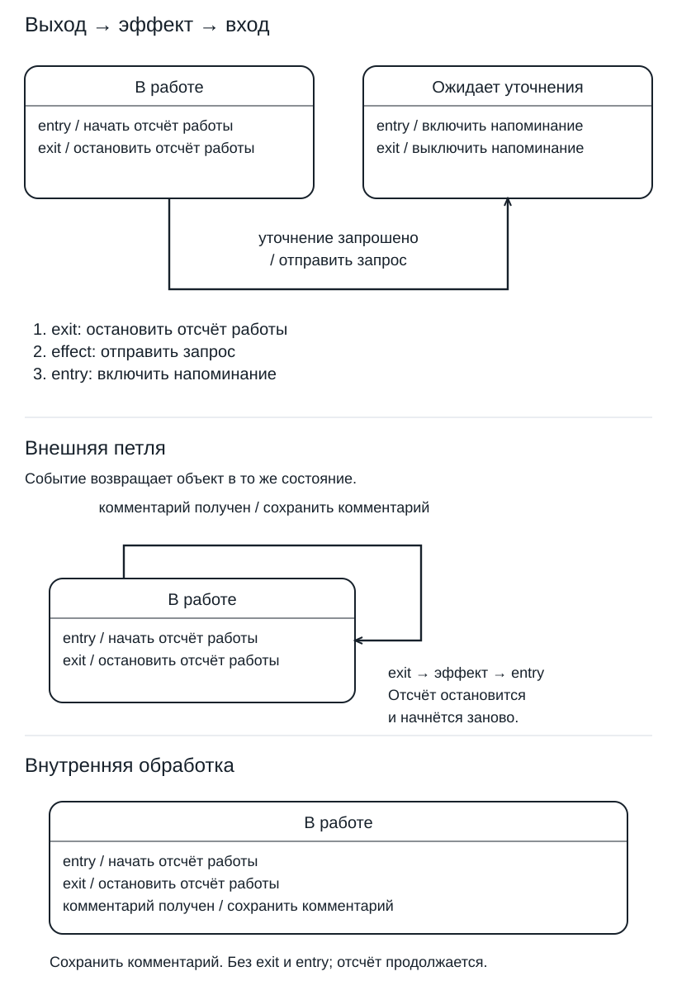
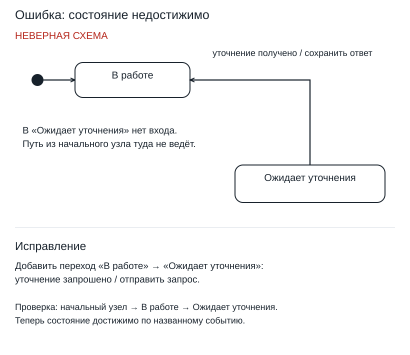

# Лекция 21. UML. Диаграмма состояний

## Состояние и действие

Обращение сотрудника Compliance утром было новым, после назначения офицера оказалось в работе, после подтверждения решения — закрытым. Диаграмма состояний показывает, какие события меняют состояние этого обращения. Объект на всех шагах один.

Все правила обращения в этом уроке — учебные допущения, а не согласованные требования Compliance. Начальная граница примера — обращение уже создано. Рассматриваем четыре состояния: «Новое», «В работе», «Ожидает уточнения», «Закрыто». Создание записи не рисуем отдельным состоянием: оно произошло до начала рассматриваемого жизненного цикла.

На рисунке состояние изображено скруглённым прямоугольником с именем. «В работе» — ситуация, сохраняющаяся между событиями. Офицер может читать документы или готовить ответ, пока обращение остаётся в ней. Состояние не обязательно означает ожидание.

Фраза «Рассмотреть обращение» на месте имени такого прямоугольника смешала бы действие и состояние. Рассмотрение — работа, которую выполняют; «В работе» — положение обращения, пока работа продолжается. Проверка имени: можно ли сказать «обращение сейчас…» и назвать событие выхода? Обращение сейчас в работе; подтверждение решения или запрос уточнения выводят из неё.

В уроке 20 диаграмма активности связывала действия участников: принять обращение, проверить сведения, подготовить решение. Здесь проверка сведений может не появиться отдельным узлом: она не меняет состояние обращения. Activity diagram показывает ход работы; модель состояний — можно ли закрыть обращение сейчас и что произойдёт при повторном открытии.

Чёрная точка на легенде обозначает initial — начало модели; стрелка от неё указывает первое состояние. В нашем случае это «Новое». На этой стрелке нет события или условия: обращение уже существует и начинает рассматриваемую жизнь новым. Отдельный знак с чёрным центром и внешним кольцом — final. Его назначение разберём при закрытии; он не является ещё одним вариантом значка «Новое».

## События и переходы

Проследите на схеме сначала короткую часть: initial, «Новое», затем «В работе». Учебное событие «назначено» означает, что назначение офицера состоялось. Стрелка начинается в «Новое» и заканчивается в «В работе». Её направление существенно: само наличие двух прямоугольников ещё не разрешает переходить между ними в любую сторону.

Для построения фрагмента подпишите объект и границу начала, нарисуйте «Новое» и «В работе», соедините их стрелкой «назначено».

Увеличенный образец читается так: `решение подтверждено [основание записано] / уведомить сотрудника`. Часть до квадратных скобок — trigger, то есть событие, на которое реагирует переход. В скобках находится guard — условие допустимости. После косой черты указан effect — действие при выполнении перехода. Общая форма подписи: `trigger [guard] / effect`.

Событие «решение подтверждено» приходит к обращению в состоянии «В работе». Проверяют наличие основания: если оно записано, выполняется переход в «Закрыто» с уведомлением. «Основание записано» — проверяемый факт, «уведомить сотрудника» — действие. Это разные части правила.

Проверьте три случая на одной стрелке. В первом основание уже заполнено, но подтверждения решения ещё не было: обращение остаётся в работе. Во втором подтверждение пришло, а основания нет: эта стрелка не выполняется. В третьем подтверждение пришло и основание есть: переход разрешён. Истинное условие само по себе не заменяет событие; последующая запись основания тоже не означает повторного подтверждения решения.

На переходе «назначено» нет условия и эффекта, пустые скобки и косая черта не нужны. Отсутствие события в подписи нельзя трактовать как постоянное ожидание истинного условия.

## Закрытие и уточнение

На основной схеме из «В работе» есть два разных продолжения. По событию «решение подтверждено» при записанном основании обращение закрывают. По событию «уточнение запрошено» его переводят в «Ожидает уточнения» с эффектом «отправить запрос». Во втором случае работа над решением прерывается до получения ответа. Это дополнительное учебное правило обращения.

Стрелка «уточнение получено / сохранить ответ» возвращает обращение из «Ожидает уточнения» в «В работе». Ответ сохранён, но решение ещё не подтверждено. Автоматического закрытия после ответа на рисунке нет. Такой переход был бы отдельным требованием, а не следствием названия события.

Первый проход — обычное закрытие. Обращение №41 в «Новое». Произошло «назначено» — теперь оно в работе. Основание записано, произошло «решение подтверждено». Условие истинно, выполняется «уведомить сотрудника», обращение в «Закрыто». После каждого события назовите активный прямоугольник.

Второй проход — одно уточнение. Обращение №42 назначено и находится в работе. «Уточнение запрошено» — отправлен запрос, обращение ожидает уточнения. «Уточнение получено» — ответ сохранён, обращение снова в работе. Основание записано, решение подтверждено — переход в «Закрыто». Узел «В работе» посещён дважды одним обращением.

## Повторное открытие

На основной схеме из «Закрыто» проведена обратная стрелка в «В работе»: `повторное открытие запрошено [есть полномочие и основание] / зарегистрировать повторное открытие`. Учебное правило разрешает продолжить рассмотрение, когда одновременно есть полномочие и основание для открытия. Формулировка guard сокращает два обязательных условия, а не предлагает выбрать одно из них.

Уполномоченный участник запросил открытие обращения №41 с основанием — обращение возвращается в работу, открытие регистрируется. При запросе без полномочия условие ложно: обращение остаётся закрытым. Ответ интерфейса нужно определить отдельно: guard задаёт допустимость перехода, а не текст сообщения.

«Закрыто» нарисовано обычным состоянием именно потому, что у него есть разрешённое продолжение. Знак final на легенде означает завершение рассматриваемого поведения: из него не ведут исходящие переходы. Подменив «Закрыто» этим знаком, мы потеряли бы показанное повторное открытие. В основной модели final поэтому не используется, хотя его образец нужен для чтения чужих диаграмм.

Final мог бы обозначать окончательную границу при согласованном запрете дальнейшего открытия. Удаление записи из базы данных из значка final не следует.

Если на встрече говорят «закрытое можно открыть заново всегда», проверьте закрытый случай без полномочия. На рисунке полномочие обязательно, в новой формулировке — нет. Запишите вопрос владельцу процесса Compliance: кто вправе открыть обращение и какое основание обязательно? До ответа не выдавайте допущение за согласованное правило.

## Entry и exit

В верхнем фрагменте рисунка внутри «В работе» указаны `entry / начать отсчёт работы` и `exit / остановить отсчёт работы`. Внутри «Ожидает уточнения» — `entry / включить напоминание` и `exit / выключить напоминание`. Это дополнительные учебные действия: отсчёт относится к одному периоду работы, напоминание — к одному периоду ожидания. По ним удобно увидеть последствия входа и выхода.

Прочитайте переход «уточнение запрошено / отправить запрос» по порядку. Сначала обращение выходит из «В работе»: выполняется exit и отсчёт останавливается. Затем выполняется эффект стрелки — отправить запрос. После этого обращение входит в «Ожидает уточнения»: выполняется entry и включается напоминание. Получается конкретная последовательность: остановить отсчёт → отправить запрос → включить напоминание.

На обратной стрелке «уточнение получено / сохранить ответ» порядок тот же: выключить напоминание при выходе, сохранить ответ как эффект, начать новый отсчёт при входе в работу. Отличие entry от эффекта видно по месту записи: «начать отсчёт» находится внутри состояния и относится к входу в него; «сохранить ответ» находится на конкретной стрелке получения уточнения.

При повторном открытии из «Закрыто» тоже начнётся новый отсчёт: entry относится к любому входу в «В работе». Если отсчёт нужен только после назначения, его следует перенести на стрелку назначения. Место записи задаёт разные требования.

## Повторные события

В нижней части рисунка показаны два альтернативных способа принять комментарий в «В работе». Сверху стрелка выходит из состояния и возвращается в него: это внешняя петля с подписью `комментарий получен / сохранить комментарий`. Снизу та же подпись находится внутри прямоугольника: это внутренняя обработка. Варианты сравниваются отдельно; одновременно применять оба правила к одному комментарию в этом примере не нужно.

Пройдите верхний вариант с одним комментарием. Обращение покидает «В работе», поэтому останавливается отсчёт. Эффект сохраняет комментарий. Затем обращение снова входит в «В работе», и начинается новый отсчёт. Имя состояния до и после одинаковое, но граница выхода и входа пересечена. Для учебного счётчика один комментарий создаёт новый период работы.

Пройдите нижний вариант: комментарий сохраняется внутри текущего состояния. Выхода и нового входа нет, отсчёт продолжается. Для добавления комментария к текущему рассмотрению подходит этот вариант. Внешняя петля уместна, когда действительно требуется повторить выход и вход.

Посчитайте действия для двух комментариев после первоначального входа в «В работе». С внешней петлёй получится три entry: первоначальный и по одному на каждый комментарий; exit выполнится дважды. С внутренней обработкой останется один первоначальный entry и ни одного exit. Эффект сохранения комментария в обоих вариантах выполнится дважды. Число сохранений одинаково, а число периодов работы различается.

Другой повтор — «решение подтверждено», доставленное уже закрытому обращению. Из «Закрыто» по этому событию нет перехода, состояние останется прежним. Ответ отправителю определяется отдельно. Это также не доказывает безопасность повторной обработки уведомления в реализации: её нужно задать отдельным требованием.

## Проверка модели

На диагностическом рисунке «Ожидает уточнения» присутствует, и из него можно вернуться в работу по получению ответа. Но из начального узла попасть в ожидание нельзя: стрелка «уточнение запрошено» пропущена. Проведите пальцем путь от initial — он оборвётся на попытке запросить уточнение. Обратная стрелка не делает состояние достижимым. Исправление здесь конкретное: восстановить входящий переход из «В работе» с событием и эффектом, как на основной схеме.

Проверьте два предполагаемых перехода из «Закрыто» по одному событию открытия: guard «есть полномочие» ведёт к одному результату, «есть основание» — к другому. При обоих признаках разрешены два продолжения. Если требуется одно открытие при двух обязательных признаках, нужен один guard с «и», как на основной схеме. Для разных исходов условия следует развести и согласовать.

Состояние без исходящей стрелки само по себе ещё не доказывает ошибку. Сначала проверьте его назначение: должно ли рассмотрение здесь окончательно закончиться или правило продолжения забыли? Для нашего «Закрыто» ответ известен — разрешённое открытие предусмотрено, поэтому его отсутствие было бы пропуском. Для final исходящей стрелки быть не должно. Одинаковая внешняя ситуация «не нарисован выход» требует разных исправлений.

Превратите второй проход в проверяемый сценарий. Дано созданное обращение в «Новое». После назначения ожидается «В работе»; после запроса уточнения — «Ожидает уточнения» и отправка запроса; после получения уточнения — «В работе» и сохранённый ответ; после подтверждения решения с записанным основанием — «Закрыто» и выполненный эффект уведомления. Проверяющий наблюдает состояния и результаты действий после каждого события, а не только итоговое слово «Закрыто».

Добавьте к нему отрицательную проверку: подтвердить решение в «В работе» без основания. Ожидаемый результат по схеме — состояние остаётся «В работе», эффект уведомления этой стрелки не выполняется. Затем проверьте закрытый случай с запросом открытия без полномочия: остаётся «Закрыто», повторное открытие не регистрируется. Эти два случая проверяют разные guards и не заменяют друг друга.

Перед передачей модели проверьте достижимость состояний, реакцию на значимые события, совместимость условий и совпадение разобранных путей с подписями стрелок. Событие из требования без подходящей стрелки — повод выяснить, пропущено правило или операция намеренно запрещена.

## Источники

Авторские материалы не предоставлены. Нотация и семантика опираются на официальные источники; правила обращения созданы для урока.

- [OMG Unified Modeling Language 2.5.1, глава 14 StateMachines](https://www.omg.org/spec/UML/2.5.1/PDF).
- [PlantUML: State Diagram — примеры записи и отображения состояний и переходов](https://plantuml.com/state-diagram).
