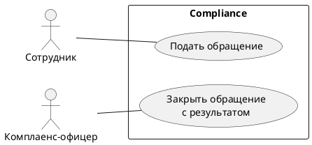
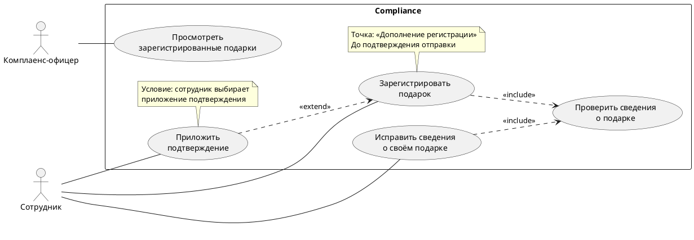

# Ответы и критерии к уроку 19

Это образцы обоснованных решений, а не единственная допустимая формулировка. Условия Compliance здесь учебные. Варианты, добавляющие новые бизнес-правила, нужно помечать гипотезами, а не считать автоматически верными.

## 1. Какой вопрос решает модель — UC19-01

**A — use-case diagram; B — activity diagram; C — sequence diagram.** Первая помогает обсудить цели и участников относительно выбранной границы. Второй вопрос требует порядка действий и ветвлений, третий — сообщений в конкретном взаимодействии. В этой практике подробную activity или sequence диаграмму строить не нужно.

Ассоциация актор—вариант означает участие во взаимодействии. Она не задаёт порядок шагов, поток данных, расположение экранов или полную матрицу прав. Например, линия к «Подать обращение» сама по себе не определяет, какие обращения пользователь может видеть.

**Критерии:** три верных сопоставления; объяснение участия; хотя бы два ограничения интерпретации линии.

## 2. Что находится снаружи — UC19-02

| Элемент | Решение в заданной границе | Почему |
| --- | --- | --- |
| Сотрудник | Актор снаружи | Взаимодействует с Compliance ради результата |
| Комплаенс-офицер | Актор снаружи | Использует поведение системы; работа внутри компании не помещает его внутрь программной системы |
| Корпоративный SSO | Внешний системный актор в модели начала сеанса | Compliance взаимодействует с ним, а сам сервис не включён в subject |
| Хранилище Compliance | Внутри subject, не внешний актор | Его включение в систему задано условием |
| Юристы | Стейкхолдеры, актор не показан | Влияют на правила, но взаимодействие с системой здесь не задано |

SSO участвует в начале сеанса, однако для отдельно рассматриваемой подачи обращения вход уже выполнен. Нельзя добавлять линию SSO к каждому варианту только потому, что сервис есть в архитектуре. Если граница или моделируемое поведение изменятся, решение об акторах нужно пересмотреть.

**Критерии:** явный subject; верно размещены пять элементов; различены внешний сервис и внутреннее хранилище; участие SSO обосновано конкретным взаимодействием.

## 3. Исправьте карту целей — UC19-03

Один минимальный вариант:

Сотрудник перенесён наружу: он взаимодействует с выбранной системой. «Нажать отправку» заменено целью «Подать обращение». «Сохранить в БД» исключено с этого обзорного уровня: это внутреннее действие для достижения результата. Стрелки порядка удалены — диаграмма не описывает жизненный путь обращения. Ассоциации участия обозначены обычными сплошными линиями.

Из отсутствия линии офицер—подача запрет не следует. Человек может подать личное обращение в роли сотрудника; может существовать и иная договорённость. Чтобы сделать вывод о доступе, нужны правила ролей и полномочий, а не догадка по рисунку.

**Критерии:** оба актора снаружи; две понятные цели внутри; нет внутренней операции хранения и стрелок порядка; две корректные ассоциации; отсутствие линии не выдано за доказательство запрета.

## 4. Связь определяется поведением — UC19-04

| Случай | Решение | Направление и причина |
| --- | --- | --- |
| A | Два `include` | «Подать обращение» → «Проверить обращение перед отправкой»; «Повторно отправить уточнённое обращение» → та же проверка. Включается заданный фрагмент поведения |
| B | `extend` допустим по условиям задания | «Приложить материалы» → «Подать обращение». Названы база, её точка и условие выбора приложения; подача осмысленна без файла |
| C | Отдельная связь не требуется | Ошибка остаётся альтернативой текстового сценария; само наличие ветки не требует нового овала |
| D | `include` к входу не нужен | Уже выполненный вход — исходное условие, а не включённая процедура начала сеанса |

`extend` нельзя определять только как «необязательное действие». Если у отношения нет условия, расширение выполняется при достижении соответствующей точки расширения. В случае B условие задано явно. Выбор отдельного расширения здесь также задан учебной задачей; в другой модели приложение документов могло бы остаться фрагментом текстового сценария.

**Критерии:** оба направления верны; для B указаны база, точка и условие; объяснена самостоятельная осмысленность базы; C и D не превращены механически в отношения; разобран случай отсутствующего условия.

## 5. Обобщение или должностное подчинение — UC19-05

Пустой треугольник направлен **к общему актору «Сотрудник»**. В PlantUML это можно записать как `Employee <|-- Officer`: офицер — специальный вид сотрудника в явно заданной модели.

Одного должностного подчинения для обобщения руководителя и офицера недостаточно. Руководитель может иметь другие цели и не выполнять все предусмотренные взаимодействия офицера. Это нужно выяснить, а не выводить из оргструктуры.

Обобщение связывает специальный вид с общим; его сплошная линия заканчивается пустым треугольником у общего элемента. `extend` описывает дополнение поведения базы в её точке расширения; пунктирная открытая стрелка направлена к базовому варианту. Это разные отношения.

**Критерии:** треугольник у «Сотрудника»; объяснено условие допустимости обобщения; отсутствует вывод только из подчинения; различены семантика и нотация.

## 6. Из «успешно» в проверяемый сценарий — UC19-06

**UC-EX-01. Подать обращение.** Цель — передать вопрос в комплаенс и получить подтверждение регистрации. Актор — сотрудник. Предусловия: сотрудник уже вошёл и имеет право подачи. Триггер: он начинает подачу нового обращения.

Основной сценарий:

1. Сотрудник начинает подачу обращения.
2. Система предлагает подготовить описание вопроса и объясняет обязательность сведений.
3. Сотрудник вводит сведения.
4. Сотрудник подтверждает отправку.
5. Система проверяет обязательные сведения; в основном ходе проверка успешна.
6. Система регистрирует обращение, назначает идентификатор, связывает его с сотрудником и делает доступным в его списке и очереди офицера.
7. Система показывает подтверждение с идентификатором.

**Альтернатива 5а:** описание пусто. Система объясняет, что нужно дополнить, сохраняет введённое в текущем взаимодействии и не создаёт поданное обращение. Сотрудник исправляет сведения и возвращается к шагу 4. Это не обещание отдельного сохранённого черновика после выхода.

**Успех:** зарегистрированное обращение существует, связано с сотрудником, имеет идентификатор и доступно нужным участникам по условиям упражнения. **При неуспешной проверке:** поданного обращения нет; данные доступны для исправления в текущем взаимодействии. Одного сообщения «Успешно» для доказательства результата недостаточно.

REQ-EX-01 связан со шагом 6 и показом идентификатора в шаге 7. Ожидание доступности в очереди офицера дополнительно дано условием задачи; не следует выдавать его за буквальное содержание REQ-EX-01, если оно не включено в формулировку требования.

Открытый вопрос: «Как сотрудник выяснит результат, если после подтверждения отправки пропала связь?» Способ безопасного повтора пока не задан. Также допустим вопрос о сохранении черновика после прекращения работы.

**Критерии:** предусловия и триггер отделены от шагов; 5–7 понятных шагов с действиями актора и ответами системы; проверка перед регистрацией; альтернатива с ответвлением и возвратом; различены результаты; требование связано с шагами; новый технический механизм не выдуман.

## 7. «Рисуйте как хотите» — UC19-07

Возможные вопросы:

1. «Какую работу вы считаете законченной после закрытия и какой результат должен увидеть сотрудник?»
2. «Разберём последнее обращение, по которому пришлось ждать уточнения: что позволило его закрыть?»
3. «Можно ли закрыть ошибочное обращение без ответа сотруднику? Кто вправе принять такое решение?»

Пример записи для согласования:

- **Подтверждено:** в учебном контексте офицер обрабатывает обращения и запрашивает функцию закрытия. Детальные условия закрытия ещё не согласованы.
- **Гипотеза:** для закрытия обычного обращения нужен подготовленный ответ сотруднику.
- **Открытый вопрос:** допускается ли закрытие ошибочного обращения без ответа и какое подтверждение получает сотрудник?
- **Владелец решения:** владелец процесса обработки обращений; если конкретное лицо неизвестно, сначала установить его у заказчика.
- **Следующий шаг:** подготовить два коротких случая — обычное и ошибочное обращение — и назначить предметный разбор с владельцем решения. До ответа отметить правило как неподтверждённое.

Не нужно убеждать собеседника «просто согласовать диаграмму». Нужно получить или явно оставить открытой конкретную договорённость. «Потом посмотрим» не является утверждением бизнес-правила.

**Критерии:** вопросы о результате, конкретном эпизоде и отрицательном случае; в записи отделены известное и гипотеза; установлен владелец или способ его установить; следующий шаг конкретен; молчание не приравнено к согласию.

## 8. Учебный проект: регистрация подарка — UC19-08

Один согласованный вариант диаграммы:

Общая проверка включается в регистрацию и исправление; обе стрелки направлены к проверке. Приложение подтверждения расширяет регистрацию и направлено к ней. Без приложения базовая регистрация достигает результата. Связь с исправлением для вложения не добавлена: такая возможность в условии не задана. Актору не обязательно проводить линию к внутреннему включаемому фрагменту только потому, что его поведение выполняется.

**UC-EX-GIFT-01. Зарегистрировать подарок.** Актор — сотрудник. Предусловия: он уже вошёл и имеет право регистрации. Триггер: сотрудник начинает регистрацию нового подарка.

1. Сотрудник начинает регистрацию подарка.
2. Система предлагает указать описание и дату, объясняет обязательность данных.
3. Сотрудник вводит сведения. В точке «Дополнение регистрации» при выборе сотрудника выполняется отдельно описанное приложение подтверждения; после него подготовка регистрации продолжается.
4. Сотрудник подтверждает отправку.
5. Система выполняет включённую проверку описания и даты; в основном ходе она успешна.
6. Система регистрирует подарок, присваивает идентификатор, связывает запись с сотрудником и делает доступной ему.
7. Система показывает подтверждение с идентификатором.

**Альтернатива 5а:** описание пусто. Система сообщает, что требуется описание, сохраняет сведения в текущем взаимодействии для исправления и не создаёт зарегистрированную запись. Сотрудник дополняет описание и возвращается к шагу 4. Для отсутствующей даты нужна аналогичная согласованная обработка; её можно описать отдельной альтернативой с тем же результатом.

**Успешный результат:** существует запись о подарке с идентификатором, связанная с сотрудником и доступная ему. **При отказе проверки:** зарегистрированная запись не создана, сведения доступны для исправления в текущем взаимодействии. Срок жизни черновика после выхода не установлен. Вложение не должно становиться скрытым обязательным условием успеха.

Пример учебного требования **REQ-EX-GIFT-01**: «При успешной регистрации подарка Compliance создаёт запись с идентификатором, связывает её с подавшим сотрудником и обеспечивает ему доступ к записи». Оно раскрывается в шаге 6, а предъявление идентификатора — в шаге 7. Эти метки предназначены для упражнения и не записываются в канонический реестр требований.

Две проверки:

| Проверка | Исходные данные и действие | Ожидаемый результат |
| --- | --- | --- |
| Успех без файла | Сотрудник вводит непустое описание и дату, не выбирает приложение подтверждения, отправляет | Запись зарегистрирована, есть идентификатор и связь с сотрудником; сотрудник может найти запись. Отсутствие файла не блокирует цель |
| Пустое описание | Сотрудник указывает дату, оставляет описание пустым и отправляет | Система указывает причину, не создаёт зарегистрированную запись; дата сохранена в текущем взаимодействии, сотрудник может исправить описание и повторить отправку |

Вопросы владельцу процесса: «Какие подарки и сведения офицер вправе видеть?» и «Как сотрудник узнаёт результат при потере подтверждения после отправки?» Допустим также вопрос о правилах допустимости файлов. До ответа не задаём сроки, форматы, области видимости или гарантии отсутствия дубликатов по своему усмотрению.

**Критерии:** граница и два актора; 3–5 вариантов; верные направления и обоснования двух видов связей; у расширения названы точка и условие; сценарий совпадает с рисунком; альтернатива имеет возврат и наблюдаемый результат; требование привязано к шагам; две проверки описывают ожидаемый эффект; два содержательных вопроса оставлены для решения; работа остаётся учебным примером.

## Карта покрытия и self-check

| Результат обучения | Где проверяется |
| --- | --- |
| LO1 — назначение модели и отличие от activity/sequence | UC19-01, UC19-08 |
| LO2 — subject, граница, внешние акторы | UC19-02, UC19-08 |
| LO3 — построение, чтение и именование целей | UC19-03, UC19-08 |
| LO4 — include, extend, обобщение | UC19-04, UC19-05, UC19-08 |
| LO5 — сценарий, альтернативы, результат, требования | UC19-06, UC19-08 |
| LO6 — исправление модели и уточнение неопределённости | UC19-03, UC19-07, UC19-08 |

Всего восемь заданий; у каждого есть ответ и наблюдаемые критерии. Все шесть LO покрыты. Проектный кейс предназначен для самостоятельной учебной работы; завершённость и ревью канонического проектного документа из выполнения практики не следуют.
