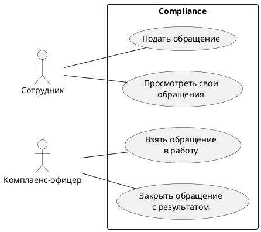
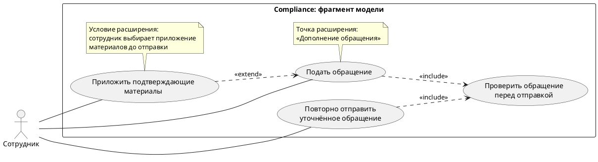

# Лекция 19. UML. Диаграмма сценариев использования

Представьте встречу о будущей системе Compliance. Заказчик говорит: «Сотруднику нужна форма обращения, офицеру — очередь, руководителю — дашборд». Дизайнер уже прикидывает экраны, разработчик спрашивает про поля. Кажется, работа пошла. Но пока никто не ответил на более простой вопрос: какой результат должен получить человек, воспользовавшись системой?

Форма сама по себе результата не гарантирует. Сотрудник может заполнить её, но не понять, принято ли обращение. Очередь может показывать записи, но не позволять офицеру взять обращение в работу. Дашборд может выглядеть убедительно, хотя решение по его данным принять невозможно. Перечень интерфейсов помогает обсуждать представление информации, а цели использования — ожидаемое поведение системы.

В этом уроке мы построим небольшую карту таких целей, научимся читать её связи и раскроем один элемент карты в текстовый сценарий. Затем проверим, какие вопросы модель действительно закрыла, а какие только сделала заметными. Предыдущий урок про управление требованиями уже дал важный ориентир: договорённость нужно уметь найти, проверить и изменить. Здесь появится ещё одно представление этой договорённости — через участников и результаты их взаимодействия с системой.

## Сначала результат, затем овал

UML — язык моделирования с согласованными обозначениями. Вариант использования, или use case, описывает поведение рассматриваемого предмета, которое даёт наблюдаемый ценный результат. Диаграмма сценариев использования показывает варианты и участников рядом с выбранной границей. Нормативная основа этих обозначений — спецификация OMG UML; мы используем только небольшой набор из её главы 18.

Для нашей работы удобно задавать вопрос так: «Кто обращается к системе, чего хочет добиться и по какому результату поймёт, что получилось?» Это рабочий приём аналитика, а не требование именовать каждый овал строго определённой фразой.

Возьмём сотрудника, который хочет передать вопрос в комплаенс и иметь подтверждение, что вопрос принят. Название «Подать обращение» подходит лучше, чем «Нажать кнопку отправки». Кнопка — одно из возможных средств. Если завтра обращение будут подавать через другой интерфейс, цель сотрудника сохранится. Название «Форма обращения» тоже слабее: оно говорит о месте ввода, но не объясняет ожидаемый итог.

Хорошая проверка названия — закончить фразу: «После выполнения сотрудник получил…». Для «Подать обращение» можно ответить: «Зарегистрированное обращение с идентификатором, которое он видит среди своих». Для «Открыть окно» ответ часто сводится к тому же окну. Это сигнал посмотреть на цель выше, а не запрет когда-либо моделировать небольшие действия. Уровень детализации выбирают под задачу; сейчас мы строим обзор пользовательских целей.

Диаграмму можно сравнить с перечнем услуг на стойке обслуживания: видно, за каким результатом можно обратиться. Но сходство заканчивается на карте возможностей. Диаграмма не является меню приложения, не задаёт расположение экранов и не показывает, как люди стоят в очереди. Все эти вопросы потребуют других описаний.

## Граница системы меняет ответ на вопрос «кто снаружи»

До рисования участников нужно договориться, что именно рассматриваем. В UML это называют subject — предметом рассмотрения. В учебном примере выберем **Compliance целиком**: портал сотрудника и рабочее место комплаенс-офицера как одну систему. Прямоугольник с таким названием будет обозначать её границу.

Теперь сотрудник и комплаенс-офицер находятся снаружи прямоугольника. Это не значит, что они работают вне компании. Они внешние по отношению к выбранной системе, с которой взаимодействуют. Внутри прямоугольника будут её возможности, а не отделы организации и не перечень программных компонентов.

Если предметом рассмотрения станет только портал сотрудника, та же схема потребует пересмотра. Часть взаимодействий с рабочим местом офицера может оказаться взаимодействием с другой системой. Поэтому спор «эта система внешняя или внутренняя?» без названия subject обычно не имеет полезного ответа. Сначала фиксируем границу системы, затем принимаем решение о размещении элементов.

Актор — роль человека, устройства или другой системы, взаимодействующей с выбранным предметом. На нашей карте важен «Сотрудник», а не Иван из финансового отдела. Один человек может в разных ситуациях выступать сотрудником и комплаенс-офицером. И наоборот, роль сотрудника могут исполнять сотни людей. Роли помогают описать устойчивое поведение без привязки к конкретной фамилии.

Не каждый стейкхолдер автоматически становится актором. Юридическая служба может влиять на правила хранения обращений, но если в рассматриваемой модели она не взаимодействует с Compliance, добавлять её человечком «на всякий случай» не нужно. И не каждый элемент технической архитектуры — актор. Если база данных входит в выбранную систему, её не выводят за рамку просто потому, что система обращается к ней.

Внешняя система тоже может быть актором. Например, корпоративный сервис единого входа, или SSO, может участвовать в начале сеанса в Compliance. Тогда на соответствующей модели уместна роль внешнего сервиса. Но в нашей первой диаграмме рассматриваются цели уже вошедших пользователей. Само наличие SSO в компании ещё не требует рисовать его рядом с каждой целью и соединять со всеми овалами. Нужно показать участие в конкретном моделируемом поведении.

## Собираем первую карту Compliance

Дальше действуют **учебные допущения**. Мы предположим, что сотрудник подаёт обращения и видит свои обращения, а комплаенс-офицер берёт обращение в работу и закрывает его с результатом. Это материал для объяснения, а не подтверждённая спецификация реального заказчика. Названия и правила примера ещё нужно было бы согласовать на проекте.

Для обзорной карты достаточно четырёх целей. Овал обозначает вариант использования, человечек — актора, а обычная сплошная линия между ними — участие во взаимодействии. Пока не добавляем стрелки последовательности: задача этой схемы — показать доступные цели и участников.

Прочитаем схему вслух. Сотрудник участвует в подаче обращения и просмотре своих обращений. Офицер участвует во взятии обращения в работу и его закрытии. Все четыре варианта относятся к выбранной системе Compliance. Уже по такой карте можно задать предметные вопросы: кто видит чужие обращения, может ли сотрудник отозвать отправленное, кто получает результат закрытия?

Схема не отвечает на эти вопросы автоматически. Отсутствие линии у офицера к «Подать обращение» не доказывает, что у человека с такой должностью нет права подать личное обращение. Возможно, в этой ситуации он действует как сотрудник. Матрицу прав и условия доступа нужно описать отдельно. Соединительная линия не заменяет ни проверку полномочий, ни правила видимости данных.

Другая распространённая попытка — соединить «Подать обращение» с «Взять обращение в работу», а затем с «Закрыть обращение» и назвать это процессом. Мы действительно предполагаем такой жизненный путь обращения, но use-case диаграмма не задаёт его порядок. Между этими целями могут пройти дни, смениться исполнители и произойти возврат на уточнение. Для последовательности работы понадобится диаграмма активности, для обмена сообщениями между участниками — диаграмма последовательности. Их будем разбирать в следующих уроках.

Практическая ценность первой карты в другом: она позволяет проверить границы обсуждения. Если у заказчика в голове есть функция для руководителя, а на карте нет ни его роли, ни соответствующей цели, это видно до рисования десятого экрана. Но «не видно на карте» означает вопрос о полноте выбранного обзора, а не основание самостоятельно расширить согласованный объём проекта.

## Когда нужны include и extend

На первой диаграмме нет отношений между вариантами использования — и это нормально. У модели нет обязанности использовать все доступные обозначения. Добавлять связь стоит тогда, когда без неё хуже понятен смысл поведения.

В UML `include` обозначает включение поведения одного варианта в другой; пунктирная стрелка идёт от включающего варианта к включаемому. `extend` обозначает дополнение базового поведения в предусмотренных точках расширения; стрелка идёт от расширяющего варианта к расширяемому. Эти краткие определения задают направление чтения. Чтобы выбрать связь на практике, нужно договориться о содержании вариантов, а не подобрать похожую английскую надпись.

Продолжим учебные допущения. Пусть в Compliance есть две цели: впервые подать обращение и повторно отправить обращение после запроса уточнений. Перед каждой отправкой система выполняет один согласованный набор проверок: есть описание вопроса, выбран допустимый способ обратной связи, сведения достаточно полны для приёма. При ошибках обращение не поступает на обработку, а сотрудник получает объяснение, что нужно исправить.

Это поведение можно вынести в «Проверить обращение перед отправкой» и включить в оба варианта. Здесь `include` полезен тем, что одна согласованная проверка участвует в двух описаниях. Но повторное использование — удобная причина выделения, а не вся семантика связи. Нужно показать, что именно включается в поведение базового варианта. Одного сходства названий недостаточно.

Не следует превращать в отдельный овал каждое сравнение значения с ограничением. От такого разбиения диаграмма перестанет быть читаемой картой. В нашем примере включаемый вариант объединяет содержательно связанный фрагмент, который команда решила описывать вместе. Его детали всё равно придётся раскрыть текстом. Стрелка не сообщает, какие поля обязательны и что происходит при отказе проверки.

Теперь предположим другую договорённость: обычное обращение можно подать без документов, но сотрудник вправе приложить подтверждающие материалы до отправки. При выборе этого действия система принимает файл, проверяет его по согласованным правилам и связывает с готовящимся обращением. Для отдельного обсуждения такого дополнения мы выделим расширяющий вариант «Приложить подтверждающие материалы». В базовом варианте предусмотрим точку расширения «Дополнение обращения».

Для `include` читаем стрелку так: «Подать обращение» включает «Проверить обращение перед отправкой». Для `extend` — наоборот по смысловой роли: «Приложить подтверждающие материалы» расширяет «Подать обращение». Базовый вариант подачи остаётся осмысленным без приложения файлов. Поэтому стрелка расширения направлена **к базе**, а не к добавляемому поведению.

Вторая схема — отдельный фрагмент модели для объяснения отношений; она не дополняет первую скрытыми требованиями. Точку расширения и условие мы вынесли в заметки, чтобы они читались рядом со связью. В текстовом описании базы нужно указать, где наступает эта точка. Для примера это момент после подготовки сведений об обращении и до окончательной отправки. В описании расширения нужно определить, когда управление возвращается к подготовке обращения и что происходит с неприемлемым файлом.

Сам факт наличия условия не делает любую ветку `extend`. Можно оставить приложение документов альтернативным фрагментом одного текстового сценария, если отдельная модель не приносит пользы. Ошибку «не заполнено описание» тоже обычно достаточно разобрать в альтернативе: отдельный овал ошибки часто лишь усложнит обсуждение.

Обратная ошибка — объяснять `extend` исключительно как «необязательное действие». В нормативной семантике важны база, расширяющее поведение и точка расширения. Условие у отношения может отсутствовать; тогда расширение выполняется при достижении предусмотренной точки. В нашем учебном случае условие задано явно, поэтому легко проверить, когда дополнение включится.

Отдельно проверьте популярный `include` к «Войти в систему» от каждого овала. Для нашей модели это означало бы совсем другую договорённость: начало сеанса включается в поведение каждой цели. Но мы выбрали уже вошедшего сотрудника как предусловие подачи. Поэтому добавлять такой `include` по привычке не будем. Если реальная система требует повторной проверки личности для отдельной операции, это нужно исследовать и описать как конкретное правило, а не угадывать по рисунку.

## Обобщение — ещё одно отношение, с другим смыслом

Обобщение связывает специальный вид с более общим. Его показывают сплошной линией с пустым треугольником, направленным к общему элементу. Это правило UML отличается от пунктирных стрелок `include` и `extend`.

Предположим, в небольшой модели есть общий актор «Сотрудник» и специальный актор «Комплаенс-офицер». Обобщение от офицера к сотруднику можно рассмотреть, если в этом subject офицер действительно является разновидностью сотрудника и может участвовать в предусмотренных для сотрудника взаимодействиях. Мы должны сначала подтвердить такую договорённость. Одного факта трудоустройства недостаточно: в некоторых системах рабочие и личные действия сознательно разделены разными учётными контекстами.

Тем более не следует проводить обобщение от «Руководителя комплаенс» к «Комплаенс-офицеру» просто потому, что первый руководит вторым. Начальник не обязательно выполняет все операции подчинённого. Диаграмма ролей не становится организационной структурой оттого, что на ней нарисовали начальника выше.

Похожая проверка нужна при обобщении вариантов использования: речь о специальном виде более общего поведения. Для начальной карты Compliance такие отношения пока не нужны. Если четыре обычные ассоциации передают задачу точнее, простая схема будет полезнее, чем треугольники ради знакомства с треугольниками.

## Один овал превращаем в проверяемое описание

Вернёмся к «Подать обращение». На диаграмме мы видим цель, но не договорились о достаточном результате и отказах. Два человека могут одинаково назвать овал и представить разные функции: один считает отправкой сохранение черновика, другой — регистрацию в очереди офицера. Чтобы устранить расхождение, раскроем вариант текстом.

Ниже — **учебная рабочая карточка**, а не обязательный шаблон стандарта UML. Мы сохраняем допущения примера: сотрудник действует от своего имени, документы необязательны, а после успешной отправки появляется идентификатор и обращение поступает в очередь обработки. Никакие сроки, форматы файлов и права других ролей из этого примера автоматически не следуют.

**UC-01. Подать обращение.** Цель сотрудника — передать вопрос в комплаенс и получить подтверждение регистрации. Основной актор — сотрудник. Предусловия: он уже вошёл в Compliance, система распознаёт его как сотрудника, и у него есть право подавать обращения. Условия входа в этот вариант описывают исходную ситуацию; сама процедура входа сюда не включается.

**Триггер:** сотрудник начинает подачу нового обращения. Это начало взаимодействия для достижения цели. Формулировка «возник вопрос» объясняет потребность человека, но для данной карточки мы дополнительно называем наблюдаемое начало работы с системой.

### Основной сценарий

1. Сотрудник начинает подачу обращения.
2. Система предлагает ввести описание вопроса и сведения для обратной связи, поясняет обязательность данных.
3. Сотрудник подготавливает сведения об обращении. Здесь находится точка расширения «Дополнение обращения»: до отправки можно выполнить отдельно описанное приложение материалов.
4. Сотрудник подтверждает отправку подготовленного обращения.
5. Система выполняет включённую проверку обращения перед отправкой. В основном сценарии сведения проходят проверку.
6. Система регистрирует обращение, назначает идентификатор и делает его доступным в очереди обработки комплаенс-офицера.
7. Система показывает сотруднику подтверждение с идентификатором. Обращение доступно в списке его обращений.

**Успешный результат:** существует зарегистрированное обращение, связанное с подавшим сотрудником; сотрудник получил его идентификатор и может найти его среди своих, а офицер может обнаружить его в очереди обработки. «Появилось сообщение “Успешно”» было бы более слабым постусловием: сообщение ещё не доказывает, что данные сохранены и доступны нужным участникам.

Обратите внимание на разделение шагов. Сотрудник сообщает сведения и подтверждает намерение. Система проверяет их и фиксирует результат. Здесь не описывается, какой экранный компонент посылает запрос какому программному сервису: для такого уровня пока нет задачи. Но читатель уже может различить действие человека и ответ системы.

### Альтернативный сценарий и отказ результата

**5а. Описание вопроса отсутствует.** Вместо шага 6 система сообщает, какие сведения нужно дополнить, сохраняет введённые данные для исправления в текущем взаимодействии и не регистрирует обращение как поданное. Сотрудник может дополнить описание и повторить подтверждение отправки, вернувшись к шагу 4. Пока проверка не пройдена, успешный результат варианта не достигнут.

В этой альтернативе важны три вещи: точка ответвления, наблюдаемое поведение и место возвращения. Фраза «при ошибке показать ошибку» ничего из этого не согласовывает. Она оставляет открытыми и потерю введённых данных, и повторную отправку, и возможность случайно создать неполное обращение.

**4а. Сотрудник прекращает подачу до подтверждения отправки.** Успешной регистрации нет. Сохранение отдельного черновика после прекращения работы мы в этом примере не обещаем: это открытый вопрос. Если заказчик захочет такую возможность, нужно отдельно определить момент сохранения, срок хранения и способ продолжения. Недосказанность лучше назвать, чем превратить в неявную функцию.

**Техническая неопределённость после отправки:** сотрудник подтвердил действие, но не увидел результат из-за обрыва связи. Из текста основного сценария ещё нельзя вывести ни способ безопасного повтора, ни гарантию отсутствия дубликатов. Это вопрос для уточнения требований и последующего проектирования. Аналитик фиксирует риск: «Как сотрудник узнаёт, принято ли обращение, если подтверждение не получено?» Овал на диаграмме не закрывает эту ситуацию.

Расширяющий вариант приложения материалов тоже должен иметь описание. Для учебной модели достаточно договориться, что оно начинается в названной точке при выборе сотрудника, успешно заканчивается связью принятых материалов с готовящимся обращением и возвращает сотрудника к подготовке данных. Если файл не принят, нужно сообщить причину и дать продолжить без него. Условия допустимости файла остаются отдельным вопросом. Мы не будем изобретать размер и формат из соображения «так обычно делают».

## Как use case связан с требованиями

Возьмём учебное требование **REQ-EX-01**: «При успешной подаче обращения Compliance должна зарегистрировать его, присвоить идентификатор и обеспечить сотруднику возможность найти это обращение среди своих». Метка `EX` подчёркивает, что это пример для урока, а не номер реального согласованного требования.

Теперь мы можем связать его с UC-01 и конкретными шагами 6–7. Проверяющий понимает, где раскрывается ожидаемое поведение, а автор сценария — на какую договорённость опирается результат. Если требование изменится и регистрация станет завершаться иначе, будет понятно, какую часть сценария и какие проверки пересматривать.

Связь работает и в обратную сторону. В шаге 5 возникла проверка обязательности описания. Где зафиксировано соответствующее правило? Если в реестре требований его нет, сценарий помог обнаружить недостающую договорённость. Однако это не повод автоматически считать наше допущение утверждённым требованием. Нужно назвать владельца решения и согласовать правило.

Из одного UC-01 появится несколько проверок, потому что счастливый путь и альтернатива имеют разные ожидаемые результаты. В успешной подаче проверим идентификатор, связь с сотрудником, видимость в его списке и появление в очереди офицера. При пустом описании проверим объяснение причины, сохранность введённых данных в текущем взаимодействии и отсутствие поданного обращения. Так модель начинает приносить пользу разработке и тестированию, а не просто украшать документ.

При этом use case не заменяет весь набор требований. Скорость ответа, доступность системы, правила хранения, ограничения доступа и аудит не становятся определёнными только потому, что у нас есть семь шагов. На этой стадии полезно перечислить, какие из этих вопросов затрагивает сценарий и где им предстоит получить отдельное описание.

## Если на встрече отвечают кнопками, общими словами или молчат

Диаграмма часто кажется формальной задачей: открыл инструмент и нарисовал. На практике больше времени занимает получение содержательных ответов. Человек знает свою работу, но описывает привычный экран, пересказывает регламент или избегает решения, за которое не хочет отвечать. В такой ситуации аналитик не должен заполнять пробелы уверенно нарисованными овалами.

Например, собеседник говорит: «Мне нужна кнопка “Закрыть”». Вместо спора об интерфейсе можно спросить: «Какую работу вы считаете законченной после её нажатия? Что должен увидеть сотрудник? Когда закрывать ещё нельзя?» Допустим, офицер отвечает: «Когда подготовлен ответ, сотрудник должен его получить, а обращение уйти из моей очереди». Мы получили материал для цели и результата. Теперь нужно проверить, действительно ли закрытие всегда требует ответа и что означает “получить”: наличие ответа в системе или ещё и отдельное уведомление.

Если ответ звучит как «ну, всё должно быть удобно», сменим масштаб вопроса: «Возьмём последнее обращение, которое потребовало уточнения. С чего началась работа, что вы запросили у сотрудника и что позволило продолжить?» Конкретный эпизод легче разобрать, чем абстрактную идеальную систему. После рассказа полезно восстановить один ход и предложить собеседнику исправить его: «Я записал, что до ответа сотрудника обращение не закрывается. Это правило или только особенность того случая?»

Бывает и прямое уклонение: «Рисуйте как хотите, потом посмотрим». Тогда схема может стать ловушкой: команда начнёт реализовывать предположение, а владелец решения позже скажет, что не согласовывал его. Рабочий выход — коротко отделить подтверждённое от гипотезы. Например: «Подтверждено: офицер обрабатывает обращения. Гипотеза: закрыть можно только с ответом. Вопрос: допускается ли закрытие ошибочного обращения без ответа? Решение ожидается от владельца процесса; до ответа не принимаем это условие как согласованное».

Дальше выбираем конкретный следующий шаг: отправить владельцу процесса два небольших случая для выбора, назначить короткий разбор или зафиксировать зависимость, которая мешает завершить описание. Если собеседник не уполномочен решать, спрашиваем, кто принимает такое решение. Диаграмма помогает сузить неопределённость, но не даёт аналитику полномочий самостоятельно утвердить бизнес-правило.

## Проверяем модель перед передачей команде

Начните проверку с содержания. Можете ли вы одним предложением назвать subject и объяснить, почему каждый актор находится снаружи? Завершает ли название каждого основного варианта фразу о результате пользователя? Существует ли хотя бы один сценарий, в котором можно увидеть этот результат, а не только название функции?

Затем проверьте нотацию. Сплошные линии участия не должны притворяться порядком выполнения. Каждая стрелка `include` должна читаться от включающего к включаемому поведению. Для каждого `extend` нужно найти базу, точку расширения и договорённость об условии, если оно используется. Для обобщения нужно суметь объяснить отношение специального вида к общему, а не должностное подчинение.

Наконец, проверьте границы знания. В нашем примере известно, какие цели и правила мы приняли для объяснения. Не определены допустимые файлы, поведение при неопределённом результате отправки и сохранение черновика после ухода. Эти вопросы не делают учебную карту бесполезной. Они показывают, где карта закончилась и началась следующая аналитическая работа.

После урока вы должны уметь взять небольшую задачу Compliance, выбрать границу системы, назвать роли и цели, построить читаемую диаграмму и раскрыть один овал в основной сценарий с альтернативой. В практике нужно будет не только расставить стрелки, но и обосновать решения. Если правильное направление стрелки невозможно объяснить поведением, стоит вернуться к договорённости, которую она должна выражать.

## Источники

- [OMG UML 2.5.1 — нормативная спецификация, глава 18, §§18.1.3–18.1.4](https://www.omg.org/spec/UML/2.5.1/PDF).
- [OMG UML 2.5 — нормативная спецификация, §§9.2.3–9.2.4 об обобщении](https://www.omg.org/spec/UML/2.5/PDF).
- [PlantUML — официальный синтаксис диаграмм вариантов использования](https://plantuml.com/use-case-diagram).
