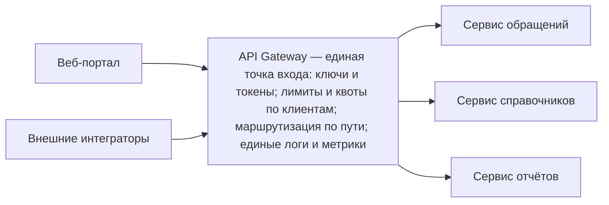

# Answers

Разбор заданий из [exercises.md](exercises.md). В коротких ответах и кейсе засчитываем смысл, а не дословную формулировку: главное — опора на материал лекции 29.

## A1. Что такое API Gateway

**Правильный ответ: A.** Gateway — единая точка входа, которая решает судьбу каждого запроса по правилам: кто обратился, что ему разрешено, куда передать запрос и в каком виде вернуть ответ. На схеме он стоит между клиентами и внутренними сервисами.

Почему другие варианты неверны:

- **B** — gateway не заменяет сервисы: «внутренние сервисы занимаются своей логикой — обращениями, справочниками, отчётами — и не знают, сколько клиентов за шлюзом». Он обслуживает вход к ним, а не избавляет от них.
- **C** — gateway принадлежит системе, к которой обращаются (вендоры называют его «front door», фасадом). Интегратор ничего не встраивает в свою программу — он обращается по адресу системы.
- **D** — смысл gateway в том, что вход один для всех клиентов; интеграторы, работающие с сервисами напрямую, противоречат самой схеме из лекции.

## A2. Gateway и reverse proxy

**Правильный ответ: C.** Общее у reverse proxy и gateway — единая точка входа и маршрутизация. Gateway добавляет правила: ключи и токены, лимиты и квоты, поддержку нескольких версий API, трансформацию и агрегацию, общий мониторинг. Это формула Kong: «reverse proxy, к которому добавляются управление, настройка и маршрутизация». Роль определяется тем, сколько правил на входе назначено этому слою, а не названием коробки — один и тот же продукт может исполнять обе роли.

Почему другие варианты неверны:

- **A** — конструкция одна и та же: у обоих единая точка входа и маршрутизация, различие — в количестве правил на входе, а не в «разных механизмах».
- **B** — типовой неверный вывод: «умный» не значит «обязательный». Правила на входе оправданы, когда появляются разные клиенты; для монолита без внешних клиентов gateway избыточен.
- **D** — различие в обязанностях есть; синонимами они не являются.

## A3. Перегрузка от интегратора

**Правильный ответ: A.** Лимит — ограничение вида «не больше N запросов в единицу времени», квота — ограничение на объём за период. Они делят возможности системы между клиентами справедливо и предсказуемо, поэтому зацикленная программа одного интегратора не тормозит работу остальных — включая сотрудников портала. Для Compliance это прямой ответ на ожидание бизнеса, что внешние подключения не помешают основной работе.

Почему другие варианты неверны:

- **B** — маршрутизация выбирает нужный сервис по пути запроса; «справедливо поделить поток между клиентами» — не её задача.
- **C** — агрегация удобна клиенту (один запрос вместо обхода трёх сервисов), но от зацикленной программы систему не защищает.
- **D** — мониторинг и логирование фиксируют картину обращений, но сами по себе трафик не останавливают.

## A4. Почему правила живут на входе

Ожидаемый ответ (пример своими словами):

> Если повторять правила в каждом сервисе, то каждый сервис проверял бы ключи отдельно, считал лимиты отдельно и писал бы логи по-своему, а при первых изменениях правила разъехались бы по сервисам. На gateway правила настроены в одном месте и правятся в одном месте — проверка пропуска сделана один раз на входе. Поэтому внутренние сервисы занимаются своей бизнес-логикой и не знают, сколько клиентов за шлюзом.

Что важно в ответе: аргумент консолидации («правила в одном месте и не разъедутся при изменениях») и эффект для сервисов («не повторяют проверку и учёт, занимаются бизнес-логикой»). Своими словами достаточно; термины вендоров не нужны.

## A5. Когда gateway избыточен

**Правильный ответ: A.** Проведём чек-лист лекции по этой системе: внешних клиентов несколько — нет; единая выдача и проверка ключей — нет; лимиты и квоты по клиентам — нет; несколько версий API — нет; единые логи и метрики — нет. По всем пунктам «нет» достаточно reverse proxy с балансировкой из урока 28: шлюз не решает ни одной задачи этой системы, а цена платится сразу и полностью — правила, которые нужно придумать и согласовать, настройка, которую нужно поддерживать, и лишняя точка отказа.

Почему другие варианты неверны:

- **B** — типовой неверный вывод «умный ⇒ обязательный»: gateway полезен при разных клиентах, а не «по умолчанию».
- **C** — ошибка «на вырост»: издержки появляются немедленно, а польза — только когда появятся разные клиенты. Решение фиксируют по текущим признакам, а не по страхованию будущего.
- **D** — противоречит принципу «правила правятся в одном месте»: продублированные правила разъедутся при первом изменении.

## A6. Читаем требования: есть ли запрос на gateway

Ожидаемый результат:

1. — **да**: «единый вход» — прямой признак из чек-листа лекции.
2. — **да**: выдача и проверка API-ключей интеграторам.
3. — **да**: лимиты и квоты по каждому клиенту.
4. — **нет**: это обязанность внутреннего сервиса (его бизнес-логика), а не входного слоя; на такой строке gateway не появляется.
5. — **да**: одновременная поддержка нескольких версий API.

Итого: четыре пункта из пяти — сигналы gateway. Задание проверяет распознавание признаков из лекции; пункт 4 — контрастный: он отличает правила входного слоя от обязанностей внутренних сервисов (хранение данных справочников не имеет отношения к точке входа).

## A7. Позиция на схеме

Ожидаемый ответ (пример своими словами):

> Клиенты обращаются по одному адресу и не знают внутреннего устройства системы, а все обращения к API проходят через одну точку. Поэтому общие правила — ключи, лимиты, наблюдаемость — живут именно там, на входе, а не рассыпаны по системе. Для сервисов это означает, что они занимаются своей бизнес-логикой — обращениями, справочниками, отчётами — и не знают, сколько клиентов за шлюзом, и не повторяют правила для каждого клиента. А если завтра появится новый сервис, меняется конфигурация шлюза, а не код клиентов.

Что важно в ответе: один адрес для всех клиентов; единая точка, где живут общие правила; сервисы «не знают» клиентов и правила не повторяют; изменения — в конфигурации шлюза, а не в коде клиентов.

## A8. Мини-кейс: единый вход в API Compliance

Кейс считается решённым, если выполнены все наблюдаемые критерии приёмки:

1. Все клиенты (портал и внешние интеграторы) обращаются к API только через gateway; прямых обращений клиентов к внутренним сервисам на схеме нет.
2. Выдача и проверка ключей и токенов размещены на gateway, с пояснением «проверяется один раз на входе, сервисы не повторяют проверку».
3. Лимиты и квоты привязаны к клиентам и живут на gateway; назначение объяснено (внешние подключения не мешают основной работе, один клиент не тормозит остальных).
4. Маршрутизация по пути (`/api/requests` → сервис обращений, `/api/reports` → сервис отчётов, `/api/directories` → сервис справочников) описана и размещена на gateway.
5. Единые логи и метрики размещены на gateway; причина названа: через gateway проходят все запросы.
6. Внутренние сервисы описаны как занятые своей бизнес-логикой; повторения правил доступа в каждом сервисе нет.
7. Обоснование опирается на признаки из лекции (несколько разных клиентов, правила у них различаются, единый вход, ключи, лимиты и квоты, версии, единые логи), а не на «так делают все».
8. Названа цена решения — новые правила и настройка, лишняя точка отказа — и объяснено, почему её принимают.
9. В решении не появляются компоненты, не разобранные в лекции; продукты-вендоры, если упомянуты, — только как примеры класса, без тарифов и настроек.

Пример развязки — для самопроверки, повторять дословно не обязательно:

Все общие правила живут на gateway: ключи и токены проверяются один раз на входе; лимиты и квоты задаётся каждому клиенту; маршрутизация читает путь и ведёт запрос к нужному сервису; логи и метрики складываются сами, потому что через точку проходят все запросы. Сервисы занимаются своей логикой. Обоснование: внешних клиентов несколько и правила у них различаются — чек-лист лекции сходится. Цена: новые правила и настройка, лишняя точка отказа; её принимают, потому что без единого входа общие правила пришлось бы повторять в каждом сервисе и они разъехались бы при первом же изменении.
