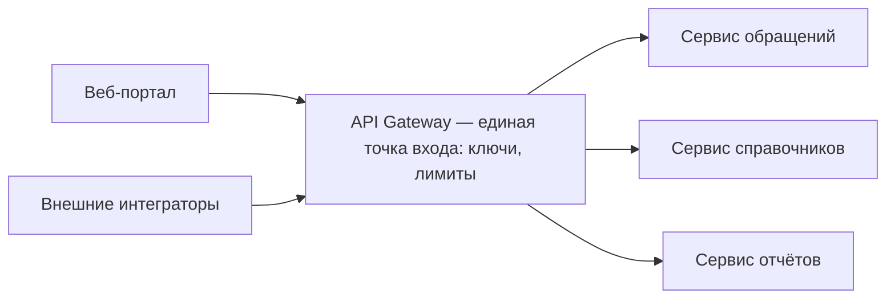

# Лекция 29. API Gateway — обзор

На прошлом уроке мы разобрали reverse proxy и аналогию «ресепшен в офисном здании»: все посетители проходят через одну стойку, а стойка знает, в какой кабинет кого провести. Сегодня эта инфраструктура делает следующий шаг. Представьте, что в здание стали приходить не случайные гости, а постоянные контрагенты, и с каждым нужно по правилам: проверить пропуск, ограничить число визитов, записать, кто и когда приходил, и проводить по этажам. Стойку в такой ситуации превращают в «службу единого окна» — то же место, где принимают всех, но работа с каждым визитёром идёт по правилам. В архитектуре роль такого окна на входе в API выполняет API Gateway.

## Что такое API Gateway

API Gateway (в переводе «шлюз API») — единая точка входа для всех обращений к API, которая решает судьбу каждого запроса по правилам: кто обратился, что ему разрешено, куда передать запрос и в каком виде вернуть ответ. Самое наглядное определение даёт Kong, один из известных продуктов этого класса: «API gateway — это reverse proxy, который позволяет управлять, настраивать и маршрутизировать запросы к вашим API». Обратите внимание: это не механизм другого рода, а всё тот же reverse proxy, к которому добавили управление и настройку.

AWS в своей документации называет такой шлюз «front door» — входной дверью к внутренним сервисам, через которую проходят управление потоком запросов, проверка доступа, мониторинг и управление версиями API. Microsoft описывает своё решение, Azure API Management, в том же духе: запросы клиентов сначала приходят на шлюз, который служит фасадом к сервисам backend, а маршрутизация, безопасность, лимиты, кэширование и наблюдаемость настраиваются в одном месте. Названия у вендоров различаются, конструкция одна и та же.

## Чем Gateway отличается от reverse proxy

Начнём с общего. И reverse proxy, и API Gateway — единая точка входа: клиент обращается по одному адресу и не знает внутреннего устройства системы. Оба занимаются маршрутизацией — решают, какому внутреннему серверу передать запрос. Из урока 28 мы помним, как это устроено в nginx: прокси передаёт запрос на указанный сервер и возвращает ответ, а типовое назначение reverse proxy — балансировка нагрузки. Если большего от входа не нужно, reverse proxy с балансировкой закрывает вопрос.

Gateway добавляет к этому правила. Разница видна в поведении стойки. Reverse proxy — это ресепшен: «пропустите, третий этаж, кабинет номер семь». Gateway — это «единое окно» приёмной службы, как в многофункциональных центрах госуслуг: специалист проверяет, кто вы и какие документы у вас с собой, определяет, к какому окну направить вопрос, ограничивает, сколько раз в день вы можете обращаться без записи, и фиксирует визит в общей книге. С каждым визитёром работают по одним и тем же настроенным правилам, и правятся они в одном месте, а не у каждого специалиста отдельно.

Здесь важны две оговорки — граница аналогии. Первая: «окно» объясняет суть правил, но не масштаб. Настоящий шлюз — программная система, которая обрабатывает тысячи запросов в секунду, хранит свою конфигурацию и сама может стать точкой отказа — местом, падение которого остановит весь вход в систему. Поэтому и сам шлюз проектируют по правилам отказоустойчивости. Вторая оговорка: граница между reverse proxy и gateway — не «глупый против умного». Один и тот же продукт может исполнять обе роли: NGINX описывает NGINX Plus как балансировщик, reverse proxy и API gateway одновременно. Роль определяется тем, сколько правил на входе вы назначили этому слою, а не названием коробки.

## Задача в проекте Compliance: появились разные клиенты

Вернёмся в сквозной кейс. До недавнего времени API в Compliance обслуживал только собственный веб-портал: сотрудники заводят обращения о конфликте интересов и декларации о подарках, комплаенс-офицер их разбирает. Внешние обращения к API не предусматривались, правила доступа были простыми и общими — reverse proxy справлялся.

Теперь ситуация изменилась: к системе подключаются внешние интеграторы — сторонние организации, чьи программы общаются с Compliance через API. Например, HR-система компании сама загружает заявления сотрудников о конфликте интересов. Появилось несколько разных клиентов со своими правами, нагрузкой и уровнем аккуратности.

Проектировочный вопрос: повторять одни и те же правила доступа в каждом внутреннем сервисе или поставить одно «окно»? Повторять плохо: тогда каждый сервис проверял бы ключи отдельно, считал лимиты отдельно и писал бы логи по-своему, а при первых изменениях правила разъехались бы по сервисам. Решение — один слой на входе, который делает общее для всех клиентов:

На схеме видно главное: все обращения проходят через одну точку, и именно здесь живут ключи, лимиты и общая наблюдаемость. Внутренние сервисы занимаются своей логикой — обращениями, справочниками, отчётами — и не знают, сколько клиентов за шлюзом.

## Обязанности шлюза: путь одного запроса

Разберём обязанности так, как их проживает один запрос интегратора от входа до ответа.

Первое, что происходит на входе, — по адресу определяют, куда вести запрос. Вспомним, как мы читаем такие записи в курсе: домен — имя узла в сети, по которому систему находят; путь — дополнение к домену, которое говорит, к какой части API идёт обращение. Это не папка на диске и не локальный файл: реального каталога с таким именем на сервере может вообще не существовать, путь разбирается по правилам маршрута. Совокупность конкретного домена и пути называют endpoint — за каждым endpoint закреплена определённая операция, например «создать обращение». В Compliance адрес создания обращений мог бы выглядеть как `compliance.company.local/api/requests`: домен здесь `compliance.company.local`, путь — `/api/requests`.

Маршрутизация у gateway тоньше, чем у reverse proxy: не «передать всё на один сервер», а «прочитать путь и направить к нужному сервису». То, что начинается с `/api/requests`, уходит в сервис обращений; `/api/reports` — в сервис отчётов; `/api/directories` — в сервис справочников. Если завтра появится сервис деклараций, меняется конфигурация шлюза, а не код клиентов.

Вторая обязанность — версионность. Версия API — это опубликованный вариант правил общения: какие существуют endpoint'ы, какие данные приходят в запросах и возвращаются в ответах, что означают поля. Пока изменения совместимы со старыми клиентами — например, добавлено необязательное поле, — версия остаётся прежней. Как только очередное изменение сломает старых клиентов — скажем, переименовано обязательное поле, — публикуется новая версия, и какое-то время работают обе: старые интеграторы не спешат переделываться, новые сразу подключаются к свежей параллельной версии. Gateway помогает содержать такое сосуществование: `/api/v1/requests` маршрутизируется в старый вариант сервиса, `/api/v2/requests` — в новый, а правила перехода прописаны в одном месте. AWS прямо называет управление версиями API среди задач, которые шлюз берёт на себя.

Третья обязанность — пропуск и разрешения. Аутентификация отвечает на вопрос «кто обратился». Типовые средства — API-ключ и токен. API-ключ — длинная секретная строка, которую система выдаёт интегратору один раз при подключении; токен — кратковременный пропуск, который клиент получает после подтверждения личности и который быстро истекает. Gateway проверяет ключ или токен один раз на входе, и внутренним сервисам не нужно повторять эту проверку. Авторизация отвечает на вопрос «что этому клиенту разрешено»: интегратору А можно создавать обращения, но нельзя выгружать справочники целиком, а комплаенс-офицеру портала можно и то и другое. Правила различаются по клиентам и живут на шлюзе.

Четвёртое — лимиты и квоты, защита от перегрузки. Лимит — ограничение вида «не больше столько-то запросов в единицу времени»; квота — ограничение на объём за период, например на число обращений в сутки. Зачем это нужно: один интегратор с зацикленной программой, который по ошибке (или умышленно) штурмует систему сотнями запросов в секунду, способен затормозить работу всех остальных — включая сотрудников портала. Лимиты и квоты делят возможности системы справедливо и предсказуемо; для Compliance это прямой ответ на ожидание бизнеса, что внешние подключения не помешают основной работе. Терминология у вендоров разная: у AWS это throttling, у Azure quotas, у Kong rate limiting. Суть одна, и в требованиях мы пишем обычными словами: лимиты и квоты.

Дальше шлюз приводит данные к удобному виду. Трансформация — изменение формы запроса или ответа: поля переименовываются, лишнее скрывается, значения приводятся к нужному формату, чтобы клиент получил данные так, как ему удобно, а не во внутреннем формате сервиса. В Azure API Management такие правила называются policies — это просто настраиваемые правила на шлюзе. Агрегация — соединение ответов нескольких сервисов в один. Чтобы собрать полную картину «обращение + назначенный исполнитель + статус», интегратору пришлось бы самостоятельно обойти три сервиса тремя запросами; с агрегацией он делает один запрос, а шлюз сам обходит нужные сервисы и склеивает ответ. Интегратору проще, но шлюзу прибавилось работы — ещё один пункт в балансе «польза/цена».

Наконец, наблюдаемость. Мониторинг — постоянное наблюдение за состоянием: сколько запросов проходит, сколько из них с ошибками, какова задержка ответов. Логирование — записи о конкретных событиях: кто, когда, к какому endpoint обращался и чем всё закончилось. Так как через шлюз проходят все запросы, общая картина складывается сама собой: не нужно в каждом сервисе заново считать обращения по каждому клиенту. Для аналитика это тоже типовая строка требований: «нужны единые логи и метрики по обращениям интеграторов».

Мост к следующему уроку: многие шлюзы умеют кэшировать ответы — так делает, например, Azure API Management: частый одинаковый ответ он отдаёт из своей памяти, не дёргая сервис. Это полезно, но кэширование — отдельная тема со своими ловушками, и следующая лекция посвящена именно ему.

## Признаки запроса на gateway в требованиях

Аналитик редко встретит в тексте требований слово «API Gateway» — обычно запрос предъявляется признаками. Если встречается набор вроде:

- «нужен единый вход для всех внешних обращений к API»;
- «система выдаёт API-ключи интеграторам и проверяет их»;
- «для каждого интегратора задаются свои лимиты и квоты»;
- «API должен поддерживать несколько версий одновременно»;
- «нужны единые логи и метрики по обращениям к API»;

— это сильный сигнал, что на схеме системы появится gateway. Если же таких строк нет, а речь о внутреннем монолите, — скорее всего, достаточно reverse proxy из урока 28.

## Когда Gateway избыточен

Обратная сторона. Пусть Compliance на ранней стадии: система только для сотрудников, один портал, один монолитный backend. Правила доступа просты и одинаковы для всех, версионности нет, лимитов по клиентам нет, учёт запросов сервис ведёт сам. Шлюз здесь не решает ни одной задачи этой системы — цену платит сразу и полностью. Каждый новый компонент — это правила, которые нужно придумать и согласовать; настройка, которую нужно поддерживать; и лишняя точка отказа, через которую может остановиться весь вход в систему. Ставить gateway «потому что модно и у всех» — классическая ошибка проектирования: издержки появляются немедленно, а польза — только когда появляется много клиентов с разными правилами.

Рабочий ориентир: чем больше разных внешних клиентов и чем сильнее различаются их права, нагрузки и версии, тем весомее аргументы за gateway; чем ближе картина к «один внутренний портал, один сервер», тем уместнее reverse proxy с балансировкой. Между полюсами граница плавная: два интегратора с одинаковыми правилами часто живут без шлюза, а вот десяток интеграторов с разными квотами и версиями — уже нет.

## Решение для Compliance

Разрешим сценарий урока. Система Compliance открывает API наружу, и все клиенты — портал и внешние интеграторы — работают через единый вход. Gateway проверяет ключи и токены, задаёт каждому клиенту свои лимиты и квоты, маршрутизирует обращения к сервисам обращений, справочников и отчётов и даёт единую картину мониторинга и логов. Backend не повторяет правила для каждого клиента отдельно: проверка пропуска сделана один раз на входе, сервисы отвечают за свою бизнес-логику.

Важно, как это решение выглядит в работе аналитика: не «поставим gateway, так делают все», а зафиксированные требования — единый вход, выдача и проверка ключей, лимиты по клиентам, поддержка нескольких версий, единые логи и метрики. Конкретный продукт — AWS API Gateway, Azure API Management, Kong или NGINX — вторичен: это пока просто примеры одного класса инструментов, без тарифов и настроек.

## Итог и место в модуле

Соберём урок в несколько строк. API Gateway — развитие reverse proxy: та же единая точка входа и маршрутизация, плюс правила — аутентификация и авторизация, лимиты и квоты, версионность API, трансформация и агрегация данных, общий мониторинг. Самый короткий способ запомнить границу — формула Kong: «reverse proxy, к которому добавили управление и настройку».

Чек-лист, когда выбираем gateway, а не только reverse proxy:

- внешних клиентов несколько, и правила у них различаются;
- нужна единая выдача и проверка API-ключей;
- нужны лимиты и квоты по каждому клиенту;
- API живёт в нескольких версиях одновременно;
- нужны единые логи и метрики по всему входящему трафику.

Если по всем пунктам ответ «нет», достаточно reverse proxy с балансировкой, а введение шлюза стало бы лишней точкой отказа без выгоды. Место темы в M05: по инфраструктурной линии сразу после reverse proxy (урок 28) и перед кэшированием, которое станет темой следующего урока.

## Источники

- Kong Docs, «Kong Gateway» (обзор): формула «API gateway — это reverse proxy, к которому добавляются управление, настройка и маршрутизация» — https://docs.konghq.com/gateway/latest/
- Microsoft Learn, «Azure API Management — Overview and key concepts»: шлюз как фасад к backend-сервисам, policies, quotas, логи и метрики — https://learn.microsoft.com/en-us/azure/api-management/api-management-key-concepts
- Amazon API Gateway Developer Guide, «What is Amazon API Gateway?»: «front door», авторизация и контроль доступа, управление версиями API — https://docs.aws.amazon.com/apigateway/latest/developerguide/welcome.html
- NGINX Docs, «NGINX Reverse Proxy» (admin guide): прокси передаёт запрос на указанный сервер и возвращает ответ; балансировка как типовое применение — https://docs.nginx.com/nginx/admin-guide/web-server/reverse-proxy/
- NGINX (F5), обзорная страница NGINX Plus: позиционирование «балансировщик, reverse proxy и API gateway в одном продукте» (оговорка: это общая продуктовая страница, а не профильная статья по API gateway) — https://www.nginx.com/products/nginx-plus/
