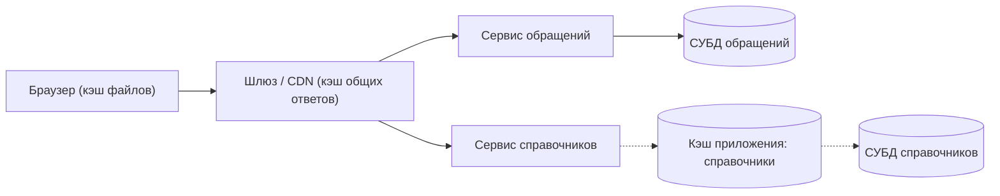

# Answers

Разбор заданий из [exercises.md](exercises.md). В коротких ответах и кейсе засчитываем смысл, а не дословную формулировку: главное — опора на материал лекции 30.

## A1. Что такое кэш и зачем он нужен

**Правильный ответ: A.** Кэш — быстрое хранилище копий часто используемых данных рядом с их медленным источником. Причин у него ровно две: сделать ответ быстрее и снять нагрузку с источника. Хороший кэш снимает обе задачи сразу.

Почему другие варианты неверны:

- **B** — кэш хранит копии, а не оригиналы. Источник истины всегда один (база данных); копию можно в любой момент отбросить и взять заново.
- **C** — упущена вторая причина. Чем больше запросов обслужено из копии, тем меньше работы достаётся базе. Лекция отдельно предупреждает: очень быстрый кэш при заваленном источнике не ускоряет ничего — пользователи всё равно будут ждать.
- **D** — кэш не может быть единственным путём к данным: если копии нет, источник обязан быть доступен, иначе промах превращается в отказ.

## A2. Попадание в кэш и промах

**Правильный ответ: A.** Первый запрос — промах (cache miss): копии в кэше не было, сервис пошёл в источник, забрал данные и положил их в кэш на будущее. Второй — попадание в кэш (cache hit): копия уже была, источник не трогали. Промах — не авария и не ошибка, а нормальная часть работы: у любого кэша есть доля промахов, и она тем больше, чем быстрее меняются данные или чем реже к ним обращаются.

Почему другие варианты неверны:

- **B** — вывод «кэш сломался» здесь неверный. Промах означает «копии не было, пошли за оригиналом» — чинить тут нечего.
- **C** — быстрый ответ сам по себе не доказывает попадание в кэш. Попадание или промах решается по ключу кэша и по наличию действительной копии, а не по задержке.
- **D** — направление перепутано: первым копии ещё нет, а второй запрос как раз её находит.

Отдельно из лекции: кэш не может быть единственным путём к данным — при промахе источник обязан быть доступен.

## A3. Где живут кэши

**Правильный ответ: A.** Кэш — не одна волшебная коробка, а слой, который может стоять в нескольких местах, и каждый уровень хранит своё и отвечает за свой участок пути: браузер — скачанные файлы, шлюз и CDN — ответы, заведомо одинаковые для всех, кэш приложения — копии часто запрашиваемых данных, СУБД — данные, к которым обращаются чаще всего.

Почему другие варианты неверны:

- **B** — мест несколько, и у каждого своё содержимое; схема лекции это показывает прямо.
- **C** — шлюз умеет кэшировать ответы, одинаковые для всех (это и есть мост из урока 29), а CDN — сеть промежуточных узлов, где ответы хранятся ближе к пользователю.
- **D** — уровни кэшируют разное: браузер хранит файлы (картинки, стили, скрипты), шлюз — ответы для всех, кэш приложения — копии запрашиваемых данных. Персональные и авторизованные ответы в общий кэш на шлюзе не кладут.

Следствие, важное для всей темы: раз кэшей несколько, вопрос «откуда пришёл ответ» имеет несколько ответов. Когда пользователь жалуется, что видит старое, проверять придётся цепочку, а не один слой.

## A4. Когда кэш вредит

**Правильный ответ: A.** Правило лекции: кэшируем то, что меняется редко и читается часто; не кэшируем то, что меняется быстро; не кэшируем персональное. Быстро меняющиеся данные (статусы обращений, свежие решения, зависящие от действий людей) — прямой пример «кэша ради кэша»: копия устаревает быстрее, чем успевает пригодиться, пользователи получают старое, а инженер всё это чинит.

Почему другие варианты неверны:

- **B** — типовой вывод «кэш всегда ускоряет, значит включаем везде». Выигрыш зависит и от свежести, а «ограничить только персональными данными» убирает ровно тот случай, где кэш вредит сильнее всего.
- **C** — правило перевёрнуто: как раз быстро меняющиеся данные кэшировать нельзя.
- **D** — кэш не «лекарство по жалобе»: решение принимается по типу данных и по свежести, а не по факту жалобы.

## A5. Два риска и сложность сброса

Ожидаемый ответ (пример своими словами):

> Два риска из лекции — устаревший кэш и кэш ради кэша. Устаревший кэш: сотрудник подал обращение, комплаенс-офицер вручную изменил его решение или статус, сотрудник обновил страницу — и видит прежний статус. Система при этом «работает», ошибок нет, но человек видит старое: сохранённая копия выдаётся до конца её времени жизни. Кэш ради кэша: начинают кэшировать всё подряд, включая то, что меняется быстро, — такой кэш создаёт работу, а не снимает её: копия устаревает быстрее, чем успевает пригодиться, пользователи получают старое, а инженер всё это время чинит. Сброс кэша сложен потому, что проблема не в строчке кода, а в договорённостях между компонентами: кэшей несколько, у каждого своя копия и свой срок, поэтому надо знать, где лежит копия, каков её срок и кто её сбрасывает. Без такой записи в требованиях вопрос «почему видно старое» приходится искать по всей цепочке: браузер → шлюз → кэш приложения → база.

Что важно в ответе: названы оба риска (устаревший кэш и кэш ради кэша) и объяснена сложность сброса — копий несколько, у каждой свой срок, нужен явный ответ «кто и когда сбрасывает».

## A6. Почему статусы обращений не кэшируют

Ожидаемый ответ (пример своими словами):

> Статусы обращений и свежие решения меняются быстро и зависят от действий людей, поэтому их копия устареет быстрее, чем пригодится. Это и есть отрицательный случай «устаревший кэш»: сотрудник обновил страницу и видит прежний статус, при этом система «работает» и ошибок нет — то есть человек видит старое и считает, что система сломалась. Отсюда правило лекции: кэшируем то, что меняется редко и читается часто (в Compliance — справочники), а то, что меняется быстро, не кэшируем. Если копия всё же необходима, задают срок жизни в минуты, чтобы «старое» не успевало задержаться, и решение фиксируют в требованиях, а не оставляют на усмотрение разработчика. И ещё: статус — это данные конкретного сотрудника, а общий кэш живёт в общем пространстве, поэтому такие ответы, как и персональные данные, в кэш не кладут.

Что важно в ответе: (1) причина — быстрое изменение данных и зависимость от действий людей; (2) следствие — устаревшая копия и жалоба «вижу старое, система сломалась», хотя система работает; (3) решение — не кэшировать, а если без копии нельзя, срок жизни в минуты, зафиксированный в требованиях.

## A7. Что записать в требования про кэш

Ожидаемый результат — минимум четыре пункта, и по каждому типу данных:

1. **Что кэшируем, а что нет.** Справочники (типы обращений, коды, подразделения, категории) — да; статусы обращений и свежие решения — нет; персональные данные и ответы конкретному пользователю — нет.
2. **Где лежит копия.** Для справочников — кэш приложения; что кэшируется на уровне шлюза или CDN — там, где ответ заведомо одинаков для всех.
3. **Каков срок жизни (TTL) копии.** Для справочников — часовой порядок как ориентир; для быстро меняющихся данных, если копия всё-таки нужна, — минуты.
4. **Кто и когда сбрасывает копию.** Пример: администратор меняет справочник подразделений и сохраняет изменение — система должна сбросить копию в кэше сразу после сохранения, а не ждать истечения срока.

Разграничение обязательно: TTL защищает медленно («в крайнем случае через заданный срок»), инвалидация — сразу («сбросили в момент сохранения»). Ответ без пункта «кто и когда сбрасывает копию» считается неполным: без него свежесть не гарантирована ни в каком сценарии.

Допускается (но не обязательно) назвать ключ кэша: по лекции это часть требований, а не деталь реализации — при несовпадении ключей кэш стабильно показывает промахи, а при совпадении ключей у разных запросов отдаёт чужую запись.

## A8. Мини-кейс: кэширование в Compliance

Кейс считается решённым, если выполнены все наблюдаемые критерии приёмки:

1. По справочникам принято решение «кэшируем»: копия лежит в кэше приложения, срок жизни — «часовой порядок» как ориентир (без конкретных цифр конфигурации), а при изменении справочника копия сбрасывается инвалидацией сразу после сохранения.
2. Статусы обращений и свежие решения названы некэшируемыми; допустимо указать срок жизни в минуты, если без копии обойтись нельзя; решение зафиксировано в требованиях, а не оставлено на усмотрение разработчика.
3. Персональные данные и ответы конкретному пользователю названы некэшируемыми, причина названа: общий кэш живёт в общем пространстве, ошибка в ключе отдаёт человеку чужое, авторизованные ответы на шлюзе не переиспользуются.
4. Для каждого типа данных указано, где лежит копия (браузер, шлюз или CDN, кэш приложения): копия не «в вакууме».
5. Названы все четыре пункта требований: что кэшируем и что нет; где лежит копия; каков срок жизни (TTL); кто и когда сбрасывает копию.
6. Различены TTL и инвалидация: TTL защищает медленно («в крайнем случае через заданный срок»), инвалидация — сразу («сбросили в момент сохранения»); в требованиях есть отдельная строка о том, кто и когда сбрасывает копию.
7. На схеме показаны уровни: браузер → шлюз или CDN → сервисы → СУБД; отмечено, где стоит кэш приложения (между сервисом справочников и базой) и что ветка обращений идёт в базу без кэша.
8. Разобрана механика запросов: первый запрос после сброса или истечения срока — промах (cache miss), источник отработал и копия создана; повторный — попадание в кэш (cache hit), до базы запрос не доходит; промах назван нормальной частью работы, а не поломкой.
9. Описан порядок поиска причины при жалобе «вижу старое»: где кэш и каково его время жизни, дальше по цепочке — браузер, шлюз, кэш приложения, база; ответ берётся из требований, а не ищется в коде.
10. В решении не появляются компоненты, правила и настройки, не разобранные в лекции: нет тарифов и параметров конфигурации конкретных продуктов, нет разбора конкретных HTTP-заголовков и алгоритмов вытеснения записей, нет ссылок на шаблоны кэширования, которых в лекции не было.

Пример развязки — для самопроверки, повторять дословно не обязательно:

Решение по типам данных:

| Тип данных | Кэшируем? | Где копия | Срок жизни (TTL) | Кто и когда сбрасывает |
| --- | --- | --- | --- | --- |
| Справочники (типы обращений, коды, подразделения, категории) | Да | Кэш приложения | Часовой порядок как ориентир | Система — инвалидацией сразу после сохранения изменения справочника |
| Статусы обращений и свежие решения | Нет (если без копии нельзя — срок в минуты) | — | Минуты, если копия допущена | То же правило: по событию изменения; но основной путь — не кэшировать |
| Персональные данные и ответы конкретному пользователю | Нет | — | — | — |

Почему так: справочники меняются редко и читаются постоянно, поэтому кэш снимает нагрузку с базы и заметно ускоряет страницу; статусы и решения меняются быстро и зависят от действий людей — их копия устаревает быстрее, чем пригодится, а это и есть устаревший кэш; персональные данные в общий кэш не кладут, потому что ошибка в ключе отдаёт человеку чужое.

Строка о сбросе в требованиях звучит так: «При сохранении изменения справочника система сбрасывает соответствующую копию в кэше приложения немедленно; срок жизни (TTL) служит запасным механизмом на случай, если сброс по событию не произошёл». TTL защищает медленно, инвалидация — сразу.

Если пользователь жалуется, что видит старое, первый вопрос аналитика: где кэш и каково его время жизни? Дальше — по цепочке схемы: браузер, шлюз, кэш приложения, база. Ответ берётся из требований: если там написано, где лежит копия, какой у неё срок и кто её сбрасывает, вопрос закрывается за минуты.

Типовые ошибки в кейсе: «закэшируем всё подряд» без срока и без правила сброса; «срок подберём позже»; «промах — это ошибка, надо чинить»; «сбросит кэш тот, кто разбирается» вместо записи в требованиях.

---

**Карта покрытия learning outcomes**

| LO | Задания |
| --- | --- |
| ARCH-CACHE-LO1 — что такое кэш и две причины его появления | A1 |
| ARCH-CACHE-LO2 — где живут кэши, каждый уровень кэширует своё | A3, A8 |
| ARCH-CACHE-LO3 — попадание в кэш и промах, промах — норма | A2, A8 |
| ARCH-CACHE-LO4 — время жизни (TTL) и инвалидация | A5, A7, A8 |
| ARCH-CACHE-LO5 — что кэшируем в Compliance, а что нет | A4, A6, A7, A8 |
| ARCH-CACHE-LO6 — риски: устаревший кэш, кэш ради кэша, сложность сброса | A4, A5, A6, A8 |
