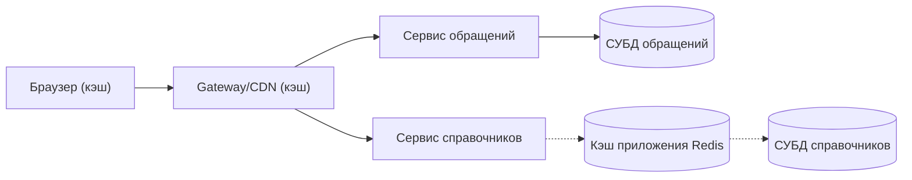

# Лекция 30. Кэш — обзор

## Что такое кэш

В конце прошлого урока мы говорили про шлюз: он принимает запросы снаружи, проверяет доступ, разводит их по внутренним сервисам и скрывает от пользователя устройство системы. Там же прозвучала фраза, которую стоит вспомнить дословно: многие шлюзы умеют кэшировать ответы. Сегодня мы эту фразу раскрываем: выясним, что именно шлюз и другие части системы держат «под рукой», пока пользователь ждёт ответ.

Начнём с рабочей ситуации. Сотрудник компании открывает портал Compliance и идёт в справочник типов обращений. Страница со списком из сорока позиций грузится каждое обращение заново, и каждый раз браузер идёт через шлюз в сервис справочников, а тот — в базу данных. База отвечает честно, но медленно: соединение, запрос, чтение строк, возврат. Для одного списка это десятки миллисекунд, для сотни таких списков за день — заметная нагрузка, которую база всё равно не любит. При этом сами справочники меняются раз в месяц или реже.

**Кэш** — это быстрое хранилище копий часто используемых данных, расположенное рядом с их медленным источником. Слово «копии» здесь ключевое: кэш хранит не оригиналы, а их дубликаты, которые можно отбросить в любой момент и взять заново. Оригинал, то есть источник истины, у данных всегда один — база данных.

Появление кэша объясняется ровно двумя причинами, и важно понимать их отдельно. Первая — **скорость**: прочитать из быстрого хранилища рядом с приложением почти всегда дешевле, чем сходить в базу по сети. Вторая — **снятие нагрузки** с источника: чем больше запросов обслуживается из копии, тем меньше работы достаётся базе. Это разные выгоды, и они не всегда совпадают: теоретически можно сделать кэш очень быстрым, но если источник всё равно завален, пользователи всё равно будут ждать. Хороший кэш снимает обе задачи сразу.

Помогает аналогия с конспектом. Студент пересказывает лекцию в тетрадь — краткий конспект позволяет вспомнить материал за секунды, не поднимая учебник. Роль та же: быстрая копия под рукой. Но здесь проходит граница применимости аналогии: у конспекта нет ни времени жизни, ни механизма сброса. Если учебник переиздали, конспект останется прежним, и студент будет уверенно пересказывать устаревшую версию — и не узнает, что ошибся. У кэша оба механизма обязательны: у каждой копии есть срок, после которого она протухает, и есть способ сбросить её досрочно, если источник изменился. Дальше мы разберём и то, и другое.

## Где живут кэши

Кэш — не одна волшебная коробка, а слой, который может стоять в нескольких местах. Каждый уровень хранит своё и отвечает за свой участок пути. На схеме ниже «СУБД» — это базы данных, где лежат сами записи.

Ближе всего к пользователю — **браузер**: он умеет хранить у себя скачанные файлы (картинки, стили, скрипты) и повторно использовать их, не обращаясь к серверам вообще. Дальше — **шлюз и CDN**: CDN (сеть доставки контента) — это сеть промежуточных узлов по всему миру, где ответы хранятся ближе к пользователю; шлюз умеет делать то же самое для тех ответов, которые заведомо одинаковы для всех. Ещё глубже — **кэш приложения**: обычный сервисный компонент, который хранит копии часто запрашиваемых данных (в нашей схеме условно Redis — это продукт класса «быстрое хранилище в памяти», то есть данные лежат в оперативной памяти, а не на диске). И наконец, сама **СУБД** внутри умеет держать в памяти данные, к которым обращаются чаще всего, чтобы не читать их каждый раз с диска.

Пунктиром на схеме выделена ветка со справочниками: там между сервисом и базой стоит кэш приложения — сервис сначала смотрит в кэш, и если нужной копии там нет, идёт в базу и наполняет кэш. У ветки обращений такого звена нет: там запрос идёт прямо в базу. Схема показывает, где стоят кэши, а не точную последовательность вызовов: важно, что при попадании в кэш запрос до базы не доходит.

Важное следствие: раз кэшей несколько, то «откуда пришёл ответ» — вопрос с несколькими ответами. Когда пользователь жалуется, что видит старое, проверять придётся не один слой, а цепочку. Именно поэтому в требованиях к системе кэш описывают явно: где именно лежит копия, на какой срок и кто её сбрасывает.

## Попадания и промахи

Разберём механику на сквозном примере Compliance. Аналитик открывает справочник типов обращений, чтобы создать обращение. Сервис справочников смотрит в кэш приложения.

Копии там нет. Это **промах** (cache miss): кэш не смог обслужить запрос, и сервис идёт в базу, достаёт данные и кладёт их в кэш на будущее. Первый запрос после сброса или после истечения срока всегда такой — источник отработал, копия создана. Второй запрос того же справочника, скажем, из соседней вкладки, копию уже находит: это **попадание в кэш** (cache hit) — источник не трогали, ответ собрали из копии.

Промах — не авария и не ошибка. Это нормальная часть работы кэша: у любого кэша есть доля промахов, и она тем больше, чем быстрее меняются данные или чем реже к ним обращаются. Аналитику важно понимать именно это: промах не означает «кэш сломался», он означает «копии не было, пошли за оригиналом». Второй важный вывод: кэш не может быть единственным путём к данным. Если копии нет, источник обязан быть доступен — иначе промах превращается в отказ.

Решение «попадание или промах» принимается по ключу кэша — по признаку, по которому запись ищется и складывается: один и тот же запрос с одним и тем же ключом даёт попадание, если копия по этому ключу есть и действительна, и промах, если её нет. Отсюда две типичные поломки. Если ключ, по которому ищут, не совпадает с тем, по которому клали, кэш будет стабильно показывать промахи. Если же два разных запроса поделили один ключ, кэш отдаст чужую запись — поэтому персональные данные в кэш не кладут. Именно поэтому ключ кэша — часть требований, а не деталь реализации.

Отдельно стоит сказать про то, что кэш обычно меряют долей попаданий: чем больше запросов обслужено из копий, тем сильнее снята нагрузка с базы и тем короче ответ. Это не единственная метрика — важна ещё и свежесть, — но для разговора об «узких местах» это первое, что стоит посмотреть.

## Время жизни

У копии в кэше есть **время жизни** — срок, в течение которого её можно выдавать, не сверяясь с источником. В профессиональной речи этот срок называют TTL (Time to Live, «время жизни»): время, за которое запись в кэше остаётся действительной, а потом считается протухшей.

Два уровня задают срок по-разному, но идея одна. В кэше приложения записи живут в памяти и умирают по таймеру: истёк срок — запись удаляется, и следующий запрос снова идёт к базе, как это было при первом промахе. На уровне веб-сервера и шлюза срок задаётся как «срок валидности ответа»: пока он не прошёл, шлюз отдаёт сохранённую копию. Тот же смысл в стандарте HTTP, который описывает кэширование ответов: там у ответа есть «свежесть», и пока запас свежести не исчерпан, ответ можно отдавать из копии.

Выбор срока — это компромисс, и его полезно проговаривать явно. Большой TTL означает, что мы редко ходим в базу и сильно снимаем нагрузку, но любая ошибка в данных живёт в копии долго. Маленький TTL означает, что данные быстро «освежаются», но походы в базу повторяются часто и нагрузка возвращается. Практическое правило, выведенное из опыта эксплуатации: срок жизни подбирают под скорость изменения данных, а не «на глаз».

## Инвалидация

Срок жизни — защита медленная: пока время не истекло, кэш считает копию годной и отдаёт её, даже если источник давно изменился. Второй механизм нужен для случая, когда данные изменились, а срок ещё не вышел: **инвалидация** — принудительный сброс или обновление копии по событию «источник изменился».

Как это выглядит на практике. В кэше приложения (Redis) сервер отслеживает изменения данных и сообщает, какие копии нужно выбросить: устаревшая копия удаляется, и при следующем обращении данные читаются заново из источника. У веб-сервера и шлюза (nginx) есть механизм принудительного сброса записи — чтобы старые и новые данные не смешивались в отдаче. В стандарте HTTP есть раздел про инвалидацию сохранённых ответов: копию разрешено не только выбросить по сроку, но и сбросить, когда источник сообщил об изменении.

Разница между двумя механизмами стоит запомнить формулой: **TTL защищает медленно, инвалидация — сразу**. TTL — это «в крайнем случае через заданный срок», инвалидация — «сбросили в момент сохранения». В рабочих требованиях на кэш обязательно появляется строка о том, кто и когда сбрасывает копию: без неё свежесть не гарантирована ни в каком сценарии. В Compliance это выглядит так: администратор меняет справочник подразделений и сохраняет изменение; система должна сбросить копию в кэше сразу после сохранения, а не ждать истечения срока.

## Когда кэш вредит

Разбор кэша без отрицательных случаев дал бы неполную картину. Вот два типичных.

**Первый: устаревший кэш.** Сотрудник подал обращение, комплаенс-офицер вручную изменил его решение или статус, сотрудник обновил страницу — и видит прежний статус. Система при этом «работает», ошибок нет, но человек видит старое. Причина в том, что ответ «об этом обращении» был сохранён в копии, и до истечения её времени жизни шлюз или сервис отдаёт сохранённую версию. Особенно обидно, когда речь о персональных данных сотрудника: в стандарте HTTP прямо оговорено, что общий кэш на шлюзе не должен переиспользовать авторизованные ответы без явного разрешения на то. Персональные страницы в кэш не кладут.

**Второй: кэш ради кэша.** Соблазн поддаётся на фразу «данные уже там» — и начинают кэшировать всё подряд, включая то, что меняется быстро. Такой кэш создаёт работу, а не снимает её: копия устаревает быстрее, чем успевает пригодиться, пользователи получают старое, а инженер всё это время чинит. Правило, которое стоит записать в требования: кэшируем то, что меняется редко и читается часто; не кэшируем то, что меняется быстро; не кэшируем персональное.

Жизненная ситуация, из которой вырастает первое правило диагностики: пользователь изменил свои данные, а до конца времени жизни копии всё ещё видит старое. Обычно в этот момент звучит «система сломалась». Первый вопрос аналитика звучит так: **где кэш и каково его время жизни?** Дальше — по цепочке из схемы: браузер, шлюз, кэш приложения, база. Ответ находится не в коде, а в требованиях: если в них написано, где лежит копия, какой у неё срок и кто её сбрасывает, то такой вопрос закрывается за минуты.

Есть даже приписываемая Фила Карлтону шутка о том, что две труднейшие задачи в информатике — придумать имена и сбросить кэш. Это пересказ чужой мысли, а не руководство к действию, но шутка точная: проблема сброса действительно не в строчке кода, а в договорённостях между компонентами.

## Что кэшируем в Compliance

Теперь превратим рассуждение в решение по нашим данным.

**Справочники** — типы обращений, коды, подразделения, справочник категорий — меняются редко, запрашиваются постоянно. Их кэшируем: копия лежит в кэше приложения, срок жизни подлиннее (часовой порядок — разумный ориентир для редко меняющихся справочников), а при изменении справочника копия сбрасывается инвалидацией сразу после сохранения. Здесь кэш снимает нагрузку с базы и заметно ускоряет страницу.

**Статусы обращений и свежие решения** меняются быстро и зависят от действий людей. Их в кэш не кладём: либо не кэшируем вовсе, либо — если без копии обойтись нельзя — задаём срок жизни в минуты, чтобы «старое» не успевало задержаться. Решение фиксируется в требованиях, а не остаётся на усмотрение разработчика.

**Персональные данные и ответы конкретному пользователю** — в кэш не попадают. Кэш живёт в общем пространстве, ошибка в его ключе отдаёт человеку чужое.

Чтобы это не превратилось в устную договорённость, фиксируем в требованиях четыре вещи — и четыре пункта на каждый тип данных:

- что кэшируем, а что нет;
- где лежит копия (браузер, шлюз, кэш приложения);
- каков срок жизни (TTL) копии;
- кто и когда сбрасывает копию.

Этого достаточно, чтобы ответить и на вопрос пользователя «почему старое», и на вопрос эксплуатации «куда смотреть, когда нагрузка на базу растёт».

## Что дальше

Кэш хранит копии — и это хорошо, но копия всегда указывает на оригинал. Оригиналы же лежат в хранилищах: в базах данных, в файловых системах, в объектных хранилищах, где лежат сами документы Compliance — заявления, доказательства, вложения. Как устроены эти хранилища, чем они отличаются друг от друга и почему для больших объёмов данных выбирают объектное, а не файловое, — тема следующего урока ARCH-STORAGE. А пока зафиксируем главное: кэш — это ускоритель, а не хранилище. Он помогает отвечать быстро, пока данные не меняются, и обязан уступить место источнику, как только те изменились.

## Источники

- NGINX Admin Guide, «NGINX Content Caching» — https://docs.nginx.com/nginx/admin-guide/content-cache/content-caching/
- Redis Docs, «Client-side caching introduction» — https://redis.io/docs/latest/develop/clients/client-side-caching
- AWS, «Caching Overview» — https://aws.amazon.com/caching/
- AWS CloudFront Developer Guide, «Understand the cache key» — https://docs.aws.amazon.com/AmazonCloudFront/latest/DeveloperGuide/understanding-the-cache-key.html
- IETF RFC 9111, «HTTP Caching» (стандарт HTTP о кэшировании ответов) — https://www.rfc-editor.org/rfc/rfc9111.html
