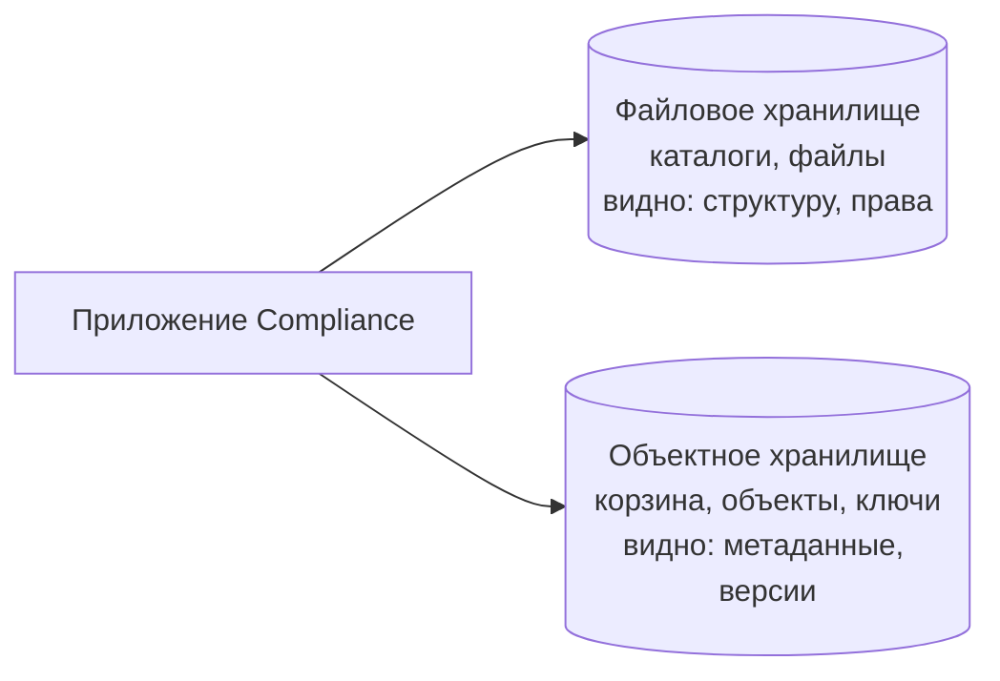

# Лекция 31. Файловое/объектное хранилище — обзор

Прошлый урок — про кэш — закончился простым правилом: копия всегда указывает на оригинал. Отсюда следовало, что оригиналы живут отдельно, в хранилищах: в базах данных, в файловых системах, в объектных хранилищах. Сегодня смотрим на эти хранилища как на три разных инструмента — три ответа на вопрос «как положить данные и как потом их найти».

## Три вида хранилищ

Хранилищ на самом деле три, и в требованиях их регулярно путают.

**Блочное хранилище** — это «сырой том»: кусок диска, отданный системе целиком, без файлов и без структуры. Файловую систему поверх него строит кто-то другой — обычно сама СУБД, которая решает, как разместить свои таблицы и индексы по этому куску. Для нас это в первую очередь контекст: на уровне требований мы говорим «таблица заявок», «запись в таблице», а не «файл базы данных». Блочное хранилище — это то, на чём работает база, а не то, с чем мы работаем руками.

**Файловое хранилище** — привычная картина: каталоги вложены друг в друга, и в них лежат файлы. Иерархия каталогов здесь не украшение: поверх неё живут права доступа и общие папки, к которым подключаются несколько человек сразу.

**Объектное хранилище** — склады контейнеров, в которых лежат объекты. У объекта нет имени файла и нет родительского каталога; у него есть уникальный адрес внутри контейнера, который так и называется — ключ (key). Контейнер называется корзина (bucket).

Схема читается так: одно приложение пишет в два разных хранилища, и в каждом оно видит разное. В файловом хранилище видно структуру — каталоги, вложенность, права на папку. В объектном — не структуру, а свойства объекта: метаданные, версии, когда объект создан и кем. Эта разница определяет, что вы вообще сможете показать пользователю в интерфейсе и по чему сможете искать.

## Файловое хранилище: каталоги, файлы и права

Файловое хранилище удобно представить как шкаф с папками и ярлыками: в шкафу папки, в папках документы, на каждом — ярлык с названием. Граница аналогии: шкаф ничего не знает о содержимом и не замечает, что ярлык устарел. В настоящем хранилище за ярлыком стоит файл, у которого есть права, размер, дата изменения и владелец.

Файловое хранилище ведёт себя как привычный диск. Файл можно открыть, изменить и закрыть; переименовать — и он останется на месте под новым именем; переместить в другой каталог; удалить. Переименование и перемещение — операции над **адресом** файла: они выполняются «поверх» данных, содержимое не переписывается. А изменение содержимого перезаписывает данные.

Отсюда же видно, зачем файловым хранилищам права и общие папки. Если рабочий документ лежит в папке, доступ к папке — это и есть доступ к документу. Несколько человек могут работать с одной папкой одновременно, а руководитель видит всё её содержимое, даже если часть файлов создавали другие. Доступ из другого офиса дают тем же способом — делают папку общей по сети; как это устроено, мы не разбираем: для нас важно, что общий доступ — обычное свойство файлового хранилища, а не отдельная система.

Для Compliance это хранилище подходит под рабочие документы офицера: черновики и шаблоны, которые он правит, переименовывает и перекладывает по каталогам.

## Объектное хранилище: объекты, ключи и корзины

Объектное хранилище устроено иначе. Представьте склад: огромное помещение, в нём коробки, на каждой — бирка с номером. Чтобы забрать коробку, нужен её номер. Складу всё равно, где стоит коробка: склад не про расположение, склад про адреса.

Объект в объектном хранилище — это **данные и метаданные** в одном объекте. Данные — это содержимое: сам файл. Метаданные — служебные сведения о нём: тип содержимого, размер, дата последнего изменения, кто загрузил объект. Отдельного файла с описанием нет: описание лежит рядом с данными и едет вместе с ними. Поэтому метаданные — рабочий инструмент: по ним объект находят, сортируют и фильтруют.

Адрес объекта — это ключ (key), уникальная строка внутри корзины. Например: `заявки/2026/REQ-1024/договор.pdf`. Строка выглядит как путь, и это главный источник путаницы: **ключ — это адрес, а не путь в иерархии**. Символ `/` в ключе — просто разделитель, договорённость о том, как мы читаем ключ. Не путайте его с ключом кэша из прошлого урока: там ключ искал запись в кэше, здесь ключ — адрес объекта в хранилище.

Доступ к объекту — по протоколу HTTP через программный интерфейс (API): тот же механизм, по которому браузер открывает страницу. Приложение отправляет запрос: «дай объект с таким ключом» — и получает либо содержимое, либо метаданные. Отдельной операции «найти файл по имени» нет: найти — значит знать ключ. По умолчанию содержимое закрыто.

Граница аналогии со складом принципиальна: **склад не притворяется файловой системой**. «Папки» на складе ненастоящие, их физически нет; есть договорённость, как устроен номер. И коробку найдёшь только по заранее оговорённому адресу — просто «пройти по складу и посмотреть» нельзя, хотя склад и показывает список коробок.

## Почему в объектном хранилище нет папок

Базовая модель объектного хранилища — **плоская структура**: каталогов нет, все объекты лежат в корзине рядом, и различает их только ключ. Когда вы пишете ключ `заявки/2026/REQ-1024/договор.pdf`, никто не создаёт папку «заявки» и не заводит в ней подкаталоги «2026». Просто у ключа есть символ `/`, и наш код умеет по нему разбирать. Некоторые консоли показывают «папки» — но это просто группировка по общему началу ключа, придуманная интерфейсом.

Отсюда же — отсутствие переименования и перемещения как отдельных операций. Ключ определяет, как объект будет найден. Сделать вид, что объект «переехал», можно только одним способом: записать содержимое под новым ключом и удалить объект по старому. Это две операции, и между ними есть момент, когда объект существует в двух местах — или ни в одном, если вторая не прошла. Переименование в файловом хранилище атомарно — выполняется целиком: адрес меняется целиком или не меняется вовсе, содержимое остаётся. В объектном — это фактически копирование плюс удаление.

Честная оговорка, чтобы не превратить это в догму: у некоторых вендоров иерархия бывает отдельной опцией. У Google Cloud Storage есть «иерархическое пространство имён» (hierarchical namespace) — настоящие каталоги и атомарное переименование; включается оно при создании корзины и потом не меняется. У Microsoft объектное хранилище устроено как «учётная запись → контейнер → объект», и контейнер прямо сравнивают с каталогом файловой системы. Корректная формулировка такая: **плоская модель — это базовое поведение (по умолчанию так работают Amazon S3 и Google Cloud Storage), а не свойство всех объектных хранилищ.** Но в требованиях считайтесь с базовым случаем: папок нет, переименования нет, есть ключ.

## Версии, срок хранения и надёжность

**Версионирование.** Если для корзины включено версионирование, перезапись объекта не уничтожает старый, а сохраняет его как отдельную версию. Можно вернуть прошлую версию — например, если офицер испортил шаблон или кто-то залил не тот файл. В S3 удаление при включённом версионировании тоже не стирает данные, а помечает объект как удалённый, сохраняя версии для восстановления. По умолчанию версионирование выключено, поэтому оно должно быть явным пунктом требования, а не «ну там вроде есть».

**Жизненный цикл и срок хранения.** Жизненный цикл объекта — правило, по которому объект меняется со временем: спустя заданный срок он удаляется или уходит в архив. Срок хранения берётся из политики компании: сколько лет живёт заявка с вложениями, сколько — материалы проверки. Жизненный цикл и срок хранения работают только в паре: срок без правила остаётся пожеланием, правило без срока удалит лишнее. И ещё деталь: правило действует и на объекты, загруженные раньше, — старые файлы не «выпадают» из-под него только потому, что они старые.

**Надёжность.** Данные в объектном хранилище дублируются внутри площадки: они хранятся сразу на нескольких серверах, в разных зонах доступности. Зона доступности — это отдельная независимая площадка внутри одного центра обработки данных: отказ узла или сервера не означает потерю данных — читатель не заметит. Обратная сторона: такое решение не отменяет резервных копий, но снимает самый частый класс аварий «диск в комнате сгорел».

## Три случая, когда хранилище вредит

Разбор трёх ситуаций, в которых выбор хранилища или его настройка оборачивается проблемой.

**«Сложили папку в объектное хранилище и забыли».** Команда выгрузила в корзину содержимое папки «Договоры 2026» одним списком: ключи получились вроде `Договоры 2026/договор-1.pdf`, а у части файлов — `scan_0001.pdf` без всякой структуры. Формально всё лежит, объектное хранилище довольно. Через полгода приходит запрос: «дайте договор по заявке REQ-1024» — и никто не может выдать ссылку, потому что неизвестно, каким ключом файл залит, а перебирать корзину и сравнивать содержимое никто не станет. Причина одна: у ключа нет согласованного шаблона. Объектное хранилище не спросит, «как это назвать», — оно честно хранит то, что положили. Схема именования — часть требования, а не часть «наведения порядка потом».

**«Вечное» хранилище.** Корзина «навсегда», из которой ничего не удаляется, постепенно наполняется тем, что меняется каждый день (черновики, ежедневные выгрузки, версии документов), и тем, что содержит персональные данные и должно исчезнуть по сроку. Пока не заданы правила жизненного цикла, «срок хранения» существует только в описании требований: данные лежат, ссылка уже выдана, и убрать это в одиночку не получится. Проблема, кстати, не в том, что срок не назвали, а в том, что не задали механизм, который этот срок исполняет.

**Ошибка выбора в обе стороны.** Первый вариант: взять объектное хранилище там, где нужны совместная работа и каталоги. Офицер хочет разложить вложения по заявкам, дать коллеге общий доступ и переименовать файл. В объектном хранилище каталогов нет, переименование — это запись под новым ключом и удаление старого: две операции вместо мгновенного переименования, общий доступ на каталог не настроить. Второй вариант: взять файловое хранилище там, где данные приходят извне и должны отдаваться по ссылке. У файлового хранилища есть способы раздачи доступа, в том числе общий доступ; разница в другом: объектное хранилище отдаёт объект по ключу и ссылке через API, а выгрузка файлов оттуда — забота администратора сервера. Ошибка не в том, что «выбрали не то», а в том, что не задали сценарий: кто пишет, откуда приходят данные, как их читают.

## Compliance: кто что хранит

Теперь превратим это в проектное решение. Материалы Compliance разнородны, и разложить их по хранилищам — как раз тот случай, где три варианта дают пользу.

**Заявления, доказательства, вложения, фотографии подарков** — внешние, разовые, большие и нужные по ссылке. Им место в объектном хранилище. Одна корзина, понятный шаблон ключа, доступ по ключу, срок хранения — из политики компании. Ключ должен читаться: `заявки/2026/REQ-1024/договор.pdf` — по нему сразу видно, к какой заявке относится документ, в каком он году и что это за файл. Ссылку на объект можно выдать получателю и потом отозвать, когда срок вышел.

**Рабочие документы офицера** — черновики, шаблоны, памятки, которые он правит, переименовывает, раскладывает по каталогам. Им место в файловом хранилище: `Рабочие документы/Шаблоны/`, `Рабочие документы/Черновики/`. Здесь работают привычные операции с файлом и права на папку — «мой отдел видит эту папку, чужой не видит».

**Статусы, решения, связи между сущностями** — «заявка в работе», «решение принято», «кто и когда согласовал». Это место для СУБД: такие записи должны находиться по полям, связываться между собой и участвовать в отчётности. Файловое или объектное хранилище для этого — неудобный инструмент: файлы так не фильтруются.

Формулировка требований. Правило простое: для каждой группы данных фиксируем четыре вещи — **что** где лежит, **путь или ключ**, **доступ** (кто, как, до какого момента) и **срок хранения** (что происходит, когда он истечёт). Например:

> Требование. Вложения к заявке хранятся в объектном хранилище, корзина `compliance-docs`. Ключ объекта формируется по шаблону `заявки/<год>/<номер заявки>/<имя файла>`. Доступ к вложению предоставляется по ссылке на объект получателю заявки и членам проверки; по умолчанию объект закрыт. Срок хранения вложения совпадает со сроком хранения заявки по политике компании; по истечении срока объект удаляется правилом жизненного цикла.

> Требование. Рабочие документы офицера хранятся в файловом хранилище в каталоге `Рабочие документы`; доступ — на чтение и изменение для сотрудников комплаенс-отдела, на чтение — для руководителя; срок хранения — до завершения проекта, далее перенос в архив.

> Требование. Статус заявки, результаты проверки и сроки хранятся в базе данных; в требованиях к базе фиксируются поля и связи, а срок хранения для таких записей не задаётся: персональные данные, которые тоже лежат в базе, покрываются политикой хранения.

Срок хранения не должен висеть в требованиях ко всем подряд: для записи о статусе он обычно не нужен, для вложения с персональными данными — обязателен. Срок задаёт политика, а не тип хранилища.

## Что дальше

Мы разобрали, где что лежит и по каким правилам живёт. Но говорили о хранилищах как о ящиках, а не о процессе. Следующий шаг — **кто пишет в хранилище и кто читает**: приложение Compliance создаёт объект и отдаёт ссылку, проверяющий её открывает, получатель извне скачивает файл, выгрузка забирает пачку объектов. Это разговор о синхронном взаимодействии компонентов: там важны формат запроса, что считать ошибкой и что делать, если хранилище недоступно.

А пока — короткий чек-лист для любой задачи «где это хранить»:

- Определён вид хранилища и сказано почему: совместная работа и каталоги → файловое; внешние данные по ссылке → объектное; статусы и связи → СУБД.
- Для объектного хранилища задан шаблон ключа и корзина.
- Описан доступ: кто читает, как, до какого момента.
- Задан срок хранения и названо, что его исполняет — правило жизненного цикла.
- Сказано, что происходит с версиями и как вернуть прошлую.

Если хотя бы один пункт не отвечается, в требованиях дыра, и всплывёт она не на проектировании, а на приёмке — когда получить файл уже нельзя.

## Источники

- [Amazon S3 — User Guide: Welcome](https://docs.aws.amazon.com/AmazonS3/latest/userguide/Welcome.html)
- [Amazon S3 — User Guide: Object keys](https://docs.aws.amazon.com/AmazonS3/latest/userguide/object-keys.html)
- [Amazon S3 — User Guide: Versioning](https://docs.aws.amazon.com/AmazonS3/latest/userguide/Versioning.html)
- [Amazon S3 — User Guide: Object lifecycle management](https://docs.aws.amazon.com/AmazonS3/latest/userguide/object-lifecycle-mgmt.html)
- [Microsoft Learn: обзор объектного хранилища Azure](https://learn.microsoft.com/en-us/azure/storage/blobs/storage-blobs-introduction)
- [Microsoft Learn: обзор файлового хранилища Azure Files](https://learn.microsoft.com/en-us/azure/storage/files/storage-files-introduction)
- [AWS Elastic File System: Features](https://aws.amazon.com/efs/features/)
- [AWS Elastic Block Store](https://aws.amazon.com/ebs/)
- [Google Cloud Storage: About objects](https://docs.cloud.google.com/storage/docs/objects)
- [Google Cloud Storage: Hierarchical namespace overview](https://docs.cloud.google.com/storage/docs/hns-overview)
