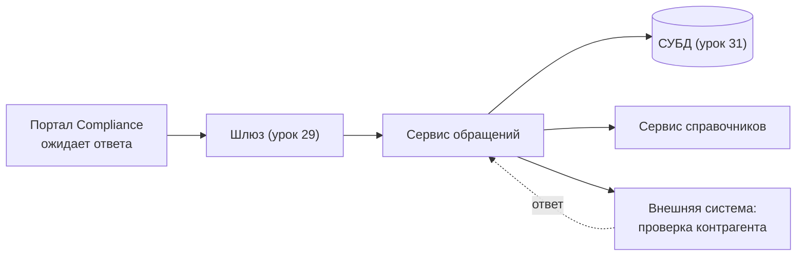

# Лекция 32. Синхронное взаимодействие

## Мост от прошлого урока

В прошлый раз мы разбирали хранилища: данные лежат в базе, и кто-то должен их забрать и показать человеку. А в портале сотрудника всё равно пусто, пока за ними не придут со стороны приложения. Значит, между компонентами есть передача: один что-то просит, другой делает и отвечает.

Сегодня разбираем первый и самый привычный способ такой передачи — синхронное взаимодействие. Это не про «быстро» и не про «медленно», а про то, как компоненты связаны между собой и что происходит, когда один ожидает другого.

## Что такое синхронное взаимодействие

Синхронное взаимодействие — это способ обмена, при котором вызывающий компонент отправляет запрос и останавливается. Он ожидает ответа и не продолжает свою работу, пока ответ не поступит. Отправили запрос — перешли в режим ожидания. Получили ответ — поехали дальше.

Ключевое здесь — «не продолжает работу». Вызывающий не может в это время ни посчитать что-то другое, ни отдать страницу пользователю, ни уйти заниматься другим запросом: он стоит и ожидает ответа.

И ожидание не бесплатное. Пока компонент ожидает, он занят: держит рабочий поток, открытое соединение с тем, к кому обратился, и данные запроса в памяти — чтобы принять ответ. Это ресурсы, которые в это время недоступны для других задач. Из этого факта вырастут и таймауты, и повторные попытки, и проблема залипшего вызова.

Насколько тесно компоненты зависят друг от друга, называют связанностью (в документации — coupling). В синхронном взаимодействии связанность высокая: вызывающий не может продолжить работу, пока не получит ответ. Чем она выше, тем дороже обходятся сбои: отказ одного звена останавливает всю цепочку.

## Цепочка вызовов

Цепочка вызовов — это путь, по которому запрос идёт от компонента, который его отправил, до компонента, который его обработает. Ответ возвращается по той же цепочке, тем же маршрутом, только в обратном направлении.

В Compliance такая цепочка выглядит так: сотрудник нажимает кнопку в портале, портал отправляет запрос в шлюз (урок 29), шлюз передаёт запрос в сервис обращений (уроки 27 и 28), тот идёт в базу данных (урок 31), чтобы записать обращение, и параллельно может обратиться к сервису справочников и к внешней системе проверки контрагента.

Пунктирная стрелка «ответ» — это возврат ответа от внешней системы в сервис обращений; обратные стрелки остальных звеньев не нарисованы, чтобы не перегружать схему.

## Задержка и время ответа

Задержка (в документации часто пишут латиницей — latency) — это время, которое проходит между отправкой запроса и получением ответа на одном звене цепочки. Условный пример: шлюз отвечает за 30 миллисекунд, сервис обращений думал 200 миллисекунд, база дала 50 миллисекунд.

Время ответа для вызывающего — это сумма задержек всех участников цепочки плюс накладные расходы на передачу сообщений. В примере выше на путь до базы уходит 280 миллисекунд. Чем длиннее цепочка, тем больше звеньев, которые могут задержать ответ, и тем меньше остаётся на то, чтобы пользователь считал интерфейс «живым». Укоротить цепочку полезно, но этого мало: задержка одного участника тоже складывается.

## Таймаут

Таймаут — это заранее заданный срок, после которого ожидание прекращается. По истечении этого срока вызывающий больше не ожидает: он сдаётся, разрывает ожидание и сообщает об ошибке тому, кто его вызвал. Смысл таймаута простой: «через сколько ждать перестаём и сдаёмся?».

Речь о предельном сроке ожидания, а не о повторном звонке и не о числе попыток.

Без таймаута ожидание не ограничено: компонент может ждать вечно, если ответа не будет, и ресурсы останутся заняты навсегда. Таймаут — это способ сказать системе: «дальше ждать бессмысленно, освобождайся и возвращай ошибку».

## Каскад таймаутов

Посмотрим на нашу цепочку и зададим таймаут каждому звену. Условный пример: портал ожидает шлюз не дольше 5 секунд, шлюз ожидает сервис не дольше 4, сервис обращений ожидает внешнюю систему проверки контрагента не дольше 3.

Из разбора цепочки получается простое, но легко упускаемое правило: таймаут внешнего вызова должен быть меньше таймаута вызывающего. В нашем примере так и есть: 3 < 4 < 5. Каждый, кто ожидает дальше по цепочке, сдаётся раньше тех, кто ожидает его. Слои освобождаются по очереди, от самого глубокого к самому внешнему, и внешняя система успевает закончить работу раньше, чем её вызывающий решит, что пора сдаваться.

Теперь переставим: пусть таймаут внешнего вызова — 10 секунд, а у вызывающего сервиса — 4. Сервис на четвёртой секунде бросит ожидание и вернёт ошибку наверх. Но внешняя система ничего не знает и продолжает работать: таймаут вызывающего не отменяет запрос на той стороне. Она ещё шесть секунд занимает ресурсы, проверяет контрагента, и её ответ поступит «в никуда» — вызывающий уже ушёл.

Такое нарушение порядка и есть каскад таймаутов. Внешние таймауты, превышающие внутренние, дают сбой, который выглядит странно: пользователь видит быструю ошибку, а нагруженной остаётся та система, которая «упала». Правило проверяемое: идём по цепочке и следим, чтобы каждое звено сдавалось раньше того, кто его ожидает.

## Ожидание и граница аналогии

Понять ожидание проще всего через обычный звонок. Вы звоните в клинику, а там не берут трубку. В это время вы не сможете разбирать почту или заполнять отчёт: линия занята, вы ожидаете ответа на том конце. Это ровно то же состояние, в котором находится компонент в синхронном вызове: он отправил запрос и стоит.

Граница аналогии здесь принципиальна. Человек может снять трубку и позвонить позже — отправить запрос второй раз, когда удобно, и это будет новый звонок. Система обычно так не умеет: уже отправленный запрос нельзя просто «отозвать», чтобы та сторона ничего не сделала. Клиент, который перестал ждать, и сервер на другой стороне определяют успех вызова независимо друг от друга: клиент может уйти с ошибкой, а сервер при этом успешно выполнить работу — и его изменения не откатятся. Таймаут вызывающего не означает, что работа на той стороне прекратилась. Отсюда следствие: «пользователь ушёл» — не значит «операция не выполнена».

## Повторные попытки

Когда попытка не удалась — вышло время ожидания, соединение оборвалось, ответ не поступил, — частый ход: попробовать ещё раз. Повторная попытка (retry) — это новый запрос к тому же адресату после неудачи.

Повторять сразу, без паузы, — плохая идея. Если система на той стороне лежит, все клиенты ударят в неё снова — и она ляжет ещё крепче.

Рабочий способ — повтор не сразу, а с паузой, и паузой растущей. Между первой неудачей и первой повторной попыткой ждут какое-то время; между второй и третьей — больше; между третьей и четвёртой — ещё больше. Такая растущая пауза называется backoff. Логика простая: чем дольше система недоступна, тем больше времени ей нужно на восстановление, поэтому и пауза растёт.

Но одной растущей паузы мало. Представьте: внешняя система лежит, и двадцать клиентов увидели одну и ту же ошибку одновременно. Все отработали свою паузу и ударили в неё в одну секунду: пауза была одинаковой у всех — значит, совпали и удары. Чтобы такого не было, к паузе добавляют случайный сдвиг: каждый клиент ожидает не ровно 3 секунды, а, скажем, от 2 до 4 — случайную величину. Этот случайный разброс называется jitter. Теперь клиенты бьют не одновременно, и падающая система получает шанс передышки между попытками.

И ещё одна вещь про повторы: они складываются по уровням. Если и портал, и шлюз умеют повторять, то один исходный запрос порождает несколько попыток на каждом уровне, и нагрузка на самую уязвимую систему умножается. Отсюда правило: повтор должен жить в одном слое, а не во всех сразу.

## Шторм повторов

Отрицательный случай, который стоит проговорить отдельно. Внешняя система проверки контрагента лежит. Обещанное время ответа не наступило, таймауты срабатывают, клиенты повторяют. Каждый клиент считает, что он «просто аккуратно повторяет», и действует в одиночку.

Но отказ не локален. Когда внешняя система лежит, она лежит от нагрузки, а повторы её нагрузку увеличивают. Получается порочный круг: чем больше отказов, тем больше повторов, тем дольше система лежит. Падение одной внешней системы превращается в отказ всей прилегающей части, причём виновата в первую очередь наша повторная политика.

Средства те же, что и выше: пауза растёт, сдвиг случайный, число попыток ограничено.

## Идемпотентность

Теперь самое важное про повторы. Если операцию безопасно повторять, повторная попытка — это просто ещё одна попытка. Но если операция создаёт что-то новое, повтор может дать двойной эффект.

Классический пример из Compliance: сотрудник нажимает «Создать обращение». Запрос ушёл, ответ потерялся или не поступил вовремя, клиент повторяет. Если на той стороне каждое повторение создаёт новое обращение, у сотрудника появятся два одинаковых обращения, а офицер увидит дубликат и будет разбираться, какое из них настоящее.

Идемпотентность — свойство операции, при котором повторное выполнение даёт тот же результат и те же побочные эффекты, что и одно-единственное выполнение. Идемпотентный запрос, повторённый дважды, равносилен одному — такие операции и имеет смысл повторять автоматически.

Честная оговорка. В HTTP идемпотентность — свойство методов протокола, а не абстрактных операций: повтор запроса с методом, который меняет состояние, не обязан приводить к тому же эффекту. В частности, создание нового объекта таким свойством по умолчанию не обладает, и клиенту не следует автоматически повторять такой запрос без отдельной гарантии. Прикладной уровень может добиться своего поведения сам — например, присвоить обращению уникальный ключ и при повторе с тем же ключом вернуть уже созданное, — но это решение приложения, а не требование протокола. Поэтому в требованиях к операции пишут отдельно: можно ли её повторять и по какому признаку повтор отличить от нового запроса.

## Залипший вызов

Ещё один отрицательный случай — скромный с виду, но бьёт по всем.

Компонент отправил запрос и не получил ответа. Ответа не будет: тот, к кому шли, упал или потерял связь. Если у вызывающего таймаут настроен не так, как мы думаем, ожидание продолжается. А ожидание — это занятые ресурсы: поток, соединение, память.

Что происходит, когда таких залипших вызовов становится много? Ресурсы конечны. Каждый залипший вызов занимает часть из них и не отпускает. Новые запросы встают в очередь, потому что свободных ресурсов для них нет. Один компонент, который не может дождаться ответа от соседа, незаметно замедляет всех, кто обратился после него, хотя сам выглядит совершенно здоровым: процесс жив, ошибок нет, счётчики нагрузки даже падают, потому что половина запросов в очереди ещё не началась обрабатываться.

Отсюда правило: таймаут должен быть задан на каждом звене цепочки, иначе отказ одного участника превращается в отказ по всей цепочке.

## Compliance: где уместно и где опасно

В системе Compliance два типовых сценария выглядят по-разному, и разница именно в том, как долго приходится ждать.

**Сотрудник жмёт «Создать обращение» и ожидает подтверждения сохранения.** Запрос уходит через шлюз в сервис обращений, тот пишет в базу и отвечает. Все участники — наши, задержка предсказуемая, ответ нужен немедленно: пользователь должен либо получить подтверждение, либо понять, что не получилось. Это уместный синхронный вызов: альтернатива — сообщить «мы записали, проверьте позже» при операции, которая записывается за секунды, — это плохой интерфейс.

**Офицер ожидает проверку контрагента во внешней системе.** Тут всё наоборот. Внешняя система — не наша: она может быть перегружена, медленной, недоступной, и сколько она будет думать, мы не контролируем. Ждать в этот момент — значит держать офицера в состоянии ожидания на неопределённый срок, а если вызовов таких много — занимать ресурсы портала. Поэтому здесь синхронный вызов допустим только с жёсткими условиями: у вызова есть таймаут; по его истечении офицер получает понятное сообщение, а не бесконечную заглушку; и понятно, что именно можно повторить безопасно.

**Негативный сценарий, которого надо избежать.** Портал вызывает внешнюю проверку контрагента и ожидает ответа по-настоящему: страница крутит индикатор, кнопка неактивна, пользователь ничего не понимает. Если внешняя система отвечает медленно или не отвечает, пользователь через несколько секунд уходит — закрывает вкладку и вернётся позже. А его запрос никуда не делся: вызывающий по-прежнему ожидает, ресурсы портала заняты. Худший вариант: пользователь ушёл, а нагрузка осталась; повторное нажатие «Создать обращение» добавит ещё один висящий вызов. Страница «висит» не потому, что система сломалась, а потому, что мы не задали предел ожидания.

Разбор «проверки контрагента» заодно показывает, почему нельзя слепо повторять всё подряд. Если проверка — только чтение (посмотреть сведения о контрагенте), повторять её безопасно. Если в какой-то момент у проверки есть побочный эффект (например, «принять контрагента в реестр»), повтор без гарантии идемпотентности может привести к двойному действию.

## Что записать в требования

Итоговый список — то, что должно быть в требованиях к взаимодействию в системе Compliance:

- **Таймаут каждого звена.** Для каждого вызова задан предельный срок ожидания. Для звена, которое вызывает другое звено, таймаут меньше таймаута вызывающего — иначе внешняя работа продолжается после того, как мы сдались.
- **Поведение при таймауте.** Что показываем пользователю: понятное сообщение и возможность повторить, а не бесконечное ожидание и не «зависшая» страница.
- **Что можно повторять.** Перечень операций, безопасных к повтору, и — отдельно — операций, где повтор может дать двойной эффект. Для повторяемых зафиксировать признак, по которому повтор отличается от нового запроса.
- **Правило повторов.** Пауза перед повтором растёт, к ней добавляется случайный сдвиг, число попыток ограничено, повтор живёт в одном слое, а не во всех.
- **Отсутствие залипания.** Ни один вызов не может ждать бесконечно; у каждого есть предел, за которым ресурсы освобождаются.

## Что дальше

Мы разобрали способ, в котором вызывающий стоит и ожидает ответа. Он удобен, когда ответ нужен немедленно и участники цепочки — свои. Но он плохо переносится на длинные и чужие вызовы: там ожидание стоит ресурсов, а ответ не в нашей власти.

Что делать, если ждать нельзя или не хочется? Как отправить запрос и уйти, получив результат позже? Это следующая тема: асинхронное взаимодействие, ARCH-ASYNC. Там посмотрим, как вызывающий освобождается сразу и как это меняет требования к сценариям.

## Источники

- RFC 9110 «HTTP Semantics» (IETF, STD 97, 2022) — идемпотентность методов, цепочка запроса и ответа: https://www.rfc-editor.org/rfc/rfc9110.html
- gRPC «Core concepts, architecture and lifecycle» — синхронный вызов, дедлайны, граница отмены: https://grpc.io/docs/what-is-grpc/core-concepts/
- AWS Builders' Library «Timeouts, retries, and backoff with jitter» — цена ожидания, backoff, jitter, риск повторов: https://aws.amazon.com/builders-library/timeouts-retries-and-backoff-with-jitter/
- Microsoft Azure Architecture Center «Retry pattern» — повтор после паузы, двойной эффект, что показывать пользователю: https://learn.microsoft.com/en-us/azure/architecture/patterns/retry
- MDN «Обзор протокола HTTP» — запрос, ответ, посредники на пути: https://developer.mozilla.org/ru/docs/Web/HTTP/Overview
