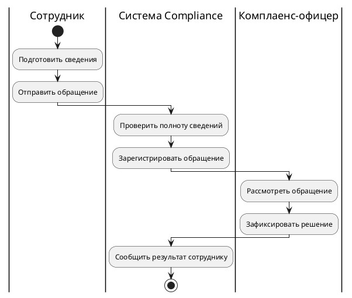
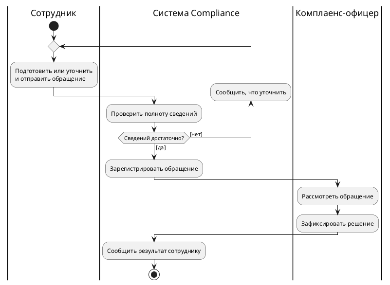
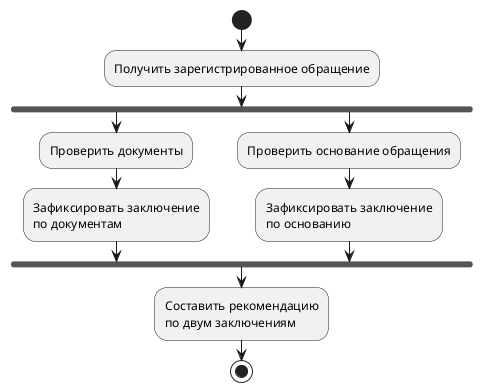
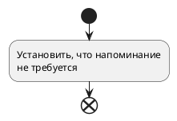
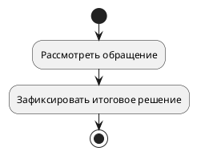

# Лекция 20. UML. Диаграмма активности

В предыдущем уроке мы выясняли, кто использует Compliance и ради какого результата. На диаграмме появился вариант «Подать обращение». Хорошее начало, но теперь комплаенс-офицер спрашивает: «А если сотрудник прислал недостаточно сведений? Мы регистрируем обращение сразу или сначала просим дополнить? После ответа сотрудника всё начинается заново?»

Ещё один овал на use-case диаграмме не даст ответа. Нам нужно разобраться в ходе работы: какие действия выполняются, почему выбирается тот или иной путь, кто продолжает работу и при каких условиях можно закончить. Для этого подойдёт диаграмма активности — activity diagram.

Начнём с короткого линейного процесса Compliance. Затем добавим нехватку сведений и возврат за уточнением. В отдельном небольшом примере проверим независимую работу и ожидание её результатов. Так новые обозначения будут появляться вслед за рабочей задачей, которую они решают. Не нужно выучить каталог символов, прежде чем нарисовать первую полезную схему.

Все правила Compliance в этой лекции — **учебные допущения**. Они помогают сравнивать варианты модели, но не являются согласованными правилами реального заказчика. Существующие проектные документы урок не изменяет.

## Какой вопрос мы задаём модели

Фраза «Нужна схема процесса» кажется конкретной, пока участники не начнут рисовать разное. Один покажет путь сотрудника по экранам, другой — передачу документов между отделами, третий — вызовы программных компонентов. Чтобы получить полезный результат, сначала ограничим вопрос.

Мы рассмотрим **одну обработку одного обращения**: от подготовки и отправки сотрудником до фиксации решения и сообщения о результате. Нас интересуют действия участников и переходы между ними. Мы пока не описываем устройство программы, формы хранения данных и каждую техническую ошибку. Время ожидания ответа тоже важно для проекта, но его правила не возникают на диаграмме автоматически.

Такое ограничение задаёт рамку чтения. Если стрелка возвращается за уточнением, это уточнение того же обращения, а не начало работы с другим. Если процесс заканчивается, речь об этой рассматриваемой обработке, а не о прекращении работы всей компании или сервера Compliance.

Диаграмму можно сравнить с маршрутом по нескольким рабочим местам: видно, какую работу нужно выполнить и куда двигаться после её результата. Но сходство ограничено. В модели могут одновременно существовать несколько независимых ветвей, а переход означает разрешённое продолжение работы, не перемещение человека по офису. Поэтому слова «пойдём по стрелке» — удобный способ читать модель, а не буквальное описание движения сотрудника.

## Первое построение: пока всё получается с первого раза

Примем простую учебную договорённость. Сотрудник подготавливает достаточно сведений и отправляет обращение. Система проверяет полноту и регистрирует его. Комплаенс-офицер рассматривает обращение и фиксирует решение. Система сообщает результат сотруднику. На этом рассматриваемая обработка завершена.

Ни сроки, ни критерии достаточности сведений, ни способ уведомления пока не определены. Это не разрешение разработчику выбрать их самостоятельно. Мы осознанно начинаем с нормального пути, чтобы понять каркас, а незаданные правила будем записывать как вопросы.

Для чтения нам понадобится компактная часть UML. **Действие** обозначает работу, направленный **control flow** — возможность её продолжения. Начало отмечают закрашенным кругом. Решение **decision** выбирает выход с допустимым условием **guard**, а **merge** сводит альтернативные пути без ожидания остальных. **Fork** разделяет поток на независимые ветви; стандартный **join** в нашем подмножестве ждёт все входы. **Flow final** завершает пришедший поток, **activity final** — всю рассматриваемую активность. Дорожки группируют ответственность. **Object flow** передаёт значения данных. Эти обозначения и их семантика определены в главе 15 спецификации OMG UML 2.5.1; ниже будем разбирать их на собственных учебных моделях.

Первая схема намеренно короткая. Скруглённые прямоугольники содержат названия действий. Вертикальные дорожки показывают, кому мы относим каждую работу. У нас три участника: сотрудник, система Compliance и комплаенс-офицер.

Пройдём её как конкретный случай. Сотрудник подготовил вопрос о допустимости подарка и отправил его. Система проверила полноту; в этом проходе всё оказалось достаточно. После регистрации офицер изучил обращение, зафиксировал решение, а система сообщила результат. Каждое следующее действие имеет понятного предшественника. Ни один шаг не требует догадываться, как продолжить путь.

Названия действий важнее, чем кажется. «Рассмотрение» можно понять по-разному, а «Рассмотреть обращение» хотя бы называет работу и её предмет. «Статус: на рассмотрении» — уже другое описание: оно говорит о состоянии обращения, а не о выполняемом действии. Состояния мы разберём в следующем уроке. Если на activity диаграмме вместо работ поставить только статусы, читателю придётся самому восстанавливать, кто и что сделал для перехода.

Другой крайний случай — «Нажать кнопку», «Открыть вкладку», «Прокрутить список». Иногда именно интерфейсный путь и нужен для отдельной задачи. Но наша рамка шире: ход обработки обращения. Если название действия зависит от расположения кнопки, проверьте, не потерялся ли за этим результат работы. В первой модели «Отправить обращение» полезнее, чем подробный перечень щелчков.

### Что дают дорожки, а что они не обещают

Дорожки помогают заметить передачу ответственности. На схеме сотрудник не регистрирует обращение вручную: эту работу мы отнесли системе. Офицер не должен угадывать, сообщил ли он результат сотруднику лично: уведомление тоже выделено как работа системы. На встрече участник может с этим не согласиться, и мы получим конкретное расхождение для обсуждения.

Но переход между дорожками сам по себе не означает ни отправку письма, ни сетевой вызов, ни передачу файла. Стрелка из «Отправить обращение» к «Проверить полноту» в этой схеме задаёт ход работы. Каким способом программа получила сведения, мы здесь не определяем.

Дорожка также не является отдельным параллельным потоком. Три колонки не означают, что три участника постоянно работают одновременно. Порядок в первой схеме задан стрелками. И дорожка не заменяет модель доступа: из размещения действия у офицера ещё не следует, какие именно пользователи имеют право видеть обращение. Для этого нужны согласованные правила, а не только подпись колонки.

## Проверка не всегда заканчивается регистрацией

Теперь воспроизведём неудобный случай. Сотрудник написал: «Можно ли принять подарок?» — и больше ничего не сообщил. Для учебной задачи предположим, что таких сведений недостаточно для приёма обращения на обработку. Система должна объяснить, что нужно уточнить, а сотрудник — дополнить сведения и отправить их повторно.

На линейной схеме такого пути нет. Действие «Проверить полноту» выглядит как формальность: после него всегда начинается регистрация. При обсуждении это опасно. Один участник решит, что проверка блокирует неполные обращения, а другой — что она только предупреждает. Схема скрыла разницу вместо того, чтобы помочь её согласовать.

После проверки нам нужен выбор. Сформулируем вопрос: «Сведений достаточно?» Он имеет смысл только вместе с правилом достаточности. В учебной модели допустим два результата проверки: сведений достаточно или требуется уточнение. Переход к регистрации получит guard «да», путь уточнения — «нет».

Guard — условие допустимости перехода. Для нашего детерминированного примера удобно, чтобы условия не пересекались и не оставляли дыру. «Достаточно» и «недостаточно» при определённом результате проверки дают именно такую пару. А «есть описание» и «есть контакт» — плохая замена двум взаимоисключающим путям: оба условия могут выполняться одновременно или не выполняться вообще. Мы ещё не договорились, какой из путей тогда выбрать.

Не стоит читать расположение ветвей как правило «сначала проверяет верхнюю, потом нижнюю». Если проекту нужна приоритетная обработка, этот приоритет нужно выразить в условиях или описании. Положение ромба на экране его не устанавливает. В простом случае вместо второй сложной формулы можно использовать один путь `else` — остаточный вариант, когда не сработали остальные условия. Это не отдельная произвольная проверка, а способ явно обозначить оставшийся путь.

Предположим, команда предложила guards «заполнены все сведения» и «офицер разрешил обработку». Мы не исправим это простым переименованием ромба. Сначала нужно выяснить, что именно решается на этом шаге: полнота данных или исключительное разрешение офицера. Возможно, это две разные проверки. Диаграмма помогает обнаружить смешение, но содержание правила придётся получить у владельца процесса.

## Альтернативы нужно не только разветвить, но и правильно соединить

После отказа проверки сотрудник уточняет сведения и снова отправляет то же обращение. Значит, мы возвращаемся к уже выполнявшейся работе. Получается цикл. Его легко нарисовать как длинную стрелку назад и гораздо труднее согласовать так, чтобы он был понятен при повторном чтении.

Сначала назовём общую работу для первого и повторного прохода: «Подготовить или уточнить и отправить обращение». На первом проходе сотрудник подготавливает исходные сведения, на следующем исправляет их по полученному объяснению. После этой работы система каждый раз выполняет проверку полноты.

Перед общей работой должны встретиться **альтернативные входы**: начало первого прохода и возврат после запроса уточнения. Для этого используется merge. Важно не заменить его двумя стрелками прямо в действие. Тогда читатель может получить совсем другой смысл: действие ждёт условия обоих входов, хотя первый запуск не может одновременно быть возвратом из будущего уточнения. Нам нужен выбор «пришли впервые или вернулись», а не ожидание «пришли впервые и вернулись».

На следующей схеме верхний ромб объединяет эти входы. Нижний ромб после проверки выбирает продолжение. Они похожи внешне, но у них разные задачи: один принимает альтернативный путь к общей работе, другой выпускает путь согласно результату проверки. Уточнение выполняется по обратной ветви, поэтому после него мы снова попадём к сотруднику, затем на проверку.

Здесь используется запись PlantUML `repeat` для изображения возврата. Это команда инструмента рисования, а не отдельное бизнес-правило. Для чтения результата важны объединение входов, проверка, подписи путей и действия на обратной ветви. Не нужно знать синтаксис генератора, чтобы объяснить схему участнику процесса.

### Первый ручной проход: всё достаточно

Возьмём обращение, в котором сотрудник сразу сообщил необходимые сведения. От начального круга попадаем в верхнее объединение и выполняем подготовку с отправкой. Система проверяет данные. На вопрос «Сведений достаточно?» ответ «да». Поэтому обратная ветвь с сообщением об уточнении не выполняется: путь идёт к регистрации, затем к рассмотрению, фиксации решения и уведомлению.

Проверим результат по смыслу. Мы не потребовали уточнение у каждого сотрудника просто ради существования цикла. Не зарегистрировали обращение раньше проверки. Не запустили одновременно рассмотрение и подготовку следующего уточнения. Первый маршрут остался понятным вариантом исходного успешного процесса.

### Второй ручной проход: одно уточнение

Теперь данных сначала мало. После первой проверки ответ «нет». Система сообщает, чего не хватает. Обратная стрелка возвращает нас к общему входу: сотрудник дополняет сведения и отправляет их повторно. Система выполняет новую проверку, а не использует прежний ответ «нет». На этот раз предположим, что сведений достаточно. Путь выходит к регистрации и дальше заканчивается как первый.

Ручной проход обнаруживает вопросы, которые легко пропустить на красивой схеме. Кто формирует объяснение о недостающих сведениях — система по правилу или офицер после чтения текста? Как сотрудник понимает, что исправлять? Остаётся ли связь между первым и повторным отправлением? Для учебной схемы мы отнесли проверку и сообщение системе. Если реальный процесс устроен иначе, дорожки и действия придётся изменить после уточнения, а не защищать первоначальный рисунок.

У диаграммы есть и сознательное ограничение: она допускает несколько возвратов за уточнением. Читатель может снова и снова пройти по ветви «нет». Мы не будем изобретать правило «после третьей попытки отказ» только для того, чтобы замкнуть описание. Нужно спросить владельца процесса, разрешены ли отмена, отказ, истечение срока ожидания и как обрабатываются обращения без ответа сотрудника.

Это различие между **наличием пути выхода** и **гарантией завершения любого случая**. В нашей модели путь к завершению есть, но без дополнительной договорённости нельзя обещать, что каждый сотрудник когда-нибудь пришлёт достаточно сведений. В рабочем описании такой вопрос должен остаться видимым. Иначе бесконечный цикл будет уже не учебным допущением, а скрытой проблемой требований.

## Когда две работы можно выполнять независимо

До сих пор мы выбирали один путь. Теперь рассмотрим отдельный фрагмент после регистрации обращения. Предположим, команда согласовала две независимые проверки: одна проверяет приложенные документы, другая — основания обращения. Для итоговой рекомендации нужны оба результата.

Это новая учебная договорённость, а не продолжение любой реальной обработки Compliance по умолчанию. Мы специально отделяем её от предыдущего цикла, чтобы не получить одну огромную схему со всеми когда-либо придуманными исключениями.

Слово «независимые» здесь нужно проверить. Может ли проверка основания начаться без результата проверки документов? И наоборот? Если для одной сначала нужен вывод другой, разводить их через fork будет неверно. В нашем примере примем, что обе работы могут начаться после регистрации и каждая даёт собственное заключение. Затем рекомендацию составляют, имея оба заключения.

Верхняя толстая планка fork разделяет ход работы. Нижняя планка join соединяет независимые ветви с ожиданием. В этом уроке используется обычный AND-join без специальных дополнительных правил: рекомендация начинается, когда обе ветви принесли результаты.

Проследим случай с разной длительностью. Заключение по документам подготовили быстро, а основание ещё проверяют. Первая ветвь дошла до join и ждёт. Это ожидание предусмотрено нашей договорённостью, а не ошибка диаграммы. Когда появляется второе заключение, общая работа может продолжиться.

Теперь уточним смысл параллельности. Мы разрешили независимое продвижение ветвей, но не пообещали, что два человека физически начнут действия в одну секунду. Даже один специалист может сначала выполнить одну проверку, а затем другую, если так распределена работа. Диаграмма отделяет отсутствие необходимого порядка от гарантии реального одновременного исполнения. Сроки и ресурсы потребуют отдельного разговора.

Здесь снова помогают хорошие названия результатов. «Проверить документы» само по себе не объясняет, что делать при неприемлемом документе. Но наша учебная ветвь заканчивается заключением, которое может быть положительным или отрицательным. Отрицательное заключение не означает исчезновение ветви: она всё равно должна передать результат, если рекомендация ожидает оба. Реальные основания остановить работу нужно моделировать явно.

## Как случайно построить вечное ожидание

Представим, что кто-то заменил fork ромбом: «Какую проверку нужно выполнить?» От ромба выходят взаимоисключающие пути «только документы» и «только основание». Внизу автор оставил стандартный join, потому что «всё должно сойтись в одном месте».

Пройдём конкретный маршрут. Выбрали «только документы», выполнили проверку и пришли к join. Проверка основания не запускалась: условие отправило этот случай по другому пути. Но join продолжает ждать и её результат. Он не различает причины отсутствия входа и не делает вывод «наверное, эта ветвь сегодня не нужна». Поэтому общий шаг не начнётся.

Такое ожидание недостижимой ветви — пример проблемы живости модели. По выбранному маршруту мы дошли до места, из которого предусмотренное продолжение невозможно. В бытовой речи его назовут зависанием; при разборе важно указать точное место и причину. Фраза «здесь deadlock» без объяснения, какой вход никогда не появится, мало помогает автору исправить схему.

Исправление зависит от смысла, а не от любимого символа. Если действительно выбирается **одна из двух альтернатив**, перед общим шагом нужен merge: он принимает тот путь, который пришёл, не ожидая невыбранный. Если действительно нужны **обе независимые проверки**, сверху должен остаться fork, а их результаты должны добираться до join. Нельзя решить вопрос заменой планки на ромб, не спросив, какая работа обязательна для результата.

Эта же проверка ловит другую ошибку. Допустим, одна из двух реально запущенных ветвей при отрицательном заключении просто обрывается до join, а вторая продолжает ждать. Если обработка должна продолжаться с отрицательным результатом, ветвь обязана довести этот результат до согласованного места. Если отрицательное заключение отменяет весь рассматриваемый процесс, нужно показать именно такое завершение и проверить, что произойдёт с другой ветвью. В этих решениях разный смысл, и дальше понадобятся разные конечные узлы.

## Конец одной ветви и конец всей активности

На линейной схеме кажется, что всякий знак конца означает одно и то же. Когда активна только одна ветвь, различие действительно легко не заметить. Проверим его на модели, в которой после разделения есть две самостоятельные работы.

Первый поток — рассмотрение обращения офицером. Второй — проверка, нужно ли напоминание. Для конкретного учебного случая предположим: проверка напоминания установила, что оно не требуется; завершать рассмотрение обращения из-за этого нельзя. Поток напоминания должен закончиться, а офицер продолжит работу.

Здесь нужен **flow final**, круг с крестом внутри: закончится только пришедший к нему поток. **Activity final**, изображаемый как мишень, нужен в другом месте — когда по нашей договорённости заканчивается вся рассматриваемая активность. Завершение активности не означает выключение Compliance: границу этого процесса мы определили ещё в начале урока.

Чтобы сначала различить сами обозначения, посмотрим на два **отдельных минимальных фрагмента**. Это не полная общая схема с двумя потоками: начальные круги показывают начало каждой иллюстрации. Первый фрагмент заканчивается flow final — кругом с крестом.

Во втором фрагменте мишень — activity final — выражает другую учебную договорённость: фиксация итогового решения завершает рассматриваемую активность.

Теперь вернём эти разные окончания в мысленный случай с двумя уже активными потоками. Поток напоминания приходит к кругу с крестом, а поток рассмотрения ещё выполняется. Первый заканчивается, второй продолжает работу. Когда поток рассмотрения достигает мишени, заканчивается вся выбранная активность. В таком учебном случае не нужна общая работа, ожидающая оба окончания: мы не обещаем последующего прохождения join. Синтаксис PlantUML `end` и `stop` служит средством получить соответствующие обозначения на рисунках; смысл читается по конечным узлам, а не по английскому слову команды.

Снова выполним ручной проход. Напоминание оказалось ненужным почти сразу. Его поток дошёл до flow final. Офицер всё ещё рассматривает обращение, и модель разрешает ему продолжать. Если бы на этом месте стоял activity final, первый же законченный вспомогательный поток завершил бы всю активность, хотя итоговое решение ещё не готово. Получился бы совсем другой результат.

Теперь рассмотрим вторую крайность. В примере с двумя обязательными заключениями поставили flow final сразу после проверки документов, до join. Эта ветвь закончилась, но результат к join уже не пришёл. Другая ветвь дошла до него и ждёт. Flow final не обязан «зачесть» успешное выполнение для любой нижней планки. Если мы хотели дождаться двух заключений, завершать одну ветвь раньше места их синхронизации было ошибкой.

Полезный вопрос к каждому конечному узлу: «Что ещё в этот момент может выполняться и должно ли оно продолжиться?» Для одиночного пути такой вопрос кажется лишним. Для разветвлённой модели он защищает от двух разных дефектов: преждевременного окончания всей работы и ожидания результата, который мы сами уничтожили по дороге.

У конечного узла не рисуют продолжение. Если после «конца» внезапно идёт «Сообщить результат», возможно, это была не конечная точка, а обычное действие. Вернитесь к названию результата: чем именно заканчивается выбранная нами обработка? Если обязательное уведомление ещё впереди, не стоит ставить знак полного завершения раньше него.

## Стрелка работы и стрелка данных

Во всех основных схемах мы обсуждали порядок действий. Когда человек видит стрелку между дорожками сотрудника и системы, он нередко читает её как «передали документ». Для наших control flows это лишний вывод. Стрелка сообщает, что после одной работы допускается следующая, но сама не называет передаваемые сведения.

Иногда именно данные и становятся главным вопросом. После «Подготовить обращение» может появиться объект **«Сведения обращения»**, который нужен действию «Проверить полноту». В activity модели такой перенос значений можно показать object flow через объектные узлы или входы и выходы действий. Здесь мы не строим полную модель данных: полезно прежде всего различить вопрос «когда можно продолжать?» и вопрос «что получило следующее действие?»

Проверим на собственном примере. Если «Проверить полноту» должно работать с последним уточнением, простого возврата стрелки недостаточно для полной договорённости о данных. Нужно знать, какие сведения изменились и какая версия проверяется. Control-flow диаграмма помогла нам увидеть повторную проверку; описание данных должно устранить риск проверки старого текста.

И наоборот, наличие объекта «Обращение» не означает выполнение работы «Создать обращение». Объект называет данные или предмет, действие — работу с ними. Если в перечне действий схемы остались только существительные «Обращение», «Документы», «Решение», попробуйте прочитать переходы вслух. Возможно, вместо модели действий получилась карта сущностей.

Не нужно немедленно добавлять объектные узлы к каждой стрелке. Для первого разговора с офицером схема потока может быть достаточно ясной. Если же участники спорят, какие сведения получены, потеряны или обновлены, полезно уточнить данные отдельно. Уровень подробности выбирают под нерешённый вопрос, а не под желание использовать ещё один элемент нотации.

## Как получить исключения, о которых не рассказывают

На встрече с участником процесса часто удаётся быстро нарисовать линейный путь. Сложнее узнать про возвраты, ожидания и обходные действия. Собеседник может считать их несущественными, не помнить в момент разговора или опасаться, что описание покажет неформальные договорённости отдела. Поэтому просьба «назовите все исключения» далеко не всегда даёт хороший результат.

Допустим, офицер говорит: «Всё обычно: получаем обращение и отвечаем». Не нужно спорить, что всё наверняка сложнее. Лучше попросить конкретный случай: «Вспомните последнее обращение, по которому не удалось ответить сразу. Что именно помешало продолжить? Кому вы написали и что ждали?» У реального эпизода есть последовательность действий и наблюдаемые причины остановки.

Предположим, выяснилось, что офицер отправил сотруднику сообщение в корпоративном чате и несколько дней ждал дополнения. Мы не переносим чат в требования автоматически. Сначала различаем текущий способ работы и нужное правило будущей системы. Можно уточнить: «Для продолжения вам были нужны такие-то сведения. Верно ли, что без них вы не начинаете рассмотрение? Должна ли система помогать запросить их, или пока меняется только место хранения обращения?»

Другой ответ — «Каждый раз по-разному, ничего не нарисуешь». Тогда полезно сравнить два случая: один прошёл сразу, другой потребовал уточнения. Что было одинаковым до расхождения? Какой факт заставил пойти по другому пути? Именно из такого сравнения часто получается содержательный guard. Формула «по решению офицера» может быть временной меткой неизвестного правила, но не объяснением решения.

Бывает и прямое уклонение: «Нарисуйте как считаете нужным, потом согласуем». В этот момент особенно легко выдать гипотезу за описанный процесс. Рабочий выход — показать один короткий маршрут и отделить три вещи: подтверждённый шаг, предположение аналитика и открытый вопрос. Например: «Подтверждено, что при нехватке сведений требуется уточнение. Предположено, что система возвращает обращение сотруднику до регистрации. Открытый вопрос: кто и по каким признакам определяет достаточность?»

После этого нужен адресат решения. Не всякий пользователь процесса уполномочен установить правило отказа или срок ожидания. Спросите, кто отвечает за процесс и может подтвердить такую договорённость. Если ответ не получен, зафиксируйте владельца вопроса, необходимое решение и следующий шаг: разбор двух примеров, короткую встречу или комментарий к конкретной ветви. Видимый вопрос полезнее условного «после трёх раз закрываем», которое никто не утверждал.

И ещё одна проверка: не маскирует ли схема организационную проблему. Если обращение неделями ждёт ответа другого отдела, новая стрелка ожидание не устранит. Она позволит назвать зависимость и обсудить ответственность. Но обещать сокращение срока только потому, что модель стала аккуратнее, было бы подменой результата моделирования результатом изменения процесса.

## Проверяем собственную диаграмму без сложного инструмента

Начните с одного полного экземпляра: конкретное обращение с конкретными входными данными. Пройдите от начального круга и называйте вслух работу, условие перехода и участника. Если на развилке нельзя определить путь по принятым допущениям, найдена недостающая договорённость. Если действие получило название «Обработать» и никто не может назвать результат, найден недостаточно раскрытый шаг.

Затем измените только одно условие. В нашей основной модели первый случай имел достаточно сведений, второй — нет. Такая маленькая разница должна дать понятную разницу маршрутов. Проверьте, выполняется ли уточнение именно на нужном пути, возвращается ли случай к новой проверке и сохраняется ли общий способ завершения после успешного выхода.

Для модели с fork нельзя ограничиться прохождением одной понравившейся ветки. Представьте, что одна закончилась быстро, а другая медленно. Найдите место ожидания и назовите, что должно к нему прийти. После этого рассмотрите отрицательный результат одной проверки: это всё ещё результат для общей работы или причина закончить весь процесс? Если ответы различаются у участников, пока рано считать модель согласованной.

Проверка завершения требует двух вопросов. Есть ли из начала допустимый путь к ожидаемому результату? И не допускает ли модель такую остановку или бесконечный повтор, который противоречит договорённостям? В учебном цикле бесконечное ожидание достаточных сведений осталось открытым вопросом; в контрпримере decision с join ожидание невыбранной ветви уже было ошибкой нашего рисунка. Их нельзя одинаково исправлять косметикой стрелок.

Такой проход не доказывает корректность любой сложной UML-модели. Мы работаем с небольшим подмножеством и проверяем конкретные маршруты, взаимоисключающие условия, места ожидания и окончания. Его преимущество в том, что эту проверку можно провести вместе с участником процесса и получить содержательные поправки, не требуя от него знания метамодели UML.

## Какую модель выбрать следующим шагом

Когда вопрос звучит «Кто и ради какого результата использует систему?», возвращаемся к use-case модели. Когда нужно понять ход действий, варианты продолжения, ответственность и независимую работу, activity diagram подходит лучше. Если обсуждение сместилось к состояниям одного обращения и допустимым изменениям состояния, нужен следующий взгляд — state diagram. Если требуется разобрать последовательность обмена сообщениями между участниками или программными частями, понадобится sequence diagram.

Это не соревнование за единственную правильную схему. Один и тот же процесс может потребовать нескольких согласованных представлений. Например, наша activity диаграмма показывает повторную проверку после уточнения, а модель состояний позднее поможет отдельно договориться, какие состояния обращения это сопровождают. Дублировать один рисунок другими значками бесполезно; полезно закрывать новый вопрос.

BPMN тоже используют для моделирования процессов, особенно когда нужно подробно обсуждать процессное взаимодействие и его события. Однако надпись UML на нашем рисунке не разрешает читать его элементы как BPMN-элементы с похожим видом. В этом уроке мы не переносим их правила на activity нотацию. Если проект выбрал BPMN для конкретного уровня описания, сначала договоримся о языке и границе задачи, а затем будем пользоваться его обозначениями.

## Самопроверка

Перед передачей схемы команде ответьте на несколько вопросов:

- Какой один процесс рассматривается, что запускает его и какой результат означает завершение?
- Можно ли назвать работу в каждом действии и объяснить ответственность каждой дорожки?
- Дают ли guards в разобранном случае понятный выбор, а merge — проход только по пришедшей альтернативе?
- Где цикл повторяет проверку и какое правило разрешает выйти? Что пока неизвестно про отмену и ожидание?
- Все ли входы стандартного join действительно могут появиться в рассматриваемом маршруте?
- Что произойдёт с другими активными ветвями при достижении каждого flow final и activity final?
- Где показан только порядок через control flow, а где действительно нужны данные и object flow?

Если эти ответы нельзя получить из схемы и её коротких пояснений, проблема обычно не в недостатке декоративных символов. Вернитесь к конкретному случаю, проверьте условие и уточните договорённость. В практике мы будем делать именно это: строить небольшой процесс, проходить его по разным путям и исправлять рисунок там, где он обещает другое поведение.

## Источники

- [OMG UML 2.5.1 — нормативная спецификация, глава 15 Activities](https://www.omg.org/spec/UML/2.5.1/PDF).
- [PlantUML — официальный синтаксис диаграмм активности](https://plantuml.com/activity-diagram-beta).
